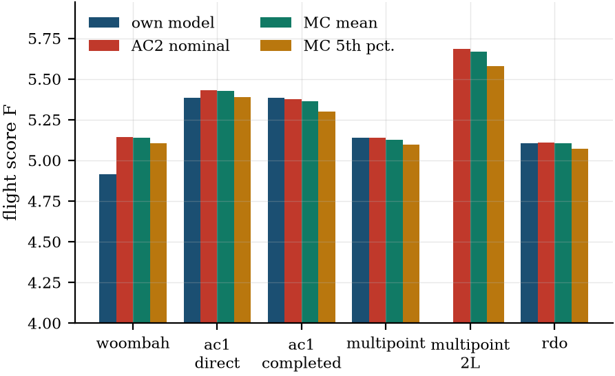
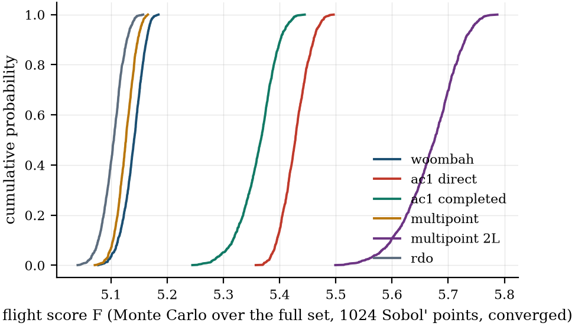

# 2024-25 results: AirCrafter 1.0 vs multipoint vs RDO

Generated by `studies/results_2025.py report` (git `e86c78f`) from `outputs/results/` (runs, screening, node check, Monte Carlo); every number below is read from `docs/studies/results/results_2025.json`. Configs: `configs/dbf2025_multipoint.yaml` (deterministic), `configs/dbf2025_multipoint_rdo.yaml` (robust: the reduced mass-and-wind set, f_build, f_tb, m_avionics and wind, docs/RDO_REDUCED_PLAN.md; the published 15-parameter set is `configs/dbf2025_multipoint_rdo_full.yaml`, kept in sections 3b and 7d), `configs/woombah_2025.yaml` (Woombah as built). Scoring `dbf2025`: F = M1 + M2 + M3, M2 = 1 + (W_fuel/t_3laps)/R2, M3 = 2 + (n_pre + B/W_X1)/R3 with **R2 = 0.2 lb/s and R3 = 27 (PLACEHOLDERS, OPEN_QUESTIONS Q35)**, B = 0. Validation of Woombah: `validation_2025.md`; AirCrafter 1.0's run: `aircrafter1_2025.json`.

**Biases stated up front.** (i) The lap model has no take-off, so every 3-lap time is fast and every M2 high (validation_2025.md). (ii) The common evaluation in the AirCrafter 2.0 analysis favours the AirCrafter 2.0 designs (they were optimised in it); the Monte Carlo favours RDO by construction (it optimised a statistic of the same model). (iii) MDA non-convergence is counted separately from constraint violation everywhere.

## Findings

1. **Best propulsion case: 6S, 11x8E (M2) / 10x7E (M3), F = 5.1394** (M2 1.7981, M3 2.3413, 13.0 lb of fuel, 10.22 M3 laps). Kv is set by points.M2.rpm_margin (lower).
2. **The fuel weight sits at its upper bound in 11 of 11 cases**: 13.0 lb, the capacity of the two 1 L bottles (OPEN_QUESTIONS Q36). M2 is tank-limited, so the bottle choice (kept at Woombah's 1 L) is an active design decision: a larger bottle buys M2 at the cost of tank drag and mass. The main results keep 1 L (decision); the bottle sensitivity (section 1b) gives 0.5L F = 4.7685 (6.5 lb), 1L F = 5.1394 (13.0 lb), 2L F = 5.6868 (26.0 lb).
3. Cell count barely matters: 4S 5.1370, 5S 5.1385, 6S 5.1394 (spread 0.0025); Kv absorbs the voltage.
4. The M2 prop decides the ranking (best-per-M2-prop spread 0.052); the M3 prop hardly moves F (at most 0.0007 for a given M2 prop): M3's laps are capped by the 100 Wh pack rule, not by the prop.
5. Multistart (10 scrambled Sobol' starts): 7/10 converge, all to F = 5.1394–5.1394 (default start 5.1394); the 3 failures are MDA non-convergence at a random start design, not optimiser failures.
6. Bookends: the M2-only optimum gains +0.0010 in M2 and the M3-only optimum +0.0077 in M3 over the multipoint design; the M3-only design gives up 0.704 in M2 for it. **The multipoint optimum is effectively the M2 optimum**: M2 (fuel/time) is the only mission with real leverage at these normalisations.
7. RDO, reduced set (f_build, f_tb, m_avionics, lap.wind; d = 4, N = 9 nodes x 2 points; rdor_ms0): mu - k sigma = 5.1188 (mu 5.1283, sigma 0.0094). The deterministic optimum has mu - k sigma 5.1187 at the same nodes and violates 4 robust constraints there. Nominal (calm-air) cost of robustness: 0.0009 in F.
8. **Wind is what robustness buys here.** The deterministic optimum flies M2's 3 laps exactly in calm air (the laps constraint is active), so any headwind costs it laps: at the mean wind (3.5 m/s) it flies 2.979 laps, and in 87 % of the Monte Carlo samples it misses M2's 3-lap requirement. The RDO design keeps the laps margin (mu - 2 sigma >= 3) for almost no score.
9. 3 converged RDO starts, spread of mu - k sigma 1.4e-08. The designs are not identical: they differ in x_cb_frac 0.3362–0.5879, Kv 632.3–780.8, x_batt_M2 0.04554–0.1026, throttle_M2 0.7672–0.9474, x_batt_M3 0.1662–0.1865, throttle_M3 0.7565–0.9342 (Kv x M2 throttle 599–599: a flat direction of the objective, the motor's no-load speed at the M2 throttle is what matters). Monte Carlo over the reduced set: the largest probability of violating a constraint goes from 0.866 (multipoint) to 0.028 (RDO); the 5th percentile of F from 5.1106 to 5.1108.
10. Out of set: the reduced-set RDO design under the full 15-parameter set has F mu 5.1253, sigma 0.0175 and a largest P(violation) of 0.499 (M2.rpm_margin 0.50, M2.energy_margin 0.41, M2.laps_frac 0.41): what the reduced set leaves unprotected.
11. Full set (published, section 7d): RDO mu - k sigma 5.0852 (mu 5.1040, sigma 0.0187) over 7 of 15 parameters.

## 1. Propulsion enumeration (deterministic multipoint)

Every run from the same start, SLSQP, warm-start MDA fallbacks. `ok` = SLSQP converged; a failed MDA is reported as such, never as infeasible. `its` = OpenMDAO driver iterations, i.e. objective evaluations (line-search steps included), here and in every table below.

| run | cells | M2 prop | M3 prop | ok | its | F | M2 | M3 | fuel (lb) | t3 (s) | M3 laps | Kv | Kv set by | M1 check |
|---|---:|---:|---:|---:|---:|---:|---:|---:|---:|---:|---:|---:|---:|---:|
| mp_4S_11x8E_10x7E | 4 | 11x8E | 10x7E | yes | 58 | 5.1370 | 1.7963 | 2.3407 | 13.00 | 81.6 | 10.20 | 953 | points.M2.rpm_margin (lower) | yes |
| mp_5S_11x8E_10x7E | 5 | 11x8E | 10x7E | yes | 49 | 5.1385 | 1.7974 | 2.3411 | 13.00 | 81.5 | 10.21 | 831 | points.M2.rpm_margin (lower) | yes |
| mp_6S_10x7E_10x7E | 6 | 10x7E | 10x7E | yes | 56 | 5.1163 | 1.7755 | 2.3408 | 13.00 | 83.8 | 10.20 | 773 | points.M2.rpm_margin (lower) | yes |
| mp_6S_10x7E_11x8E | 6 | 10x7E | 11x8E | yes | 55 | 5.1156 | 1.7755 | 2.3401 | 13.00 | 83.8 | 10.18 | 710 | points.M2.rpm_margin (lower) | yes |
| mp_6S_10x7E_9x6E | 6 | 10x7E | 9x6E | yes | 57 | 5.1161 | 1.7755 | 2.3406 | 13.00 | 83.8 | 10.19 | 788 | points.M2.rpm_margin (lower) | yes |
| mp_6S_11x8E_10x7E | 6 | 11x8E | 10x7E | yes | 47 | 5.1394 | 1.7981 | 2.3413 | 13.00 | 81.4 | 10.22 | 728 | points.M2.rpm_margin (lower) | no |
| mp_6S_11x8E_11x8E | 6 | 11x8E | 11x8E | yes | 48 | 5.1387 | 1.7981 | 2.3406 | 13.00 | 81.4 | 10.20 | 677 | points.M2.rpm_margin (lower) | yes |
| mp_6S_11x8E_9x6E | 6 | 11x8E | 9x6E | yes | 53 | 5.1392 | 1.7981 | 2.3411 | 13.00 | 81.4 | 10.21 | 783 | points.M2.rpm_margin (lower) | yes |
| mp_6S_9x6E_10x7E | 6 | 9x6E | 10x7E | yes | 63 | 5.0870 | 1.7461 | 2.3409 | 13.00 | 87.1 | 10.21 | 789 | points.M2.rpm_margin (lower) | yes |
| mp_6S_9x6E_11x8E | 6 | 9x6E | 11x8E | yes | 37 | 5.0863 | 1.7461 | 2.3402 | 13.00 | 87.1 | 10.19 | 759 | points.M2.rpm_margin (lower) | yes |
| mp_6S_9x6E_9x6E | 6 | 9x6E | 9x6E | yes | 66 | 5.0868 | 1.7460 | 2.3407 | 13.00 | 87.1 | 10.20 | 828 | points.M2.rpm_margin (lower) | yes |

Active constraints at the best case: points.M2.energy_margin (lower), points.M2.rpm_margin (lower), points.M2.V_h (lower), points.M2.V_v (lower), points.M3.V_h (lower), points.M3.V_v (lower), rules_M3.energy_margin_Wh (lower), points.M2.laps_frac (lower); at bounds: b (upper), l_ht (upper), fuel_mass (upper).

**Flag: the M1 check (no payload, M3's prop/pack/throttle) fails at 1 of 11 optima.** Violated: v_fit_margin, SM. M1 is scored 1 regardless (analysis-only check, RESULTS_PLAN §9); v_fit_margin is a model-validity limit (the light M1 aircraft outruns the propeller fit range at M3's throttle), and an SM just above its upper bound without payload is fixed by ballast or the battery station on the day.

### 1b. Store option: the external bottle (best propulsion case)

Same case, re-optimised from the 1 L optimum with each candidate bottle (dimensions and empty masses are PLACEHOLDERS, OPEN_QUESTIONS Q36). Sensitivity only: the main results use Woombah's 1 L.

| bottle | ok | its | F | M2 | M3 | fuel (lb) | t3 (s) | M3 laps | M2 mass (kg) | M2 C_D stores | at bounds | M1 check |
|---|---:|---:|---:|---:|---:|---:|---:|---:|---:|---:|---:|---:|
| 0.5L | yes | 50 | 4.7685 | 1.4169 | 2.3516 | 6.50 | 78.0 | 10.49 | 4.93 | 0.0161 | S_ht (lower), fuel_mass (upper) | yes |
| 1L | yes | 47 | 5.1394 | 1.7981 | 2.3413 | 13.00 | 81.4 | 10.22 | 8.16 | 0.0140 | b (upper), l_ht (upper), fuel_mass (upper) | no |
| 2L | yes | 47 | 5.6868 | 2.3599 | 2.3268 | 26.00 | 95.6 | 9.82 | 14.58 | 0.0128 | b (upper), c (upper), fuel_mass (upper) | yes |

**The fuel fills the tanks for every bottle**: within the model, M2 keeps rising with tank capacity (fuel weight grows faster than the 3-lap time), and nothing in the 2024-25 rules but the 55 lb TOGW and the span bounds it (no take-off distance limit, RESULTS_PLAN §2). The tank size, and the number of tanks (fixed at 2 here), are the largest levers in the problem; the 1 L result is a constrained optimum, not the problem's.

## 2. Method comparison (the AirCrafter 2.0 multipoint analysis at nominal inputs)

Woombah: as built, at the throttles that reproduce its logged currents (validation_2025.md). AirCrafter 1.0 direct = mapping (a), completed = mapping (b) (span, chord and fuel fixed at AirCrafter 1.0's values, the rest optimised). Multipoint = mp_6S_11x8E_10x7E. RDO = rdor_ms0 (reduced set; the 15-parameter RDO is in sections 3b and 7d). **AirCrafter 1.0's fuel (19.2 lb) does not fit in two 1 L bottles, so both mappings fly 2 L bottles** (smallest bottle that holds it); the like-for-like AirCrafter 2.0 design is multipoint_2L (the same case re-optimised with 2 L bottles, section 1b).

### Design variables and geometry

| quantity | woombah | ac1_direct | ac1_completed | multipoint | multipoint_2L | rdo |
|---|---:|---:|---:|---:|---:|---:|
| span b (m) | 1.801 | 1.800 | 1.800 | 1.829 | 1.829 | 1.829 |
| chord c (m) | 0.328 | 0.360 | 0.360 | 0.289 | 0.450 | 0.278 |
| t/c scale | 1.000 | 1.000 | 1.154 | 1.089 | 1.035 | 1.085 |
| camber scale | 1.000 | 1.000 | 1.241 | 0.906 | 1.236 | 0.872 |
| tail arm l_ht (m) | 1.100 | 0.900 | 1.200 | 1.200 | 1.160 | 1.200 |
| S_ht (m²) | 0.152 | 0.130 | 0.068 | 0.045 | 0.112 | 0.041 |
| S_vt (m²) | 0.067 | 0.052 | 0.019 | 0.016 | 0.026 | 0.015 |
| x_cb / l | 0.438 | 0.438 | 0.278 | 0.334 | 0.341 | 0.339 |
| Kv (rpm/V) | 1050.000 | 1050.000 | 785.015 | 728.487 | 706.736 | 632.302 |
| M2 pack (Ah) | 2.250 | 2.252 | 1.107 | 1.026 | 1.454 | 1.038 |
| M3 pack (Ah) | 2.250 | 2.252 | 2.252 | 2.252 | 2.252 | 2.252 |
| M2 throttle | 0.678 | 0.760 | 0.825 | 0.823 | 0.872 | 0.947 |
| M3 throttle | 0.537 | 0.597 | 0.729 | 0.808 | 0.802 | 0.934 |
| M2 battery station (m) | -0.021 | -0.021 | -0.100 | 0.046 | 0.035 | 0.075 |
| M3 battery station (m) | -0.746 | -0.746 | 0.170 | 0.123 | 0.187 | 0.186 |
| aspect ratio b/c | 5.50 | 5.00 | 5.00 | 6.32 | 4.06 | 6.58 |
| fuel (lb) | 13.20 | 19.19 | 19.19 | 13.00 | 26.00 | 13.00 |
| cells | 6 | 6 | 6 | 6 | 6 | 6 |
| M2 / M3 prop | 10x7E / 10x7E | 10x7E / 10x7E | 10x7E / 10x7E | 11x8E / 10x7E | 11x8E / 10x7E | 11x8E / 10x7E |

### Mass breakdown (kg)

| mass | woombah | ac1_direct | ac1_completed | multipoint | multipoint_2L | rdo |
|---|---:|---:|---:|---:|---:|---:|
| M2 m_total | 8.975 | 11.553 | 11.171 | 8.159 | 14.577 | 8.153 |
| M2 m_empty | 2.440 | 2.283 | 1.901 | 1.715 | 2.216 | 1.709 |
| M2 m_wing | 0.347 | 0.412 | 0.425 | 0.305 | 0.556 | 0.296 |
| M2 m_ht | 0.057 | 0.053 | 0.029 | 0.017 | 0.048 | 0.015 |
| M2 m_vt | 0.013 | 0.011 | 0.004 | 0.003 | 0.006 | 0.003 |
| M2 m_fus | 0.462 | 0.222 | 0.241 | 0.241 | 0.259 | 0.241 |
| M2 m_gear | 0.080 | 0.103 | 0.099 | 0.073 | 0.130 | 0.073 |
| M2 m_sys | 1.481 | 1.482 | 1.103 | 1.076 | 1.218 | 1.081 |
| M2 m_batt | 0.744 | 0.745 | 0.366 | 0.339 | 0.481 | 0.343 |
| M2 m_pay | 6.534 | 9.270 | 9.270 | 6.444 | 12.361 | 6.444 |
| M3 m_total | 2.988 | 2.850 | 2.847 | 2.668 | 3.048 | 2.657 |
| M3 m_empty | 2.440 | 2.283 | 2.280 | 2.121 | 2.480 | 2.110 |
| M3 m_wing | 0.347 | 0.412 | 0.425 | 0.305 | 0.556 | 0.296 |
| M3 m_ht | 0.057 | 0.053 | 0.029 | 0.017 | 0.048 | 0.015 |
| M3 m_vt | 0.013 | 0.011 | 0.004 | 0.003 | 0.006 | 0.003 |
| M3 m_fus | 0.462 | 0.222 | 0.241 | 0.241 | 0.259 | 0.241 |
| M3 m_gear | 0.080 | 0.103 | 0.099 | 0.073 | 0.130 | 0.073 |
| M3 m_sys | 1.481 | 1.482 | 1.482 | 1.482 | 1.482 | 1.482 |
| M3 m_batt | 0.744 | 0.745 | 0.745 | 0.745 | 0.745 | 0.745 |
| M3 m_pay | 0.547 | 0.567 | 0.567 | 0.547 | 0.567 | 0.547 |

### Performance, scores and margins

| quantity | woombah | ac1_direct | ac1_completed | multipoint | multipoint_2L | rdo |
|---|---:|---:|---:|---:|---:|---:|
| M2 cruise speed (m/s) | 40.7 | 43.0 | 35.7 | 39.4 | 36.9 | 39.5 |
| M2 3-lap time (s) | 81.3 | 82.5 | 91.7 | 81.4 | 95.6 | 81.6 |
| M2 laps in 10 min | 5.74 | 3.99 | 3.00 | 3.00 | 3.00 | 3.07 |
| M2 C_D0 (with stores) | 0.0327 | 0.0357 | 0.0363 | 0.0335 | 0.0310 | 0.0342 |
| M2 C_D stores | 0.0125 | 0.0162 | 0.0163 | 0.0140 | 0.0128 | 0.0146 |
| M2 cruise L/D | 4.9 | 4.7 | 6.3 | 5.2 | 7.0 | 5.2 |
| M2 static current (A) | 35.2 | 47.0 | 27.6 | 30.8 | 33.0 | 30.7 |
| M2 rpm margin | -1209 | -2434 | 0 | 0 | -0 | 1 |
| M2 current margin (A) | 24.8 | 13.0 | 32.4 | 29.2 | 27.0 | 29.3 |
| M2 static margin | 0.328 | 0.154 | 0.086 | 0.102 | 0.051 | 0.099 |
| M2 energy margin | 107475 | 55515 | 0 | -0 | -0 | 2298 |
| M2 stall margin (m/s) | 23.5 | 24.4 | 17.7 | 22.1 | 18.5 | 21.8 |
| M3 cruise speed (m/s) | 33.0 | 35.0 | 32.3 | 35.0 | 31.4 | 35.2 |
| M3 3-lap time (s) | 82.0 | 79.4 | 82.2 | 79.8 | 83.4 | 79.7 |
| M3 laps in 10 min | 9.99 | 8.21 | 9.94 | 10.22 | 9.82 | 10.23 |
| M3 C_D0 (with stores) | 0.0334 | 0.0361 | 0.0360 | 0.0336 | 0.0307 | 0.0344 |
| M3 C_D stores | 0.0126 | 0.0163 | 0.0163 | 0.0141 | 0.0129 | 0.0146 |
| M3 cruise L/D | 2.5 | 1.7 | 2.1 | 2.2 | 2.1 | 2.1 |
| M3 static current (A) | 19.2 | 25.4 | 20.0 | 21.5 | 19.5 | 21.7 |
| M3 rpm margin | 1376 | 336 | 1289 | 886 | 1426 | 837 |
| M3 current margin (A) | 40.8 | 34.6 | 40.0 | 38.5 | 40.5 | 38.3 |
| M3 static margin | 1.017 | 0.873 | 0.150 | 0.197 | 0.121 | 0.133 |
| M3 energy margin | 166434 | 144896 | 161004 | 162833 | 160101 | 162759 |
| M3 stall margin (m/s) | 22.9 | 25.7 | 23.2 | 25.0 | 23.0 | 25.0 |
| M2 | 1.8119 | 2.1627 | 2.0464 | 1.7981 | 2.3599 | 1.7968 |
| M3 | 2.3328 | 2.2669 | 2.3313 | 2.3413 | 2.3268 | 2.3418 |
| flight_score | 5.1447 | 5.4295 | 5.3777 | 5.1394 | 5.6868 | 5.1386 |
| Kv set by | fixed (as built) | fixed (AirCrafter 1.0) | points.M2.rpm_margin (lower) | points.M2.rpm_margin (lower) | points.M2.rpm_margin (lower) | robust M2 rpm_margin (mu - 2 sigma) |
| M1 check | fail: SM, V_h, V_v | fail: SM | pass | fail: v_fit_margin, SM | pass | pass |

### Constraint status (active within 1e-4 of ref, or violated)

| design | active constraints | at bounds | violated |
|---|---:|---:|---:|
| woombah | – | Kv (upper) | points.M2.rpm_margin = -1.21e+03; points.M2.SM = 0.328; points.M3.SM = 1.02 |
| ac1_direct | rules_M2.energy_margin_Wh (lower); rules_M3.energy_margin_Wh (lower) | Kv (upper) | points.M2.rpm_margin = -2.43e+03; points.M3.SM = 0.873 |
| ac1_completed | points.M2.energy_margin (lower); points.M2.rpm_margin (lower); points.M2.V_h (lower); points.M2.V_v (lower); points.M3.V_h (lower); points.M3.V_v (lower); rules_M3.energy_margin_Wh (lower); points.M2.laps_frac (lower) | l_ht (upper) | none (of the reported outputs) |
| multipoint | points.M2.energy_margin (lower); points.M2.rpm_margin (lower); points.M2.V_h (lower); points.M2.V_v (lower); points.M3.V_h (lower); points.M3.V_v (lower); rules_M3.energy_margin_Wh (lower); points.M2.laps_frac (lower) | b (upper); l_ht (upper); fuel_mass (upper) | none (of the reported outputs) |
| multipoint_2L | points.M2.energy_margin (lower); points.M2.rpm_margin (lower); points.M2.V_h (lower); points.M2.V_v (lower); points.M3.V_h (lower); points.M3.V_v (lower); rules_M3.energy_margin_Wh (lower); points.M2.laps_frac (lower) | b (upper); c (upper); fuel_mass (upper) | none (of the reported outputs) |
| rdo | points.M2.V_h (lower); points.M2.V_v (lower); points.M3.V_h (lower); points.M3.V_v (lower); rules_M3.energy_margin_Wh (lower) | b (upper); l_ht (upper); fuel_mass (upper) | none (of the reported outputs) |

Violations are checked here only for the outputs recorded per point (the table above); the Monte Carlo (section 3) checks every constraint.

## 3. Common evaluation

1 = in its own model (what each method claims); 2 = the AirCrafter 2.0 multipoint analysis at nominal inputs (calm air, every factor at its config value; **favours the AirCrafter 2.0 designs**); 3 = Monte Carlo in AirCrafter 2.0, 1024 scrambled Sobol' points (seed 0) over the 4 uncertain parameters of this set (f_build, f_tb, m_avionics, lap.wind), the same points for every design (**favours RDO by construction**). Analysis failures are excluded from the statistics and counted in their own column: MDA non-convergence, or **wind limit (no flight)**: the headwind is close to the light M3 aircraft's V_stall, so it cannot make progress into the wind after lift-off and would not fly (the aircraft's wind limit, a property of the design, docs/modules/mission.md).

| design | F own (1) | F nominal (2) | F mu (3) | F sigma | F p5 | M2 mu | M2 p5 | M3 mu | M3 p5 | analysis failures |
|---|---:|---:|---:|---:|---:|---:|---:|---:|---:|---:|
| woombah | 4.9158 | 5.1447 | 5.1333 | 0.0103 | 5.1143 | 1.8043 | 1.7917 | 2.3290 | 2.3224 | 0/1024 |
| ac1_direct | 5.3850 | 5.4295 | 5.4200 | 0.0101 | 5.4010 | 2.1555 | 2.1411 | 2.2644 | 2.2599 | 4/1024 (4 wind limit) |
| ac1_completed | 5.3850 | 5.3777 | 5.3638 | 0.0139 | 5.3370 | 2.0365 | 2.0165 | 2.3273 | 2.3202 | 14/1024 (14 wind limit) |
| multipoint | 5.1394 | 5.1394 | 5.1284 | 0.0097 | 5.1106 | 1.7904 | 1.7782 | 2.3380 | 2.3323 | 0/1024 |
| multipoint_2L | – | 5.6868 | 5.6702 | 0.0178 | 5.6369 | 2.3476 | 2.3219 | 2.3226 | 2.3151 | 37/1024 (37 wind limit) |
| rdo | 5.1283 | 5.1386 | 5.1282 | 0.0094 | 5.1108 | 1.7897 | 1.7779 | 2.3385 | 2.3330 | 0/1024 |
| rdo_full15 | – | – | 5.1253 | 0.0175 | 5.0953 | 1.7938 | 1.7653 | 2.3315 | 2.3061 | 0/1024 |

`rdo_full15` = this set's RDO design in a Monte Carlo over the **full 15-parameter set** (the same 1024-point rule over 15 dimensions): an out-of-set check of what the reduced set leaves unprotected.

Own-model sources: woombah: Table 39 'Design' column [W p. 59]; M2 time = 3 x the 33 s average lap; ac1_direct: AirCrafter 1.0 '2025' mode, its selected design point (the same for both mappings); t3 from its M2 score; ac1_completed: AirCrafter 1.0 '2025' mode, its selected design point (the same for both mappings); t3 from its M2 score; multipoint: AirCrafter 2.0 nominal (its own model); rdo: AirCrafter 2.0 RDO: UDR mean, sigma and mu - k sigma of the flight score at its own uncertain set.

AirCrafter 1.0's claim (19.2 lb, 8 M3 laps) has no store drag (it has no way to represent it; a limitation of AirCrafter 1.0, not added).

**Probability of violating each constraint** (Monte Carlo, converged samples; constraints never violated by any design are omitted):

| constraint | woombah | ac1_direct | ac1_completed | multipoint | multipoint_2L | rdo | rdo_full15 |
|---|---:|---:|---:|---:|---:|---:|---:|
| points.M2.SM | 1.000 | 0.000 | 0.000 | 0.000 | 0.379 | 0.000 | 0.000 |
| points.M2.V_h | 1.000 | 0.000 | 0.000 | 0.000 | 0.000 | 0.000 | 0.000 |
| points.M2.V_v | 1.000 | 0.000 | 0.000 | 0.000 | 0.000 | 0.000 | 0.000 |
| points.M2.energy_margin | 0.000 | 0.000 | 0.794 | 0.866 | 0.768 | 0.028 | 0.405 |
| points.M2.laps_frac | 0.000 | 0.000 | 0.794 | 0.866 | 0.768 | 0.028 | 0.405 |
| points.M2.rpm_margin | 1.000 | 1.000 | 0.498 | 0.506 | 0.493 | 0.001 | 0.499 |
| points.M3.SM | 1.000 | 1.000 | 0.000 | 0.462 | 0.000 | 0.000 | 0.000 |
| points.M3.V_h | 1.000 | 0.000 | 0.000 | 0.000 | 0.000 | 0.000 | 0.000 |
| points.M3.V_v | 1.000 | 0.000 | 0.000 | 0.000 | 0.000 | 0.000 | 0.000 |

### 3b. Full set (15 parameters, published)

The published common evaluation (commit c0c09bd) over the 15-parameter set of `configs/dbf2025_multipoint_rdo_full.yaml`, with that set's RDO design as `rdo`. Kept for reference; the main results above use the reduced set.

1 = in its own model (what each method claims); 2 = the AirCrafter 2.0 multipoint analysis at nominal inputs (calm air, every factor at its config value; **favours the AirCrafter 2.0 designs**); 3 = Monte Carlo in AirCrafter 2.0, 1024 scrambled Sobol' points (seed 0) over the 15 uncertain parameters of this set (f_tb, f_cb, f_gear, f_ht, f_vt, e_spec, R_cell, Kv_factor, Rm_ref, m_avionics, m_motor, eta_h, lap.thrust_factor, lap.wind, store_drag_factor), the same points for every design (**favours RDO by construction**). Analysis failures are excluded from the statistics and counted in their own column: MDA non-convergence, or **wind limit (no flight)**: the headwind is close to the light M3 aircraft's V_stall, so it cannot make progress into the wind after lift-off and would not fly (the aircraft's wind limit, a property of the design, docs/modules/mission.md).

| design | F own (1) | F nominal (2) | F mu (3) | F sigma | F p5 | M2 mu | M2 p5 | M3 mu | M3 p5 | analysis failures |
|---|---:|---:|---:|---:|---:|---:|---:|---:|---:|---:|
| woombah | 4.9158 | 5.1447 | 5.1393 | 0.0194 | 5.1038 | 1.8087 | 1.7812 | 2.3306 | 2.3218 | 0/1024 |
| ac1_direct | 5.3850 | 5.4295 | 5.4277 | 0.0247 | 5.3876 | 2.1604 | 2.1164 | 2.2673 | 2.2331 | 0/1024 |
| ac1_completed | 5.3850 | 5.3777 | 5.3620 | 0.0336 | 5.2988 | 2.0407 | 1.9789 | 2.3213 | 2.2976 | 0/1024 |
| multipoint | 5.1394 | 5.1394 | 5.1259 | 0.0171 | 5.0963 | 1.7946 | 1.7670 | 2.3313 | 2.3067 | 0/1024 |
| multipoint_2L | – | 5.6868 | 5.6693 | 0.0509 | 5.5779 | 2.3525 | 2.2626 | 2.3168 | 2.2941 | 0/1024 |
| rdo | 5.1040 | 5.1111 | 5.1036 | 0.0198 | 5.0698 | 1.7693 | 1.7397 | 2.3342 | 2.3188 | 0/1024 |

Own-model sources: woombah: Table 39 'Design' column [W p. 59]; M2 time = 3 x the 33 s average lap; ac1_direct: AirCrafter 1.0 '2025' mode, its selected design point (the same for both mappings); t3 from its M2 score; ac1_completed: AirCrafter 1.0 '2025' mode, its selected design point (the same for both mappings); t3 from its M2 score; multipoint: AirCrafter 2.0 nominal (its own model); rdo: AirCrafter 2.0 RDO: UDR mean, sigma and mu - k sigma of the flight score at its own uncertain set.

AirCrafter 1.0's claim (19.2 lb, 8 M3 laps) has no store drag (it has no way to represent it; a limitation of AirCrafter 1.0, not added).

**Probability of violating each constraint** (Monte Carlo, converged samples; constraints never violated by any design are omitted):

| constraint | woombah | ac1_direct | ac1_completed | multipoint | multipoint_2L | rdo |
|---|---:|---:|---:|---:|---:|---:|
| points.M2.SM | 1.000 | 0.000 | 0.000 | 0.000 | 0.453 | 0.000 |
| points.M2.V_h | 1.000 | 0.000 | 0.000 | 0.000 | 0.000 | 0.000 |
| points.M2.V_v | 1.000 | 0.000 | 0.000 | 0.000 | 0.000 | 0.000 |
| points.M2.energy_margin | 0.000 | 0.000 | 0.532 | 0.520 | 0.541 | 0.001 |
| points.M2.laps_frac | 0.000 | 0.000 | 0.532 | 0.520 | 0.541 | 0.001 |
| points.M2.rpm_margin | 1.000 | 1.000 | 0.507 | 0.500 | 0.493 | 0.017 |
| points.M2.thrust_margin_static | 0.000 | 0.000 | 0.000 | 0.000 | 0.184 | 0.000 |
| points.M3.SM | 1.000 | 1.000 | 0.000 | 0.407 | 0.000 | 0.027 |
| points.M3.V_h | 1.000 | 0.000 | 0.000 | 0.000 | 0.000 | 0.000 |
| points.M3.V_v | 1.000 | 0.000 | 0.000 | 0.000 | 0.000 | 0.000 |
| points.M3.rpm_margin | 0.000 | 0.188 | 0.000 | 0.000 | 0.000 | 0.000 |

## 4. Mission bookends

The same multipoint problem (both missions flown, every constraint at both points) with the objective reduced to one mission's score.

| objective | ok | its | F | M2 | M3 | fuel (lb) | t3 (s) | M3 laps |
|---|---:|---:|---:|---:|---:|---:|---:|---:|
| multipoint | yes | 47 | 5.1394 | 1.7981 | 2.3413 | 13.00 | 81.4 | 10.22 |
| M2only | yes | 24 | 5.1326 | 1.7991 | 2.3335 | 13.00 | 81.3 | 10.00 |
| M3only | yes | 111 | 4.4428 | 1.0938 | 2.3490 | 3.19 | 170.0 | 10.42 |

M3-only design vs multipoint: b 1.83 → 0.983, c 0.289 → 0.176, tc_scale 1.09 → 0.765, camber_scale 0.906 → 0.581, l_ht 1.2 → 0.53, S_ht 0.0446 → 0.02, S_vt 0.0161 → 0.01, x_cb_frac 0.334 → 0.412, Kv 728 → 620, x_batt_M2 0.0455 → 0.2, throttle_M2 0.823 → 0.529, x_batt_M3 0.123 → 0.166, throttle_M3 0.808 → 1, fuel_mass 5.9 → 1.45.

## 5. Normalisation sensitivity

R2 and R3 scaled by 0.5, 1 and 2 (R2 0.1–0.4 lb/s, R3 13.5–54); each re-optimised from the centre optimum, deterministic multipoint, mp_6S_11x8E_10x7E. A larger R makes that mission worth less.

| R2 | R3 | ok | its | F | M2 | M3 | fuel (lb) | t3 (s) | M3 laps | b | c | Kv | capacity_M2 | capacity_M3 | throttle_M2 | throttle_M3 |
|---|---:|---:|---:|---:|---:|---:|---:|---:|---:|---:|---:|---:|---:|---:|---:|---:|
| x0.5 | x0.5 | yes | 2 | 6.2789 | 2.5962 | 2.6827 | 13.00 | 81.4 | 10.22 | 1.829 | 0.289 | 728.487 | 1.026 | 2.252 | 0.823 | 0.808 |
| x0.5 | x1 | yes | 21 | 5.9377 | 2.5967 | 2.3410 | 13.00 | 81.4 | 10.21 | 1.829 | 0.292 | 728.341 | 1.029 | 2.252 | 0.824 | 0.807 |
| x0.5 | x2 | yes | 26 | 5.7675 | 2.5978 | 2.1697 | 13.00 | 81.4 | 10.17 | 1.829 | 0.292 | 728.149 | 1.038 | 2.252 | 0.826 | 0.805 |
| x1 | x0.5 | yes | 39 | 5.4817 | 1.7954 | 2.6862 | 13.00 | 81.7 | 10.26 | 1.829 | 0.305 | 728.467 | 1.015 | 2.252 | 0.820 | 0.811 |
| x1 | x1 | yes | 47 | 5.1394 | 1.7981 | 2.3413 | 13.00 | 81.4 | 10.22 | 1.829 | 0.289 | 728.487 | 1.026 | 2.252 | 0.823 | 0.808 |
| x1 | x2 | yes | 23 | 4.9688 | 1.7983 | 2.1705 | 13.00 | 81.4 | 10.21 | 1.829 | 0.292 | 728.345 | 1.029 | 2.252 | 0.824 | 0.807 |
| x2 | x0.5 | yes | 33 | 5.0841 | 1.3973 | 2.6869 | 13.00 | 81.8 | 10.27 | 1.829 | 0.304 | 728.677 | 1.012 | 2.252 | 0.820 | 0.812 |
| x2 | x1 | yes | 40 | 4.7408 | 1.3977 | 2.3431 | 13.00 | 81.7 | 10.26 | 1.829 | 0.305 | 728.456 | 1.015 | 2.252 | 0.820 | 0.811 |
| x2 | x2 | yes | 2 | 4.5697 | 1.3990 | 2.1707 | 13.00 | 81.4 | 10.22 | 1.829 | 0.289 | 728.487 | 1.026 | 2.252 | 0.823 | 0.808 |

Equal scaling of R2 and R3 (x0.5, x2) scales the whole variable part of F, so the optimum cannot move; those runs stopped in 2, 2 iterations at the centre design, as they should. 
Off-diagonal: R2 x0.5 / R3 x1: fuel +0.00 lb, M3 laps -0.01, t3 -0.0 s; R2 x0.5 / R3 x2: fuel +0.00 lb, M3 laps -0.05, t3 -0.1 s; R2 x1 / R3 x0.5: fuel +0.00 lb, M3 laps +0.05, t3 +0.3 s; R2 x1 / R3 x2: fuel +0.00 lb, M3 laps -0.01, t3 -0.0 s; R2 x2 / R3 x0.5: fuel +0.00 lb, M3 laps +0.06, t3 +0.4 s; R2 x2 / R3 x1: fuel +0.00 lb, M3 laps +0.05, t3 +0.3 s. **Largest move: R2 x2 / R3 x0.5.** The design barely moves: the M2 and M3 levers are nearly decoupled (fuel weight sets M2; M3's laps are capped by the energy rule), so the normalisation re-weights the score but not the aircraft.

## 6. Bonus scenario

B = 2.5 at W_X1 = 0.37 lb adds B/W_X1/R3 = 0.2503 to M3 for every design. W_X1 is fixed (the X-1 is not a design variable here), so the term is a constant: **the optimum does not change**, only the totals.

| design | F (B = 0) | F (B = 2.5) |
|---|---:|---:|
| woombah | 5.1447 | 5.3950 |
| ac1_direct | 5.4295 | 5.6798 |
| ac1_completed | 5.3777 | 5.6279 |
| multipoint | 5.1394 | 5.3897 |
| multipoint_2L | 5.6868 | 5.9370 |
| rdo | 5.1386 | 5.3888 |

## 7. Robust vs deterministic

**Contributions** at mp_6S_11x8E_10x7E (first-order variance (dq/dp sigma)^2 at the means; every parameter is active, d = 4, N = 9 UDR nodes, so this is a table, not a selection). Means: f_build 1, f_tb 0.847, m_avionics 0.222, lap.wind 3.5. sigma(4) and sigma(15) are the root of the summed variance over this set and over the full set's 15 (section 7d); 'share of 15' = their variance ratio; the last columns are each parameter's share of this set's variance.

| quantity | value at the means | sigma (this set) | sigma (15) | share of 15 | f_build | f_tb | m_avionics | lap.wind |
|---|---:|---:|---:|---:|---:|---:|---:|---:|
| flight_score | 5.1308 | 0.00941 | 0.0183 | 0.264 | 0.079 | 0.001 | 0.002 | 0.918 |
| M2.stall_margin | 22.0716 | 0.13 | 1.31 | 0.010 | 0.960 | 0.011 | 0.029 | 0.000 |
| M2.thrust_margin_static | 29.8364 | 0.501 | 4.34 | 0.013 | 0.960 | 0.011 | 0.029 | 0.000 |
| M2.energy_margin | -716.0665 | 763 | 7.27e+03 | 0.011 | 0.195 | 0.002 | 0.006 | 0.797 |
| M2.rpm_margin | 0.0000 | 0.615 | 323 | 0.000 | 0.960 | 0.011 | 0.029 | 0.000 |
| M2.I_margin | 29.2438 | 0 | 2.42 | 0.000 | – | – | – | – |
| M2.SM | 0.1015 | 0.00654 | 0.0101 | 0.418 | 0.699 | 0.246 | 0.055 | 0.000 |
| M2.wall_ratio | 0.0369 | 0.000362 | 0.000519 | 0.486 | 0.960 | 0.011 | 0.029 | 0.000 |
| M3.stall_margin | 25.0115 | 0.217 | 1.13 | 0.037 | 0.960 | 0.011 | 0.029 | 0.000 |
| M3.thrust_margin_static | 35.9938 | 0.284 | 3.3 | 0.007 | 0.960 | 0.011 | 0.029 | 0.000 |
| M3.energy_margin | 162345.3767 | 545 | 5e+03 | 0.012 | 0.155 | 0.002 | 0.005 | 0.839 |
| M3.rpm_margin | 885.5144 | 0.098 | 327 | 0.000 | 0.960 | 0.011 | 0.029 | 0.000 |
| M3.I_margin | 38.4982 | 0 | 1.68 | 0.000 | – | – | – | – |
| M3.SM | 0.1966 | 0.0235 | 0.016 | 2.179 | 0.778 | 0.193 | 0.029 | 0.000 |
| M3.wall_ratio | 0.0369 | 0.000362 | 0.000519 | 0.486 | 0.960 | 0.011 | 0.029 | 0.000 |
| M2.laps_frac | 2.9786 | 0.0226 | 0.217 | 0.011 | 0.195 | 0.002 | 0.006 | 0.797 |

**Node check** (every node, both mission points; MDA failures with the warm-start fallbacks): optimum 0/9 failed; start 0/9 failed; sobol0 0/9 failed; sobol1 0/9 failed; sobol2 0/9 failed; sobol3 0/9 failed; sobol4 0/9 failed; sobol5 9/9 failed.
 At sobol5 the design's own nominal point does not converge (every node fails because the start state does): a design outside the analysis' convergence region, like the failed multistarts, not a node problem.

| run | start | ok | its | wall (h) | mu F | sigma F | mu - k sigma | failed MDA attempts (recovered or not) | error |
|---|---:|---:|---:|---:|---:|---:|---:|---:|---:|
| rdor_best | mp_6S_11x8E_10x7E | yes | 22 | 0.25 | 5.1283 | 0.0094 | 5.1188 | 0 |  |
| rdor_ms0 | sobol0 | yes | 49 | 0.55 | 5.1283 | 0.0094 | 5.1188 | 0 |  |
| rdor_ms1 | sobol1 | yes | 56 | 0.63 | 5.1283 | 0.0094 | 5.1188 | 0 |  |

**The same UDR statistics at every design** (the RDO's nodes; robust constraints mu - beta sigma >= lower, mu + beta sigma <= upper, beta = 2):

| design | F nominal | mu F | sigma F | mu - k sigma | rank nominal | rank robust | robust constraints violated |
|---|---:|---:|---:|---:|---:|---:|---:|
| mp_4S_11x8E_10x7E | 5.1370 | 5.1259 | 0.0097 | 5.1162 | 5 | 5 | M2.energy_margin, M2.rpm_margin, M3.SM, M2.laps_frac |
| mp_5S_11x8E_10x7E | 5.1385 | 5.1274 | 0.0097 | 5.1177 | 4 | 4 | M2.energy_margin, M2.rpm_margin, M2.laps_frac |
| mp_6S_10x7E_10x7E | 5.1163 | 5.1052 | 0.0101 | 5.0951 | 6 | 6 | M2.energy_margin, M2.rpm_margin, M2.laps_frac |
| mp_6S_10x7E_11x8E | 5.1156 | 5.1045 | 0.0102 | 5.0943 | 8 | 8 | M2.energy_margin, M2.rpm_margin, M2.laps_frac |
| mp_6S_10x7E_9x6E | 5.1161 | 5.1050 | 0.0101 | 5.0949 | 7 | 7 | M2.energy_margin, M2.rpm_margin, M3.SM, M2.laps_frac |
| mp_6S_11x8E_10x7E | 5.1394 | 5.1284 | 0.0097 | 5.1187 | 1 | 1 | M2.energy_margin, M2.rpm_margin, M3.SM, M2.laps_frac |
| mp_6S_11x8E_11x8E | 5.1387 | 5.1276 | 0.0097 | 5.1179 | 3 | 3 | M2.energy_margin, M2.rpm_margin, M3.SM, M2.laps_frac |
| mp_6S_11x8E_9x6E | 5.1392 | 5.1282 | 0.0097 | 5.1185 | 2 | 2 | M2.energy_margin, M2.rpm_margin, M3.SM, M2.laps_frac |
| mp_6S_9x6E_10x7E | 5.0870 | 5.0765 | 0.0100 | 5.0665 | 9 | 9 | M2.energy_margin, M2.rpm_margin, M2.laps_frac |
| mp_6S_9x6E_11x8E | 5.0863 | 5.0757 | 0.0100 | 5.0657 | 11 | 11 | M2.energy_margin, M2.rpm_margin, M2.laps_frac |
| mp_6S_9x6E_9x6E | 5.0868 | 5.0762 | 0.0100 | 5.0662 | 10 | 10 | M2.energy_margin, M2.rpm_margin, M3.SM, M2.laps_frac |
| woombah | 5.1447 | 5.1333 | 0.0103 | 5.1231 | – | – | M2.rpm_margin, M2.SM, M3.SM |
| ac1_direct | 5.4295 | 5.4198 | 0.0102 | 5.4097 | – | – | M2.rpm_margin, M3.SM |
| ac1_completed | 5.3777 | 5.3635 | 0.0140 | 5.3495 | – | – | M2.energy_margin, M2.rpm_margin, M2.laps_frac |
| multipoint_2L | 5.6868 | 5.6693 | 0.0182 | 5.6512 | – | – | M2.energy_margin, M2.rpm_margin, M2.SM, M2.laps_frac |
| rdo | 5.1386 | 5.1283 | 0.0094 | 5.1188 | – | – | none |
| **rdor_ms0** | 5.1386 | 5.1283 | 0.0094 | 5.1188 | – | – | none (constrained) |

**Propulsion ranking under uncertainty: unchanged** (ranked by mu - k sigma at each case's deterministic optimum; an RDO per case was not run).

Monte Carlo (this set): multipoint F mu 5.1284 sigma 0.0097 p5 5.1106, max P(violation) 0.866; RDO mu 5.1282 sigma 0.0094 p5 5.1108, max P(violation) 0.028.

### 7a. Propagation check at the robust optimum (rdor_ms0)

| quantity (mu / sigma) | UDR (N = 9) | Smolyak level 2 (N = 49) | Sobol' MC (N = 1024) |
|---|---:|---:|---:|
| flight_score | 5.128 / 0.00941 | 5.128 / 0.00942 | 5.128 / 0.00943 |
| M2.stall_margin | 21.77 / 0.13 | 21.77 / 0.13 | 21.77 / 0.13 |
| M2.thrust_margin_static | 29.44 / 0.505 | 29.44 / 0.506 | 29.44 / 0.506 |
| M2.energy_margin | 1513 / 752 | 1512 / 755 | 1511 / 755 |
| M2.rpm_margin | 1.033 / 0.517 | 1.033 / 0.517 | 1.033 / 0.517 |
| M2.I_margin | 29.33 / 0 | 29.33 / 4.77e-07 | 29.33 / 1.07e-14 |
| M2.SM | 0.09929 / 0.00667 | 0.09929 / 0.00669 | 0.09929 / 0.00669 |
| M2.wall_ratio | 0.04122 / 0.000406 | 0.04122 / 0.000406 | 0.04122 / 0.000406 |
| M2.r_tube | 0.01391 / 0 | 0.01391 / 3.68e-10 | 0.01391 / 5.21e-18 |
| M3.stall_margin | 25.03 / 0.219 | 25.03 / 0.219 | 25.03 / 0.219 |
| M3.thrust_margin_static | 36.3 / 0.281 | 36.3 / 0.281 | 36.3 / 0.281 |
| M3.energy_margin | 1.622e+05 / 551 | 1.622e+05 / 551 | 1.622e+05 / 552 |
| M3.rpm_margin | 837.5 / 0.12 | 837.5 / 0.12 | 837.5 / 0.12 |
| M3.I_margin | 38.28 / 0 | 38.28 / 0 | 38.28 / 1.42e-14 |
| M3.SM | 0.1335 / 0.0217 | 0.1335 / 0.0217 | 0.1335 / 0.0217 |
| M3.wall_ratio | 0.04122 / 0.000406 | 0.04122 / 0.000406 | 0.04122 / 0.000406 |
| M3.r_tube | 0.01391 / 0 | 0.01391 / 3.68e-10 | 0.01391 / 5.21e-18 |
| M2.laps_frac | 3.046 / 0.0228 | 3.046 / 0.0229 | 3.046 / 0.0229 |

MDA failures: udr 0/9, smolyak 0/49, sobol 0/1024. Largest Monte Carlo P(violation): M2.energy_margin 0.028, M2.laps_frac 0.028, M2.rpm_margin 0.001.

### 7b. Calibrated build mass

f_build centred on Woombah's built/predicted structure (solved through the closure), +/-30 % about it (decision 2026-10-21: the Woombah ratio is a calibration, not a spread); config `configs/dbf2025_multipoint_rdo_calibrated.yaml`.
 Calibration: Woombah's modelled structure at f_build = 1 is 2.11 lb against Table 34's 6.05 lb (ratio 2.861); through the closure (the spar and gear resize) f_build = **2.7376** reproduces it.

| run | start | ok | its | wall (h) | mu F | sigma F | mu - k sigma | error |
|---|---:|---:|---:|---:|---:|---:|---:|---:|
| rdorc_main | rdor_ms0 | yes | 33 | 0.30 | 5.0985 | 0.0117 | 5.0868 |  |

Design change against the main robust optimum: c 0.2778 → 0.2871; tc_scale 1.085 → 1.167; camber_scale 0.872 → 0.882; l_ht 1.2 → 0.9414; S_ht 0.04117 → 0.05605; S_vt 0.01549 → 0.0204; x_cb_frac 0.3386 → 0.2322; Kv 632.3 → 629.3; capacity_M2 1.038 → 1.105; x_batt_M2 0.07515 → -0.06054; throttle_M2 0.9474 → 0.9538; x_batt_M3 0.1865 → 0.0745; throttle_M3 0.9342 → 0.9303.

### 7c. One-sided build mass (sensitivity)

f_build on [1.0, 1.3] (nominal 1.15 +/- 0.15: the reference node sits at a 15 % heavier structure); config `configs/dbf2025_multipoint_rdo_onesided.yaml`.

| run | start | ok | its | wall (h) | mu F | sigma F | mu - k sigma | error |
|---|---:|---:|---:|---:|---:|---:|---:|---:|
| rdoro_main | rdor_ms0 | yes | 9 | 0.07 | 5.1259 | 0.0090 | 5.1169 |  |

Design change against the main robust optimum: capacity_M2 1.038 → 1.04.

### 7d. Full set (15 parameters, published)

The published RDO (commit c0c09bd) over the 15-parameter set screened to d = 7 (`configs/dbf2025_multipoint_rdo_full.yaml`). Kept for reference.

**Screening** at mp_6S_11x8E_10x7E (first-order variance, threshold 90 %, max d = 7): d = 7, f_tb, f_ht, Kv_factor, Rm_ref, eta_h, lap.thrust_factor, store_drag_factor. 90 % not reached for every quantity within d = 7 (below 90 %: points.M2.wall_ratio 0.839, points.M3.SM 0.836, points.M3.wall_ratio 0.839). Flight-score coverage 0.959. UDR with 3 points per parameter gives N = 2d + 1 = 15 nodes, each a full M2 + M3 analysis.

**Node check** (every node, both mission points; MDA failures with the warm-start fallbacks): optimum 0/15 failed; start 0/15 failed; sobol0 0/15 failed; sobol1 0/15 failed; sobol2 0/15 failed; sobol3 0/15 failed; sobol4 0/15 failed; sobol5 15/15 failed.
 At sobol5 the design's own nominal point does not converge (every node fails because the start state does): a design outside the analysis' convergence region, like the failed multistarts, not a node problem.

| run | start | ok | its | wall (h) | mu F | sigma F | mu - k sigma | failed MDA attempts (recovered or not) | error |
|---|---:|---:|---:|---:|---:|---:|---:|---:|---:|
| rdo_best | mp_6S_11x8E_10x7E | yes | 26 | 0.42 | 5.1040 | 0.0187 | 5.0852 | 0 |  |
| rdo_ms0 | sobol0 | yes | 46 | 0.77 | 5.1040 | 0.0187 | 5.0852 | 0 |  |
| rdo_ms1 | sobol1 | yes | 67 | 1.13 | 5.1040 | 0.0187 | 5.0852 | 0 |  |

**The same UDR statistics at every design** (the RDO's nodes; robust constraints mu - beta sigma >= lower, mu + beta sigma <= upper, beta = 2):

| design | F nominal | mu F | sigma F | mu - k sigma | rank nominal | rank robust | robust constraints violated |
|---|---:|---:|---:|---:|---:|---:|---:|
| mp_4S_11x8E_10x7E | 5.1370 | 5.1238 | 0.0165 | 5.1073 | 5 | 5 | M2.energy_margin, M2.rpm_margin, M2.laps_frac |
| mp_5S_11x8E_10x7E | 5.1385 | 5.1250 | 0.0166 | 5.1084 | 4 | 3 | M2.energy_margin, M2.rpm_margin, M2.laps_frac |
| mp_6S_10x7E_10x7E | 5.1163 | 5.1034 | 0.0173 | 5.0861 | 6 | 6 | M2.energy_margin, M2.rpm_margin, M2.laps_frac |
| mp_6S_10x7E_11x8E | 5.1156 | 5.1024 | 0.0172 | 5.0852 | 8 | 8 | M2.energy_margin, M2.rpm_margin, M2.laps_frac |
| mp_6S_10x7E_9x6E | 5.1161 | 5.1033 | 0.0174 | 5.0859 | 7 | 7 | M2.energy_margin, M2.rpm_margin, M3.rpm_margin, M2.laps_frac |
| mp_6S_11x8E_10x7E | 5.1394 | 5.1258 | 0.0166 | 5.1092 | 1 | 1 | M2.energy_margin, M2.rpm_margin, M3.SM, M2.laps_frac |
| mp_6S_11x8E_11x8E | 5.1387 | 5.1248 | 0.0165 | 5.1083 | 3 | 4 | M2.energy_margin, M2.rpm_margin, M3.SM, M2.laps_frac |
| mp_6S_11x8E_9x6E | 5.1392 | 5.1257 | 0.0167 | 5.1090 | 2 | 2 | M2.energy_margin, M2.rpm_margin, M3.rpm_margin, M3.SM, M2.laps_frac |
| mp_6S_9x6E_10x7E | 5.0870 | 5.0750 | 0.0176 | 5.0573 | 9 | 9 | M2.energy_margin, M2.rpm_margin, M2.laps_frac |
| mp_6S_9x6E_11x8E | 5.0863 | 5.0740 | 0.0176 | 5.0564 | 11 | 11 | M2.energy_margin, M2.rpm_margin, M2.laps_frac |
| mp_6S_9x6E_9x6E | 5.0868 | 5.0749 | 0.0177 | 5.0572 | 10 | 10 | M2.energy_margin, M2.rpm_margin, M3.rpm_margin, M2.laps_frac |
| woombah | 5.1447 | 5.1405 | 0.0193 | 5.1212 | – | – | M2.rpm_margin, M2.SM, M3.SM |
| ac1_direct | 5.4295 | 5.4284 | 0.0241 | 5.4043 | – | – | M2.rpm_margin, M3.rpm_margin, M3.SM |
| ac1_completed | 5.3777 | 5.3609 | 0.0319 | 5.3290 | – | – | M2.energy_margin, M2.rpm_margin, M2.laps_frac |
| multipoint_2L | 5.6868 | 5.6687 | 0.0509 | 5.6178 | – | – | M2.thrust_margin_static, M2.energy_margin, M2.rpm_margin, M2.SM, M2.laps_frac |
| rdo | 5.1111 | 5.1040 | 0.0187 | 5.0852 | – | – | none |
| **rdo_ms1** | 5.1111 | 5.1040 | 0.0187 | 5.0852 | – | – | none (constrained) |

**Propulsion ranking under uncertainty: the best case stays first (mp_6S_11x8E_10x7E); swaps: mp_6S_11x8E_11x8E 3 → 4; mp_5S_11x8E_10x7E 4 → 3** (ranked by mu - k sigma at each case's deterministic optimum; an RDO per case was not run).

Monte Carlo (this set): multipoint F mu 5.1259 sigma 0.0171 p5 5.0963, max P(violation) 0.520; RDO mu 5.1036 sigma 0.0198 p5 5.0698, max P(violation) 0.027.

## Caveats

- R2, R3 are PLACEHOLDERS (Q35); section 5 shows what moves with them.
- No take-off in the lap model (switch `course.takeoff.in_mission_time`, off here). The bias is not uniform: it favours heavy designs (re-analysis with take-off on: ΔF −0.008 for the 0.5 L optimum to −0.053 for 2 L, −0.020 multipoint, −0.021 RDO; no ranking change at nominal inputs). With take-off on, every optimum here violates M2's energy constraint and the RDO design violates two robust constraints. Re-optimised with take-off on, the best case is feasible again at F 5.1200 and the RDO design meets every robust constraint and stays ahead in mu − kσ (docs/studies/takeoff_study.md §9).
- Bottle dimensions and masses, the store interference factors and the store drag spread are PLACEHOLDERS (Q36, Q37); every uncertainty spread is a PLACEHOLDER (configs/uncertainty.yaml).
- The mass model is uncalibrated (validation_2025.md: 24–41 % light on Woombah).
- The full ranked list of placeholders affecting the results is in INDEX.md.
