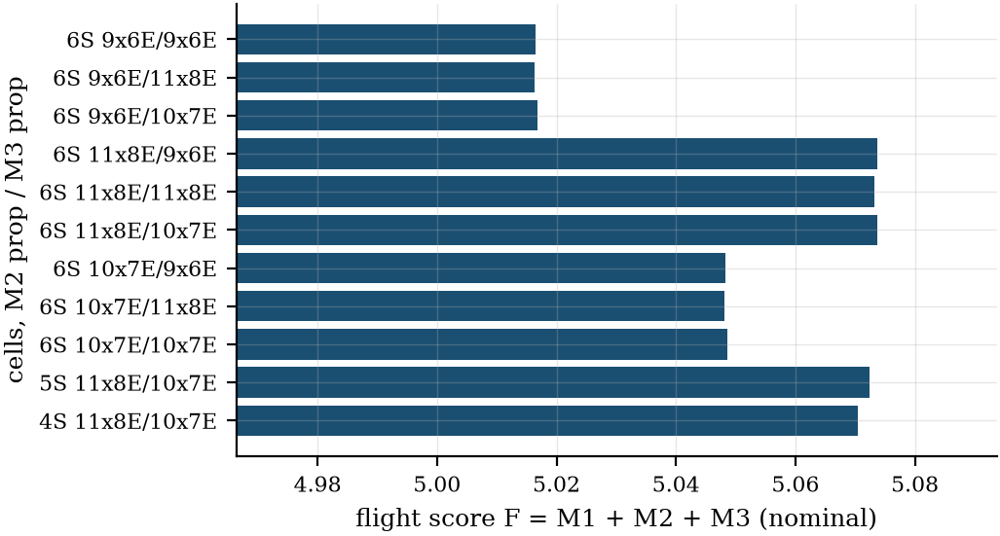
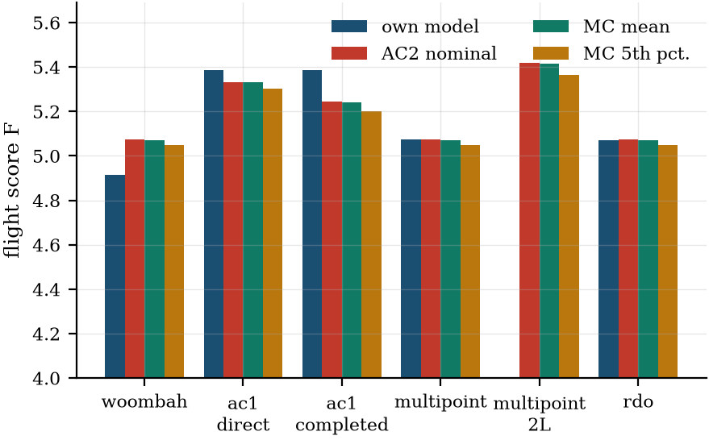
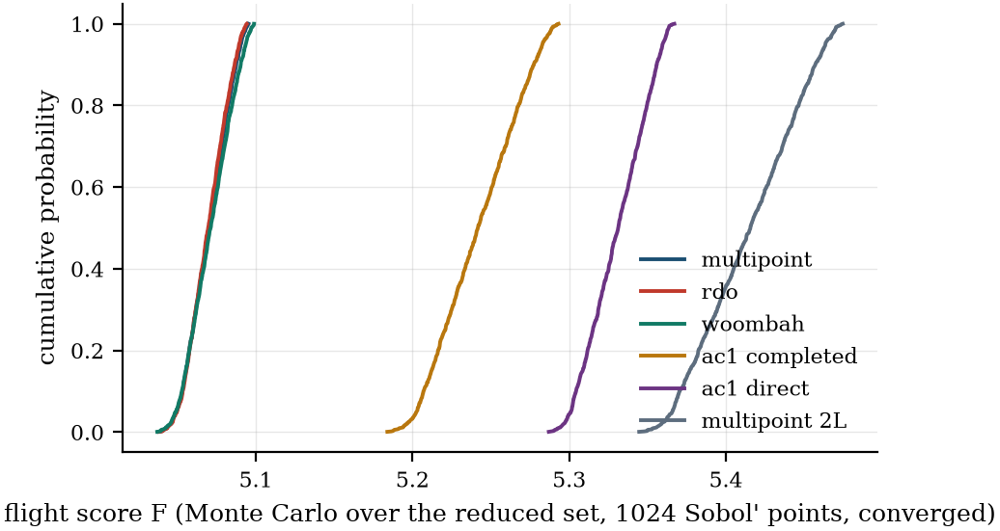
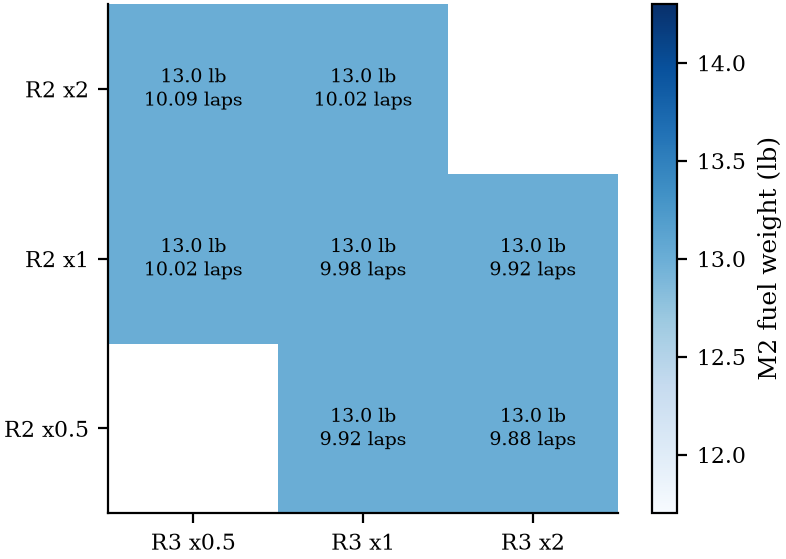

# 2024-25 results at the final code: AirCrafter 1.0 vs multipoint vs RDO

- **Commit:** `576eaa8` on `rerun-2025-final`: tag `results-2026-final` (`0a6527d`) plus configs and study scripts; nothing under `aircrafter2/` differs from the tag.
- **Take-off in mission time: on** (k_lof 1.1, CL_ground 0.15, start offset 0 ft; `configs/dbf2025_multipoint_takeoff.yaml`).
- **Mass model: USYD-calibrated** (`configs/placeholders.yaml`; Woombah's validation column: factors fitted without it).
- MDA continuation fallback on. Wind along the course axis (no wind direction, no turn drift). Course preset `dbf_2025`.
- RDO: k = 1, beta = 2, reduced set (f_build ±30 %, f_tb ±30 %, m_avionics ±15 %, wind 0–7 m/s). Monte Carlos in batches of 240 samples on fresh workers.
- **Stages completed:** 1 Woombah validation 4/4; 2 enumeration 11/11; 3 multistart 10/10; 4 bottles 2/2; 5 AirCrafter 1.0 mappings and common evaluation 4/4; 6 RDO 3/3; 7 Monte Carlo 6/6; 8 propagation 1/1; 9 bookends, normalisation, screening 8/8; 10 timing 4/4.

Generated by `studies/results_2025_final_report.py` from `outputs/results_2025_final/`; every number is read from `results_2025_final.json`. The published study at tag `results-2024-25-calibrated`: `docs/studies/results/results_2025.md`. Decisions and failures: `RERUN_2025_LOG.md`. Old against new: `thesis_number_diff.md`.

**Biases stated up front.** (i) Take-off is in the mission time here, but the validation still shows the model flying too fast (`validation_2025_final.md`). (ii) The common evaluation in the AirCrafter 2.0 analysis favours the AirCrafter 2.0 designs (they were optimised in it); the Monte Carlo favours RDO by construction. (iii) Analysis failures are counted separately from constraint violations everywhere.

## Findings

1. **Best propulsion case: 6S, 11x8E (M2) / 10x7E (M3), F = 5.0737** (M2 1.7413, M3 2.3324, 13.0 lb of fuel, 9.98 M3 laps). Kv is set by points.M2.rpm_margin (lower).
2. **The fuel weight sits at its upper bound in 11 of 11 cases**: 13.0 lb, the capacity of the two 1 L bottles (OPEN_QUESTIONS Q36). M2 is tank-limited, so the bottle choice (kept at Woombah's 1 L) is an active design decision: a larger bottle buys M2 at the cost of tank drag and mass. The main results keep 1 L (decision); the bottle sensitivity (section 1b) gives 0.5L F = 4.7499 (6.5 lb), 1L F = 5.0737 (13.0 lb), 2L F = 5.4186 (22.8 lb).
3. Cell count barely matters: 4S 5.0705, 5S 5.0724, 6S 5.0737 (spread 0.0032); Kv absorbs the voltage.
4. The M2 prop decides the ranking (best-per-M2-prop spread 0.057); the M3 prop hardly moves F (at most 0.0005 for a given M2 prop): M3's laps are capped by the 100 Wh pack rule, not by the prop.
5. Multistart (10 scrambled Sobol' starts): 8/10 converge, all to F = 5.0737–5.0740 (default start 5.0737); the 2 failures are MDA non-convergence at a random start design, not optimiser failures.
6. Bookends: the M2-only optimum gains +0.0024 in M2 and the M3-only optimum +0.0148 in M3 over the multipoint design; the M3-only design gives up 0.701 in M2 for it. **The multipoint optimum is effectively the M2 optimum**: M2 (fuel/time) is the only mission with real leverage at these normalisations.
7. RDO, reduced set (f_build, f_tb, m_avionics, lap.wind; d = 4, N = 9 nodes x 2 points; rdof_ms_b): mu - k sigma = 5.0571 (mu 5.0695, sigma 0.0124). The deterministic optimum has mu - k sigma 5.0571 at the same nodes and violates 3 robust constraints there. Nominal (calm-air) cost of robustness: 0.0005 in F.
8. **Build mass, not wind, is what robustness buys here (reversal of the published finding).** The deterministic optimum flies M2's 3 laps exactly in calm air, but at the mean headwind (3.5 m/s) it flies 3.009: more, not fewer, because with the take-off in the mission time the ground roll starts at an airspeed equal to the headwind, which saves take-off energy (mission/smooth_lap.py). It misses the 3 laps in 48 % of samples, 48 % in the calmest quartile of wind and 51 % in the windiest, against 0 % in the lightest quartile of build mass and 100 % in the heaviest. The RDO design keeps the margin (mu - 2 sigma >= 3) for almost no score.
9. 3 converged RDO starts, spread of mu - k sigma 2.1e-11. The designs are not identical: they differ in x_cb_frac 0.1891–0.4884, Kv 632.4–909, x_batt_M2 -0.5929–-0.03202, throttle_M2 0.6593–0.9476, x_batt_M3 0.03109–0.1132, throttle_M3 0.6427–0.9238 (Kv x M2 throttle 599–599: a flat direction of the objective, the motor's no-load speed at the M2 throttle is what matters). Monte Carlo over the reduced set: the largest probability of violating a constraint goes from 0.499 (multipoint) to 0.003 (RDO); the 5th percentile of F from 5.0495 to 5.0497.

**Not one optimum.** The converged multistarts reach 2 distinct airframes: F 5.0737: 4 starts, chord 0.304, t/c scale 1.08, camber scale 1.00; F 5.0740: 4 starts, chord 0.280, t/c scale 1.18, camber scale 1.38. The default start (F 5.0737, the design every section below calls 'multipoint') is in the lower group, so it is not the best known design; the gap is smaller than any other effect on this page. Every robust start ends near the upper group's airframe.

## 1. Propulsion enumeration (deterministic multipoint)

Every run from the same start, SLSQP, warm-start MDA fallbacks. `ok` = SLSQP converged; a failed MDA is reported as such, never as infeasible. `its` = OpenMDAO driver iterations, i.e. objective evaluations (line-search steps included), here and in every table below.

| run | cells | M2 prop | M3 prop | ok | its | F | M2 | M3 | fuel (lb) | t3 (s) | M3 laps | Kv | Kv set by | M1 check |
|---|---:|---:|---:|---:|---:|---:|---:|---:|---:|---:|---:|---:|---:|---:|
| mp_4S_11x8E_10x7E | 4 | 11x8E | 10x7E | yes | 37 | 5.0705 | 1.7387 | 2.3318 | 13.00 | 88.0 | 9.96 | 972 | points.M2.rpm_margin (lower) | yes |
| mp_5S_11x8E_10x7E | 5 | 11x8E | 10x7E | yes | 56 | 5.0724 | 1.7403 | 2.3322 | 13.00 | 87.8 | 9.97 | 832 | points.M2.rpm_margin (lower) | yes |
| mp_6S_10x7E_10x7E | 6 | 10x7E | 10x7E | yes | 39 | 5.0487 | 1.7161 | 2.3326 | 13.00 | 90.8 | 9.98 | 785 | points.M2.rpm_margin (lower) | yes |
| mp_6S_10x7E_11x8E | 6 | 10x7E | 11x8E | yes | 48 | 5.0481 | 1.7161 | 2.3321 | 13.00 | 90.8 | 9.97 | 729 | points.M2.rpm_margin (lower) | yes |
| mp_6S_10x7E_9x6E | 6 | 10x7E | 9x6E | yes | 52 | 5.0483 | 1.7160 | 2.3323 | 13.00 | 90.8 | 9.97 | 798 | points.M2.rpm_margin (lower) | yes |
| mp_6S_11x8E_10x7E | 6 | 11x8E | 10x7E | yes | 57 | 5.0737 | 1.7413 | 2.3324 | 13.00 | 87.7 | 9.98 | 761 | points.M2.rpm_margin (lower) | yes |
| mp_6S_11x8E_11x8E | 6 | 11x8E | 11x8E | yes | 69 | 5.0732 | 1.7413 | 2.3319 | 13.00 | 87.7 | 9.96 | 703 | points.M2.rpm_margin (lower) | yes |
| mp_6S_11x8E_9x6E | 6 | 11x8E | 9x6E | yes | 112 | 5.0737 | 1.7421 | 2.3316 | 13.00 | 87.6 | 9.95 | 784 | points.M2.rpm_margin (lower) | yes |
| mp_6S_9x6E_10x7E | 6 | 9x6E | 10x7E | yes | 50 | 5.0169 | 1.6866 | 2.3303 | 13.00 | 94.7 | 9.92 | 780 | points.M2.rpm_margin (lower) | yes |
| mp_6S_9x6E_11x8E | 6 | 9x6E | 11x8E | yes | 58 | 5.0164 | 1.6866 | 2.3298 | 13.00 | 94.7 | 9.90 | 734 | points.M2.rpm_margin (lower) | yes |
| mp_6S_9x6E_9x6E | 6 | 9x6E | 9x6E | yes | 54 | 5.0165 | 1.6866 | 2.3300 | 13.00 | 94.7 | 9.91 | 823 | points.M2.rpm_margin (lower) | yes |

Active constraints at the best case: points.M2.energy_margin (lower), points.M2.rpm_margin (lower), points.M2.V_h (lower), points.M2.V_v (lower), points.M3.V_h (lower), points.M3.V_v (lower), rules_M3.energy_margin_Wh (lower), points.M2.laps_frac (lower); at bounds: b (upper), fuel_mass (upper).

### 1b. Store option: the external bottle (best propulsion case)

Same case, re-optimised from the 1 L optimum with each candidate bottle (dimensions and empty masses are PLACEHOLDERS, OPEN_QUESTIONS Q36). Sensitivity only: the main results use Woombah's 1 L.

| bottle | ok | its | F | M2 | M3 | fuel (lb) | t3 (s) | M3 laps | M2 mass (kg) | M2 C_D stores | at bounds | M1 check |
|---|---:|---:|---:|---:|---:|---:|---:|---:|---:|---:|---:|---:|
| 0.5L | yes | 57 | 4.7499 | 1.4043 | 2.3456 | 6.50 | 80.4 | 10.33 | 6.22 | 0.0133 | b (upper), fuel_mass (upper) | yes |
| 1L | yes | 57 | 5.0737 | 1.7413 | 2.3324 | 13.00 | 87.7 | 9.98 | 9.89 | 0.0133 | b (upper), fuel_mass (upper) | yes |
| 2L | yes | 42 | 5.4186 | 2.1061 | 2.3125 | 22.82 | 103.2 | 9.44 | 15.40 | 0.0133 | b (upper) | yes |

## 2. Method comparison (the AirCrafter 2.0 multipoint analysis at nominal inputs)

Woombah: as built, at the throttles that reproduce its logged currents, on the calibrated mass model (in-sample: Woombah is one of the three calibration aircraft; the out-of-sample check is validation_2025.md). AirCrafter 1.0 direct = mapping (a), completed = mapping (b) (span, chord and fuel fixed at AirCrafter 1.0's values, the rest optimised). Multipoint = mp_6S_11x8E_10x7E. RDO = rdof_ms_b (reduced set; the 15-parameter RDO is in docs/studies/mass_calibration_usyd.md §11–12). **AirCrafter 1.0's fuel (19.2 lb) does not fit in two 1 L bottles, so both mappings fly 2 L bottles** (smallest bottle that holds it); the like-for-like AirCrafter 2.0 design is multipoint_2L (the same case re-optimised with 2 L bottles, section 1b).

### Design variables and geometry

| quantity | woombah | ac1_direct | ac1_completed | multipoint | multipoint_2L | rdo |
|---|---:|---:|---:|---:|---:|---:|
| span b (m) | 1.801 | 1.800 | 1.800 | 1.829 | 1.829 | 1.829 |
| chord c (m) | 0.328 | 0.360 | 0.360 | 0.304 | 0.433 | 0.277 |
| t/c scale | 1.000 | 1.000 | 1.180 | 1.079 | 0.982 | 1.201 |
| camber scale | 1.000 | 1.000 | 1.703 | 1.004 | 1.571 | 1.312 |
| tail arm l_ht (m) | 1.100 | 0.900 | 0.997 | 0.863 | 0.854 | 0.791 |
| S_ht (m²) | 0.152 | 0.130 | 0.082 | 0.069 | 0.141 | 0.062 |
| S_vt (m²) | 0.067 | 0.052 | 0.023 | 0.024 | 0.034 | 0.023 |
| x_cb / l | 0.438 | 0.438 | 0.250 | 0.311 | 0.237 | 0.488 |
| Kv (rpm/V) | 1050.000 | 1050.000 | 789.674 | 760.874 | 731.499 | 908.966 |
| M2 pack (Ah) | 2.250 | 2.252 | 1.280 | 1.122 | 1.570 | 1.156 |
| M3 pack (Ah) | 2.250 | 2.252 | 2.252 | 2.252 | 2.252 | 2.252 |
| M2 throttle | 0.675 | 0.753 | 0.822 | 0.787 | 0.843 | 0.659 |
| M3 throttle | 0.534 | 0.590 | 0.718 | 0.769 | 0.769 | 0.643 |
| M2 battery station (m) | -0.021 | -0.021 | -0.100 | -0.100 | -0.270 | -0.593 |
| M3 battery station (m) | -0.746 | -0.746 | -0.100 | 0.025 | 0.025 | 0.031 |
| aspect ratio b/c | 5.50 | 5.00 | 5.00 | 6.02 | 4.22 | 6.60 |
| fuel (lb) | 13.20 | 19.19 | 19.19 | 13.00 | 22.82 | 13.00 |
| cells | 6 | 6 | 6 | 6 | 6 | 6 |
| M2 / M3 prop | 10x7E / 10x7E | 10x7E / 10x7E | 10x7E / 10x7E | 11x8E / 10x7E | 11x8E / 10x7E | 11x8E / 10x7E |

### Mass breakdown (kg)

| mass | woombah | ac1_direct | ac1_completed | multipoint | multipoint_2L | rdo |
|---|---:|---:|---:|---:|---:|---:|
| M2 m_total | 10.671 | 13.634 | 13.343 | 9.888 | 15.401 | 9.838 |
| M2 m_empty | 4.137 | 4.364 | 4.073 | 3.444 | 4.481 | 3.394 |
| M2 m_wing | 1.293 | 1.528 | 1.638 | 1.214 | 1.839 | 1.180 |
| M2 m_ht | 0.179 | 0.152 | 0.096 | 0.081 | 0.165 | 0.073 |
| M2 m_vt | 0.093 | 0.072 | 0.033 | 0.033 | 0.047 | 0.033 |
| M2 m_fus | 0.768 | 0.719 | 0.743 | 0.710 | 0.708 | 0.692 |
| M2 m_gear | 0.322 | 0.411 | 0.402 | 0.298 | 0.464 | 0.297 |
| M2 m_sys | 1.481 | 1.482 | 1.161 | 1.108 | 1.256 | 1.120 |
| M2 m_batt | 0.744 | 0.745 | 0.423 | 0.371 | 0.519 | 0.382 |
| M2 m_pay | 6.534 | 9.270 | 9.270 | 6.444 | 10.920 | 6.444 |
| M3 m_total | 4.684 | 4.932 | 4.962 | 4.365 | 5.273 | 4.304 |
| M3 m_empty | 4.137 | 4.364 | 4.395 | 3.818 | 4.706 | 3.756 |
| M3 m_wing | 1.293 | 1.528 | 1.638 | 1.214 | 1.839 | 1.180 |
| M3 m_ht | 0.179 | 0.152 | 0.096 | 0.081 | 0.165 | 0.073 |
| M3 m_vt | 0.093 | 0.072 | 0.033 | 0.033 | 0.047 | 0.033 |
| M3 m_fus | 0.768 | 0.719 | 0.743 | 0.710 | 0.708 | 0.692 |
| M3 m_gear | 0.322 | 0.411 | 0.402 | 0.298 | 0.464 | 0.297 |
| M3 m_sys | 1.481 | 1.482 | 1.482 | 1.482 | 1.482 | 1.482 |
| M3 m_batt | 0.744 | 0.745 | 0.745 | 0.745 | 0.745 | 0.745 |
| M3 m_pay | 0.547 | 0.567 | 0.567 | 0.547 | 0.567 | 0.547 |

### Performance, scores and margins

| quantity | woombah | ac1_direct | ac1_completed | multipoint | multipoint_2L | rdo |
|---|---:|---:|---:|---:|---:|---:|
| M2 cruise speed (m/s) | 40.5 | 43.0 | 35.4 | 39.5 | 36.8 | 39.4 |
| M2 3-lap time (s) | 87.9 | 90.0 | 103.3 | 87.7 | 103.2 | 87.7 |
| M2 laps in 10 min | 5.42 | 3.78 | 3.00 | 3.00 | 3.00 | 3.10 |
| M2 C_D0 (with stores) | 0.0326 | 0.0341 | 0.0379 | 0.0312 | 0.0328 | 0.0354 |
| M2 C_D stores | 0.0125 | 0.0162 | 0.0163 | 0.0133 | 0.0133 | 0.0146 |
| M2 cruise L/D | 5.8 | 5.7 | 7.3 | 6.3 | 7.3 | 6.2 |
| M2 static current (A) | 34.8 | 45.8 | 27.7 | 30.7 | 33.0 | 30.7 |
| M2 rpm margin | -1152 | -2341 | -0 | 0 | 0 | 5 |
| M2 current margin (A) | 25.2 | 14.2 | 32.3 | 29.3 | 27.0 | 29.3 |
| M2 static margin | 0.230 | 0.105 | 0.054 | 0.075 | 0.063 | 0.147 |
| M2 energy margin | 97530 | 43869 | 0 | -0 | -0 | 3450 |
| M2 stall margin (m/s) | 21.7 | 22.8 | 16.3 | 20.9 | 17.5 | 20.7 |
| M3 cruise speed (m/s) | 32.8 | 35.0 | 31.7 | 34.9 | 30.9 | 34.8 |
| M3 3-lap time (s) | 85.4 | 83.0 | 86.8 | 82.9 | 88.2 | 82.9 |
| M3 laps in 10 min | 9.73 | 8.14 | 9.57 | 9.98 | 9.44 | 9.97 |
| M3 C_D0 (with stores) | 0.0334 | 0.0345 | 0.0379 | 0.0314 | 0.0336 | 0.0355 |
| M3 C_D stores | 0.0126 | 0.0163 | 0.0163 | 0.0134 | 0.0134 | 0.0147 |
| M3 cruise L/D | 3.9 | 3.2 | 3.6 | 3.6 | 3.7 | 3.5 |
| M3 static current (A) | 18.9 | 24.6 | 19.5 | 21.2 | 19.1 | 21.1 |
| M3 rpm margin | 1437 | 438 | 1408 | 941 | 1520 | 961 |
| M3 current margin (A) | 41.1 | 35.4 | 40.5 | 38.8 | 40.9 | 38.9 |
| M3 static margin | 0.542 | 0.433 | 0.143 | 0.119 | 0.092 | 0.111 |
| M3 energy margin | 163852 | 143018 | 157204 | 160057 | 156122 | 160104 |
| M3 stall margin (m/s) | 20.2 | 22.7 | 20.1 | 22.5 | 19.5 | 22.4 |
| M2 | 1.7511 | 2.0663 | 1.9283 | 1.7413 | 2.1061 | 1.7410 |
| M3 | 2.3235 | 2.2645 | 2.3176 | 2.3324 | 2.3125 | 2.3323 |
| flight_score | 5.0746 | 5.3308 | 5.2458 | 5.0737 | 5.4186 | 5.0733 |
| Kv set by | fixed (as built) | fixed (AirCrafter 1.0) | points.M2.rpm_margin (lower) | points.M2.rpm_margin (lower) | points.M2.rpm_margin (lower) | robust M2 rpm_margin (mu - 2 sigma) |
| M1 check | fail: SM, V_h, V_v | fail: SM | pass | pass | pass | pass |

### Constraint status (active within 1e-4 of ref, or violated)

| design | active constraints | at bounds | violated |
|---|---:|---:|---:|
| woombah | – | Kv (upper) | points.M2.rpm_margin = -1.15e+03; points.M2.SM = 0.23; points.M3.SM = 0.542 |
| ac1_direct | rules_M2.energy_margin_Wh (lower); rules_M3.energy_margin_Wh (lower) | Kv (upper) | points.M2.rpm_margin = -2.34e+03; points.M3.SM = 0.433 |
| ac1_completed | points.M2.energy_margin (lower); points.M2.rpm_margin (lower); points.M2.V_h (lower); points.M2.V_v (lower); points.M3.V_h (lower); points.M3.V_v (lower); rules_M3.energy_margin_Wh (lower); points.M2.laps_frac (lower) | – | none (of the reported outputs) |
| multipoint | points.M2.energy_margin (lower); points.M2.rpm_margin (lower); points.M2.V_h (lower); points.M2.V_v (lower); points.M3.V_h (lower); points.M3.V_v (lower); rules_M3.energy_margin_Wh (lower); points.M2.laps_frac (lower) | b (upper); fuel_mass (upper) | none (of the reported outputs) |
| multipoint_2L | points.M2.thrust_margin_static (lower); points.M2.energy_margin (lower); points.M2.rpm_margin (lower); points.M2.V_h (lower); points.M2.V_v (lower); points.M3.V_h (lower); points.M3.V_v (lower); rules_M3.energy_margin_Wh (lower); points.M2.laps_frac (lower) | b (upper) | none (of the reported outputs) |
| rdo | points.M2.V_h (lower); points.M2.V_v (lower); points.M3.V_h (lower); points.M3.V_v (lower); rules_M3.energy_margin_Wh (lower) | b (upper); fuel_mass (upper) | none (of the reported outputs) |

Violations are checked here only for the outputs recorded per point (the table above); the Monte Carlo (section 3) checks every constraint.

## 3. Common evaluation

1 = in its own model (what each method claims); 2 = the AirCrafter 2.0 multipoint analysis at nominal inputs (calm air, every factor at its config value; **favours the AirCrafter 2.0 designs**); 3 = Monte Carlo in AirCrafter 2.0, 1024 scrambled Sobol' points (seed 0) over the 4 uncertain parameters of this set (f_build, f_tb, m_avionics, lap.wind), the same points for every design (**favours RDO by construction**). Analysis failures are excluded from the statistics and counted in their own column: MDA non-convergence, or **wind limit (no flight)**: the headwind is close to the light M3 aircraft's V_stall, so it cannot make progress into the wind after lift-off and would not fly (the aircraft's wind limit, a property of the design, docs/modules/mission.md).

| design | F own (1) | F nominal (2) | F mu (3) | F sigma | F p5 | M2 mu | M2 p5 | M3 mu | M3 p5 | analysis failures |
|---|---:|---:|---:|---:|---:|---:|---:|---:|---:|---:|
| woombah | 4.9158 | 5.0746 | 5.0711 | 0.0140 | 5.0492 | 1.7510 | 1.7337 | 2.3201 | 2.3133 | 0/1024 |
| ac1_direct | 5.3850 | 5.3308 | 5.3307 | 0.0189 | 5.3012 | 2.0681 | 2.0431 | 2.2626 | 2.2565 | 0/1024 |
| ac1_completed | 5.3850 | 5.2458 | 5.2421 | 0.0258 | 5.2027 | 1.9282 | 1.8936 | 2.3140 | 2.3065 | 0/1024 |
| multipoint | 5.0737 | 5.0737 | 5.0699 | 0.0129 | 5.0495 | 1.7404 | 1.7248 | 2.3295 | 2.3235 | 0/1024 |
| multipoint_2L | – | 5.4186 | 5.4148 | 0.0315 | 5.3659 | 2.1065 | 2.0633 | 2.3083 | 2.2998 | 0/1024 |
| rdo | 5.0695 | 5.0733 | 5.0695 | 0.0124 | 5.0497 | 1.7402 | 1.7253 | 2.3293 | 2.3233 | 0/1024 |

Own-model sources: woombah: Table 39 'Design' column [W p. 59]; M2 time = 3 x the 33 s average lap; ac1_direct: AirCrafter 1.0 '2025' mode, its selected design point (the same for both mappings); t3 from its M2 score; ac1_completed: AirCrafter 1.0 '2025' mode, its selected design point (the same for both mappings); t3 from its M2 score; multipoint: AirCrafter 2.0 nominal (its own model); rdo: AirCrafter 2.0 RDO: UDR mean, sigma and mu - k sigma of the flight score at its own uncertain set.

AirCrafter 1.0's claim (19.2 lb, 8 M3 laps) has no store drag (it has no way to represent it; a limitation of AirCrafter 1.0, not added).

**Probability of violating each constraint** (Monte Carlo, converged samples; constraints never violated by any design are omitted):

| constraint | multipoint | rdo | woombah | ac1_completed | ac1_direct | multipoint_2L |
|---|---:|---:|---:|---:|---:|---:|
| points.M2.SM | 0.003 | 0.000 | 0.934 | 0.319 | 0.000 | 0.005 |
| points.M2.V_h | 0.000 | 0.000 | 1.000 | 0.000 | 0.000 | 0.000 |
| points.M2.V_v | 0.000 | 0.000 | 1.000 | 0.000 | 0.000 | 0.000 |
| points.M2.energy_margin | 0.476 | 0.000 | 0.000 | 0.486 | 0.000 | 0.480 |
| points.M2.laps_frac | 0.476 | 0.000 | 0.000 | 0.486 | 0.000 | 0.480 |
| points.M2.rpm_margin | 0.499 | 0.000 | 1.000 | 0.499 | 1.000 | 0.499 |
| points.M2.thrust_margin_static | 0.000 | 0.000 | 0.000 | 0.332 | 0.000 | 0.501 |
| points.M3.SM | 0.000 | 0.003 | 1.000 | 0.059 | 1.000 | 0.000 |
| points.M3.V_h | 0.000 | 0.000 | 1.000 | 0.000 | 0.000 | 0.000 |
| points.M3.V_v | 0.000 | 0.000 | 1.000 | 0.000 | 0.000 | 0.000 |

The common evaluation over the full 15-parameter set (the published section 3b) is not repeated here: on the calibrated model it covers the multipoint and RDO designs only, in docs/studies/mass_calibration_usyd.md §11–12.

## 4. Mission bookends

The same multipoint problem (both missions flown, every constraint at both points) with the objective reduced to one mission's score.

| objective | ok | its | F | M2 | M3 | fuel (lb) | t3 (s) | M3 laps |
|---|---:|---:|---:|---:|---:|---:|---:|---:|
| multipoint | yes | 57 | 5.0737 | 1.7413 | 2.3324 | 13.00 | 87.7 | 9.98 |
| M2only | yes | 30 | 5.0609 | 1.7437 | 2.3172 | 13.00 | 87.4 | 9.56 |
| M3only | yes | 138 | 4.3876 | 1.0404 | 2.3472 | 1.10 | 136.3 | 10.37 |

M3-only design vs multipoint: b 1.83 → 1.28, c 0.304 → 0.15, tc_scale 1.08 → 1.01, camber_scale 1 → 0.611, l_ht 0.863 → 0.506, S_ht 0.0685 → 0.02, S_vt 0.0236 → 0.01, x_cb_frac 0.311 → 0.434, Kv 761 → 642, capacity_M2 1.12 → 0.54, x_batt_M2 -0.1 → 0.2, throttle_M2 0.787 → 0.5, x_batt_M3 0.0247 → 0.183, throttle_M3 0.769 → 0.974, fuel_mass 5.9 → 0.5.

## 5. Normalisation sensitivity

R2 and R3 scaled by 0.5, 1 and 2 (R2 0.1–0.4 lb/s, R3 13.5–54); each re-optimised from the centre optimum, deterministic multipoint, mp_6S_11x8E_10x7E. A larger R makes that mission worth less.

| R2 | R3 | ok | its | F | M2 | M3 | fuel (lb) | t3 (s) | M3 laps | b | c | Kv | capacity_M2 | capacity_M3 | throttle_M2 | throttle_M3 |
|---|---:|---:|---:|---:|---:|---:|---:|---:|---:|---:|---:|---:|---:|---:|---:|---:|
| x0.5 | x1 | yes | 27 | 5.8161 | 2.4858 | 2.3303 | 13.00 | 87.5 | 9.92 | 1.829 | 0.317 | 760.302 | 1.142 | 2.252 | 0.791 | 0.765 |
| x0.5 | x2 | yes | 30 | 5.6513 | 2.4869 | 2.1644 | 13.00 | 87.4 | 9.88 | 1.829 | 0.324 | 760.025 | 1.155 | 2.252 | 0.793 | 0.762 |
| x1 | x0.5 | yes | 30 | 5.4072 | 1.7390 | 2.6682 | 13.00 | 88.0 | 10.02 | 1.829 | 0.268 | 761.585 | 1.106 | 2.252 | 0.785 | 0.772 |
| x1 | x1 | yes | 57 | 5.0737 | 1.7413 | 2.3324 | 13.00 | 87.7 | 9.98 | 1.829 | 0.304 | 760.874 | 1.122 | 2.252 | 0.787 | 0.769 |
| x1 | x2 | yes | 29 | 4.9080 | 1.7429 | 2.1651 | 13.00 | 87.5 | 9.92 | 1.829 | 0.317 | 760.347 | 1.142 | 2.252 | 0.791 | 0.765 |
| x2 | x0.5 | yes | 40 | 5.0392 | 1.3659 | 2.6733 | 13.00 | 88.8 | 10.09 | 1.829 | 0.266 | 762.579 | 1.083 | 2.252 | 0.781 | 0.778 |
| x2 | x1 | yes | 25 | 4.7036 | 1.3695 | 2.3341 | 13.00 | 88.0 | 10.02 | 1.829 | 0.268 | 761.579 | 1.106 | 2.252 | 0.785 | 0.772 |

Off-diagonal: R2 x0.5 / R3 x1: fuel +0.00 lb, M3 laps -0.06, t3 -0.2 s; R2 x0.5 / R3 x2: fuel +0.00 lb, M3 laps -0.10, t3 -0.3 s; R2 x1 / R3 x0.5: fuel +0.00 lb, M3 laps +0.04, t3 +0.3 s; R2 x1 / R3 x2: fuel +0.00 lb, M3 laps -0.06, t3 -0.2 s; R2 x2 / R3 x0.5: fuel +0.00 lb, M3 laps +0.11, t3 +1.1 s; R2 x2 / R3 x1: fuel +0.00 lb, M3 laps +0.04, t3 +0.3 s. **Largest move: R2 x2 / R3 x0.5.** The design barely moves: the M2 and M3 levers are nearly decoupled (fuel weight sets M2; M3's laps are capped by the energy rule), so the normalisation re-weights the score but not the aircraft.

## 6. Bonus scenario

B = 2.5 at W_X1 = 0.37 lb adds B/W_X1/R3 = 0.2503 to M3 for every design. W_X1 is fixed (the X-1 is not a design variable here), so the term is a constant: **the optimum does not change**, only the totals.

| design | F (B = 0) | F (B = 2.5) |
|---|---:|---:|
| woombah | 5.0746 | 5.3249 |
| ac1_direct | 5.3308 | 5.5811 |
| ac1_completed | 5.2458 | 5.4961 |
| multipoint | 5.0737 | 5.3240 |
| multipoint_2L | 5.4186 | 5.6688 |
| rdo | 5.0733 | 5.3235 |

## 7. Robust vs deterministic

**Contributions** at mp_6S_11x8E_10x7E (first-order variance (dq/dp sigma)^2 at the means; every parameter is active, d = 4, N = 9 UDR nodes, so this is a table, not a selection). Means: f_build 1, f_tb 3.2737, m_avionics 0.222, lap.wind 3.5. sigma(4) and sigma(15) are the root of the summed variance over this set and over the full set's 15 (its screening at the same case); 'share of 15' = their variance ratio; the last columns are each parameter's share of this set's variance.

| quantity | value at the means | sigma (this set) | sigma (15) | share of 15 | f_build | f_tb | m_avionics | lap.wind |
|---|---:|---:|---:|---:|---:|---:|---:|---:|
| flight_score | 5.0723 | 0.0127 | – | – | 0.867 | 0.005 | 0.002 | 0.126 |
| M2.stall_margin | 20.9271 | 0.451 | – | – | 0.992 | 0.006 | 0.002 | 0.000 |
| M2.thrust_margin_static | 22.5212 | 2.09 | – | – | 0.992 | 0.006 | 0.002 | 0.000 |
| M2.energy_margin | 317.7020 | 1.83e+03 | – | – | 0.991 | 0.006 | 0.002 | 0.002 |
| M2.rpm_margin | 0.0000 | 3.27 | – | – | 0.992 | 0.006 | 0.002 | 0.000 |
| M2.SM | 0.0754 | 0.0117 | – | – | 0.815 | 0.173 | 0.012 | 0.000 |
| M2.wall_ratio | 0.0664 | 0.0016 | – | – | 0.992 | 0.006 | 0.002 | 0.000 |
| M3.stall_margin | 22.5299 | 0.634 | – | – | 0.992 | 0.006 | 0.002 | 0.000 |
| M3.thrust_margin_static | 31.0220 | 1.3 | – | – | 0.992 | 0.006 | 0.002 | 0.000 |
| M3.energy_margin | 159756.9465 | 868 | – | – | 0.806 | 0.005 | 0.002 | 0.187 |
| M3.rpm_margin | 940.5791 | 0.819 | – | – | 0.992 | 0.006 | 0.002 | 0.000 |
| M3.SM | 0.1188 | 0.0306 | – | – | 0.855 | 0.138 | 0.008 | 0.000 |
| M3.wall_ratio | 0.0664 | 0.0016 | – | – | 0.992 | 0.006 | 0.002 | 0.000 |
| M2.laps_frac | 3.0091 | 0.0525 | – | – | 0.990 | 0.006 | 0.002 | 0.002 |

| run | start | ok | its | wall (h) | mu F | sigma F | mu - k sigma | failed MDA attempts (recovered or not) | error |
|---|---:|---:|---:|---:|---:|---:|---:|---:|---:|
| rdof_best | mp_6S_11x8E_10x7E | yes | 41 | 0.45 | 5.0695 | 0.0124 | 5.0571 | 0 |  |
| rdof_ms_a | mp_6S_11x8E_10x7E_ms0 | yes | 40 | 0.44 | 5.0695 | 0.0124 | 5.0571 | 0 |  |
| rdof_ms_b | mp_6S_11x8E_10x7E_ms2 | yes | 44 | 0.48 | 5.0695 | 0.0124 | 5.0571 | 0 |  |

**The same UDR statistics at every design** (the RDO's nodes; robust constraints mu - beta sigma >= lower, mu + beta sigma <= upper, beta = 2):

| design | F nominal | mu F | sigma F | mu - k sigma | rank nominal | rank robust | robust constraints violated |
|---|---:|---:|---:|---:|---:|---:|---:|
| mp_4S_11x8E_10x7E | 5.0705 | 5.0668 | 0.0129 | 5.0539 | 5 | 5 | M2.energy_margin, M2.rpm_margin, M3.SM, M2.laps_frac |
| mp_5S_11x8E_10x7E | 5.0724 | 5.0687 | 0.0129 | 5.0558 | 4 | 4 | M2.energy_margin, M2.rpm_margin, M3.SM, M2.laps_frac |
| mp_6S_10x7E_10x7E | 5.0487 | 5.0442 | 0.0138 | 5.0304 | 6 | 6 | M2.energy_margin, M2.rpm_margin, M2.SM, M3.SM, M2.laps_frac |
| mp_6S_10x7E_11x8E | 5.0481 | 5.0437 | 0.0138 | 5.0299 | 8 | 8 | M2.energy_margin, M2.rpm_margin, M2.SM, M3.SM, M2.laps_frac |
| mp_6S_10x7E_9x6E | 5.0483 | 5.0439 | 0.0139 | 5.0300 | 7 | 7 | M2.energy_margin, M2.rpm_margin, M2.SM, M3.SM, M2.laps_frac |
| mp_6S_11x8E_10x7E | 5.0737 | 5.0700 | 0.0129 | 5.0571 | 1 | 2 | M2.energy_margin, M2.rpm_margin, M2.laps_frac |
| mp_6S_11x8E_11x8E | 5.0732 | 5.0694 | 0.0129 | 5.0565 | 3 | 3 | M2.energy_margin, M2.rpm_margin, M3.SM, M2.laps_frac |
| mp_6S_11x8E_9x6E | 5.0737 | 5.0698 | 0.0126 | 5.0572 | 2 | 1 | M2.energy_margin, M2.rpm_margin, M3.SM, M2.laps_frac |
| mp_6S_9x6E_10x7E | 5.0169 | 5.0103 | 0.0165 | 4.9938 | 9 | 9 | M2.energy_margin, M2.rpm_margin, M2.SM, M3.SM, M2.laps_frac |
| mp_6S_9x6E_11x8E | 5.0164 | 5.0097 | 0.0165 | 4.9933 | 11 | 11 | M2.energy_margin, M2.rpm_margin, M2.SM, M3.SM, M2.laps_frac |
| mp_6S_9x6E_9x6E | 5.0165 | 5.0099 | 0.0165 | 4.9934 | 10 | 10 | M2.energy_margin, M2.rpm_margin, M2.SM, M3.SM, M2.laps_frac |
| woombah | 5.0746 | 5.0712 | 0.0140 | 5.0572 | – | – | M2.rpm_margin, M2.SM, M3.SM |
| ac1_direct | 5.3308 | 5.3307 | 0.0188 | 5.3120 | – | – | M2.rpm_margin, M3.SM |
| ac1_completed | 5.2458 | 5.2421 | 0.0258 | 5.2163 | – | – | M2.thrust_margin_static, M2.energy_margin, M2.rpm_margin, M2.SM, M3.SM, M2.laps_frac |
| multipoint_2L | 5.4186 | 5.4148 | 0.0317 | 5.3831 | – | – | M2.thrust_margin_static, M2.energy_margin, M2.rpm_margin, M3.SM, M2.laps_frac |
| rdo | 5.0733 | 5.0695 | 0.0124 | 5.0571 | – | – | none |
| **rdof_ms_b** | 5.0733 | 5.0695 | 0.0124 | 5.0571 | – | – | none (constrained) |

**Propulsion ranking under uncertainty: the best case changes to mp_6S_11x8E_9x6E** (ranked by mu - k sigma at each case's deterministic optimum; an RDO per case was not run).

Monte Carlo (this set): multipoint F mu 5.0699 sigma 0.0129 p5 5.0495, max P(violation) 0.499; RDO mu 5.0695 sigma 0.0124 p5 5.0497, max P(violation) 0.003.

### 7a. Propagation check at the robust optimum (rdof_ms_b)

| quantity (mu / sigma) | UDR (N = 9) | Smolyak level 2 (N = 49) | Sobol' MC (N = 1024) |
|---|---:|---:|---:|
| flight_score | 5.07 / 0.0124 | 5.07 / 0.0124 | 5.07 / 0.0124 |
| M2.stall_margin | 20.74 / 0.427 | 20.74 / 0.426 | 20.74 / 0.427 |
| M2.thrust_margin_static | 22.46 / 2.01 | 22.46 / 2.01 | 22.46 / 2.01 |
| M2.energy_margin | 3568 / 1.75e+03 | 3568 / 1.75e+03 | 3568 / 1.76e+03 |
| M2.rpm_margin | 5.093 / 2.55 | 5.092 / 2.55 | 5.092 / 2.55 |
| M2.I_margin | 29.3 / 0 | 29.3 / 5.84e-07 | 29.3 / 1.07e-14 |
| M2.SM | 0.1477 / 0.0153 | 0.1477 / 0.0153 | 0.1477 / 0.0153 |
| M2.wall_ratio | 0.0652 / 0.00075 | 0.06519 / 0.00074 | 0.06519 / 0.000743 |
| M2.r_tube | 0.01546 / 0 | 0.01546 / 2.85e-10 | 0.01546 / 5.21e-18 |
| M3.stall_margin | 22.41 / 0.612 | 22.41 / 0.611 | 22.41 / 0.612 |
| M3.thrust_margin_static | 31.01 / 1.25 | 31.01 / 1.25 | 31.01 / 1.25 |
| M3.energy_margin | 1.597e+05 / 842 | 1.597e+05 / 842 | 1.597e+05 / 843 |
| M3.rpm_margin | 960.7 / 0.78 | 960.7 / 0.78 | 960.7 / 0.781 |
| M3.I_margin | 38.9 / 0 | 38.9 / 1.35e-06 | 38.9 / 7.11e-15 |
| M3.SM | 0.1143 / 0.0321 | 0.1143 / 0.032 | 0.1143 / 0.032 |
| M3.wall_ratio | 0.0652 / 0.00075 | 0.06519 / 0.00074 | 0.06519 / 0.000743 |
| M3.r_tube | 0.01546 / 0 | 0.01546 / 2.85e-10 | 0.01546 / 5.21e-18 |
| M2.laps_frac | 3.102 / 0.0512 | 3.103 / 0.0512 | 3.102 / 0.0512 |

MDA failures: udr 0/9, smolyak 0/49, sobol 0/1024. Largest Monte Carlo P(violation): M3.SM 0.003.

### 7b. Calibrated build mass (dropped)

The Woombah-only f_build calibration (2.74, ±30 % about it) of the uncalibrated pages would count the build bias twice on the calibrated model, whose correction factors carry it (docs/studies/mass_calibration_usyd.md); it is in the pre-calibration pages (git tag `results-uncalibrated`).

The RDO over the full 15-parameter set (the published section 7d) on the calibrated model: docs/studies/mass_calibration_usyd.md §11–12.

## 8. The published designs at the final code

Each design of the published page, unchanged, analysed at the final code with take-off off, then on. The first step is what the code change moved; the second is what the take-off moved. A design optimised without take-off may violate constraints with it.

| design | published F | final code, take-off off | take-off on | violated with take-off on |
|---|---:|---:|---:|---|
| woombah | 5.1020 | 5.1020 | 5.0756 | M2.rpm_margin, M2.SM, M2.V_h, M2.V_v, M3.SM, M3.V_h, M3.V_v |
| ac1_direct | 5.3735 | 5.3735 | 5.3308 | M2.rpm_margin, M3.SM |
| ac1_completed | 5.2879 | 5.2879 | 5.2466 | M2.energy_margin, M2.laps_frac |
| multipoint | 5.0993 | 5.0993 | 5.0742 | M2.energy_margin, M2.laps_frac |
| multipoint_2L | 5.4710 | 5.4710 | 5.4209 | M2.energy_margin, M2.laps_frac |
| rdo | 5.0986 | 5.0986 | 5.0733 | M2.energy_margin, M2.laps_frac |

## 9. Timing

Single-threaded, each in its own process, nothing else running: timing_det_0 4.3 min, timing_det_1 4.3 min, timing_det_2 4.4 min, timing_rdo 26.9 min.

## Caveats

- R2, R3 are PLACEHOLDERS (Q35); section 5 shows what moves with them.
- Take-off is in the mission time at both points (the published study's was not); its ground-roll inputs CL_ground and start offset are PLACEHOLDERS.
- Bottle dimensions and masses, the store interference factors and the store drag spread are PLACEHOLDERS (Q36, Q37); every uncertainty spread is a PLACEHOLDER (configs/uncertainty.yaml).
- The mass model is the USYD-calibrated one (docs/studies/mass_calibration_usyd.md). Woombah is one of its three calibration aircraft, so its column here is in-sample; the out-of-sample check (factors fitted without Woombah) is validation_2025.md.
- The full ranked list of placeholders affecting the results is in INDEX.md.
