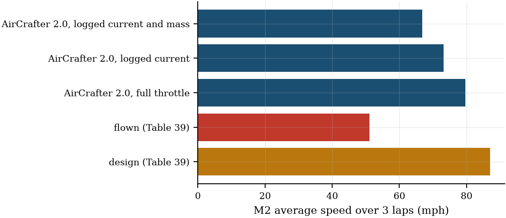

**Re-run at the final code: take-off in mission time on, commit 576eaa8.**

# 2024-25 validation: Project Woombah as built

Generated by `studies/validation_2025.py report` from `outputs/results/validation_*.json` (copied to `docs/studies/results/validation_2025.json`). Config: `configs/woombah_2025.yaml` (extends `configs/dbf2025_multipoint.yaml`). Sources: [W] 2025 USYD DBF Design Report; [R] Rules_2025.pdf. Analysis only; **nothing is tuned to the flight data**.

**Mass model (since 2026-10-23).** The optimisations now run with the USYD-calibrated mass model: the correction factors in `configs/placeholders.yaml` are fitted on Orange Hornet, Woombah and Humpback (docs/studies/mass_calibration_usyd.md). This reverses the earlier rule of running every optimisation with the uncalibrated model. Woombah is in that fit, so this validation uses two mass models applied above the layers: **G&G** (the published factors of `mass_garcia_gamboa_2022.yaml`, uncalibrated) and **out-of-sample** (`configs/mass_usyd_loo_woombah.yaml`, fitted on Orange Hornet and Humpback only). Keeping Woombah out of the fit is what keeps this comparison honest. Both use the cited Step 1 values (1 mm spar wall, 313 MPa) and Woombah's three-piece wing and cargo box (the 2024-25 ruleset). The Woombah-only refit of the earlier version stays in §2, superseded.

**Modelling differences (known before running):** rectangular-equivalent wing (same span and area; Woombah tapers 0.8); one spar tube for two; the model's fuselage is a cargo box plus a tail boom (Woombah: an 82 in fuselage); take-off in the mission time (`course.takeoff.in_mission_time`, on here); first-order motor model, APC surrogate props; stores drag from Woombah's own CFD bottle value [W p. 43].

## 2. Mass against Table 34

| Component | Table 34 (lb) | AirCrafter 2.0, G&G factors (uncalibrated) (lb) | error | AirCrafter 2.0, USYD factors without Woombah (out-of-sample) (lb) | error |
|---|---:|---:|---:|---:|---:|
| wing | 3.41 | 1.33 | -61 % | 2.01 | -41 % |
| HT | 0.41 | 0.22 | -46 % | 0.39 | -5 % |
| VT | 0.19 | 0.05 | -73 % | 0.22 | +14 % |
| fuselage + nose | 1.38 | 0.86 | -37 % | 2.17 | +57 % |
| undercarriage | 0.66 | 0.18 | -73 % | 1.08 | +63 % |
| **structure (wing to gear)** | 6.05 | 2.65 | -56 % | 5.86 | -3 % |
| **M2 take-off mass** | 26.02 (Table 38: 26.9) | 20.32 | -22 % | 23.53 | -10 % |
| **M3 take-off mass** | 10.09 (Table 38: 13.7) | 7.12 | -29 % | 10.33 | +2 % |
| **M1 take-off mass** | 9.32 | 5.91 | -37 % | 9.12 | -2 % |

Table 34's M2 total (26.02 lb) is 2.21 lb above the sum of its own rows, and its M3 total omits the empty bottles the rules require; the flight-test take-off masses (Table 38: 26.9 and 13.7 lb) include ballast added after P1 [W p. 60]. The model masses are the full-throttle point's (the closure re-sizes the structure at the closed take-off mass). Table 34 has no servo row (OPEN_QUESTIONS Q48).
## 3. Flight performance against Table 39

Table 39 is not internally consistent (docs/RESULTS_PLAN.md §6), so each quantity is compared with each reading. M2 'time' readings: 112.2 s (3 × the 37.4 s average lap), 138.1 s (the total flight time, take-off included). Average speeds are over 3 × 3000 ft. Columns: the mass model (G&G, out-of-sample), then the case.

| Quantity | Table 39 design | Table 39 actual | G&G, full throttle | G&G, logged current | G&G, logged current and mass | out-of-sample, full throttle | out-of-sample, logged current | out-of-sample, logged current and mass |
|---|---:|---:|---:|---:|---:|---:|---:|---:|
| M2 take-off mass (lb) | 26 | 26.9 (Table 38) | 20.3 | 20.2 | 26.9 | 23.5 | 23.5 | 26.9 |
| M2 average speed (mph) | 87 | 51.1 | 79.7 | 73.2 | 66.8 | 79.0 | 69.8 | 66.6 |
| M2 3-lap time (s) | 100 | 112.2 or 138.1 | 77.0 (take-off included) | 83.9 (take-off included) | 91.9 (take-off included) | 77.7 (take-off included) | 87.9 (take-off included) | 92.1 (take-off included) |
| M2 average lap (s) | 33 | 37.4 | 24.9 (lap 2+) | 26.5 (lap 2+) | 28.2 (lap 2+) | 25.0 (lap 2+) | 27.4 (lap 2+) | 28.2 (lap 2+) |
| M2 battery reserve after 3 laps | 30 % | 33 % | 13 % | 65 % | 61 % | 12 % | 63 % | 61 % |
| M2 average current per pack (A) | 60 [W p. 26] | 34 (Test 3) | 91.1 | 34.0 | 34.5 | 91.4 | 34.0 | 34.2 |
| M3 take-off mass (lb) | | 13.7 (Table 38) | 7.1 | 7.0 | 13.7 | 10.3 | 10.3 | 13.7 |
| M3 laps in the window (pre-launch) | 8 (7) | 7 (6) | 2.38 (1.38) | 9.94 (8.94) | 9.52 (8.52) | 2.31 (1.31) | 9.73 (8.73) | 9.50 (8.50) |
| M3 average speed (mph) | 80 | 52.3 | 84.4 | 74.0 | 69.7 | 82.8 | 71.9 | 69.5 |
| M3 average current per pack (A) | 50 [W p. 26] | 17.5 (Test 2) | 89.3 | 17.5 | 18.0 | 89.9 | 17.5 | 17.7 |
| flight score M1 + M2 + M3 (B = 0) | | | 4.908 | 5.118 | 5.034 | 4.899 | 5.075 | 5.031 |

G&G, logged-current case: throttles M2 0.677, M3 0.536.

out-of-sample, logged-current case: throttles M2 0.675, M3 0.534.

The logged-current throttle is the one at which the 3-lap average pack current equals Table 38's average current, read as per pack: an input condition of the flight, not a fit.

**Reading.** At full throttle the model flies M2 at 80 mph average over 3 laps, drawing 91 A per pack: above the ESC's 60 A and the APC rpm limit (rpm margin -6103 rpm), so that design point is not flyable as built. At the logged current (34 A per pack) it gives 73 mph: the operating point explains 6 of the 29 mph between full throttle and the flown 51.1 mph (23 %). Flying the logged take-off masses as well (the uncalibrated model's M2 take-off mass is 20.2 lb against 26.9 lb flown, i.e. 6.4 lb added) gives 67 mph: mass explains another 6 mph (22 %). The remaining 16 mph (55 %) is what the model does not represent: the drag of the as-built airframe (model M2 C_D0 0.0328 with stores against Woombah's FlightStream C_D,min 0.0452 [W Table 26]), the propulsion model at part throttle, and the pilot's line. M3: 9.5 laps with the logged current and mass against 7 flown (9.9 at the model's own mass). No parameter was adjusted to the flight data; the current and mass are the flights' recorded conditions. **Out-of-sample mass model:** the structure fitted without Woombah predicts an M2 take-off mass of 23.5 lb at full throttle (G&G: 20.3 lb; Table 34: 26.02 lb, Table 38: 26.9 lb) and 10.3 lb in M3 (G&G 7.1; Table 38: 13.7 lb). At the logged current it flies M2 at 70 mph (G&G 73 mph, flown 51.1 mph); with the logged masses as well, 67 mph (G&G 67 mph).

## 4. AirCrafter 1.0 ('2025' mode) at Woombah's design point

`reference/aircrafter1/ac1/ac1_point.m`: AirCrafter 1.0's own physics and Woombah's AirCrafter assumptions [W Table 4], bug fixes M2/M5/M7/M8/M13 on, at the design point the team built to (MTOW 26 lb, M3 13.6 lb, span 5.9 ft, AR 5.5 [W p. 11 Fig. 7, Table 29]); per mission the cruise speed with the best mission score on the 1 m/s axis, as AirCrafter.m selects it.

| Quantity | AirCrafter 1.0 here | Table 29 (AirCrafter 1.0 in the report) | Table 39 actual | AirCrafter 2.0, logged current and mass |
|---|---:|---:|---:|---:|
| M2 cruise speed (mph) | 105 | 87 | 51.1 (average) | 91 (level) |
| M2 3-lap time (s) | 70.5 | 100 | 112.2 or 138.1 | 91.9 |
| M2 power (W, total) | 2555 | 1300 [W p. 11] | - | - |
| M3 laps (4-min window, Table 4) | 8 | 8 | 7 | 9.5 (5 min) |
| M3 cruise speed (mph) | 72 | 80 | 52.3 (average) | 74 (level) |

AirCrafter 1.0's lap time comes from a target cruise speed and the power to hold it (P = D V / eta), with a constant C_D0 0.05 'including fuel tanks' and no propulsion model, take-off or reaction time in the 3-lap time (bugs M3, M10). Here it predicts a faster M2 than the report's own AirCrafter run (Table 29: 87 mph, 100 s): the shipped code is not the version the team ran for Woombah, which gridded power (600-2700 W) and flew 90 % of the power-limited maximum speed [W p. 9-10], where the shipped code grids a target cruise speed. Both are far from the flown 51 mph.

*M2 average speed: Woombah's design target and flight result (Table 39) against AirCrafter 2.0.*

