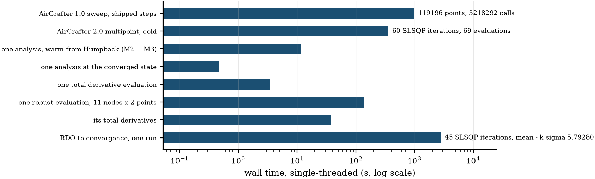
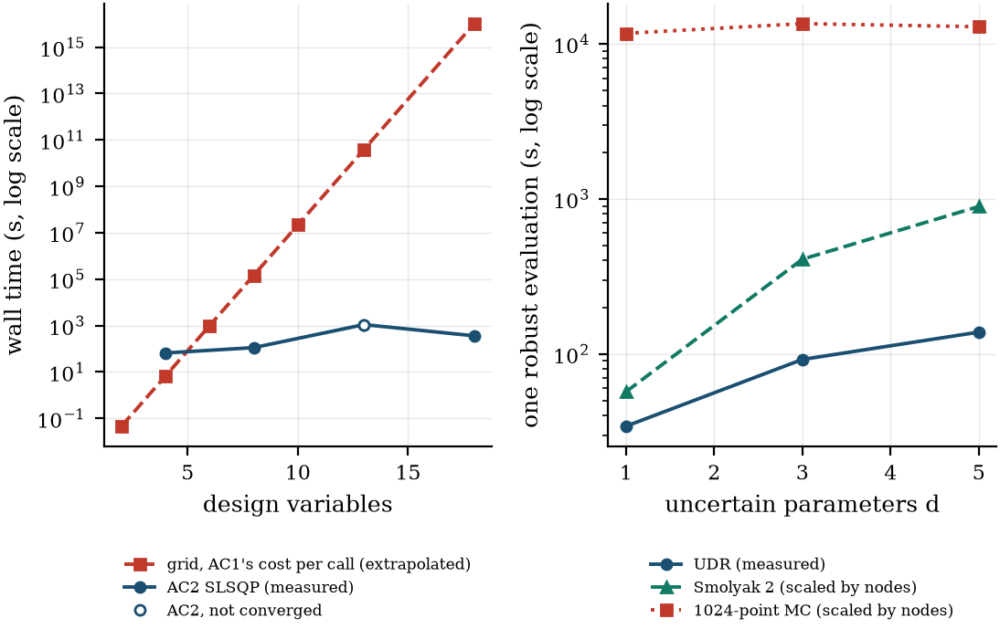

# Computational performance: AirCrafter 1.0 and AirCrafter 2.0 (2025-26 problem)

Generated by `studies/compute_performance_2026_report.py` (page commit `75072b4`); timings at 0a6527d, on a clean committed tree, from `outputs/results_2026/perf/`; every number is read from `compute_performance_2026.json`. **Machine:** AMD Ryzen 7 6800HS with Radeon Graphics, 16 logical cores, 14 GB RAM, Linux 7.3.0-4-cachyos, power profile performance; Python 3.14.8, OpenMDAO 3.45.0, numpy 2.5.2, scipy 1.18.0; MATLAB 26.1.0.3312084 (R2026a) Update 4. The main table is single-threaded (OMP, OPENBLAS and MKL threads = 1; MATLAB -singleCompThread), each measurement its own process, nothing else computing (the desktop session stayed open). Mean [min-max] over the repeats. The session was paused once between measurements, and the interrupted repeat was discarded (docs/development/RESULTS_LOG.md). **The two codes evaluate different things:** AirCrafter 1.0 a closed-form mission estimate per grid point, AirCrafter 2.0 a coupled analysis with analytic derivatives. So wall time and evaluation count are given side by side, never one speed-up.

## 1. Main table (single-threaded)

| measurement | wall (s) | repeats | notes |
|---|---:|---:|---:|
| AirCrafter 1.0 sweep, shipped steps | 999 [989-1005] | 3 | 119196 points, 3218292 calls |
| AirCrafter 2.0 multipoint, cold | 361 [359-363] | 3 | 60 SLSQP iterations, 69 evaluations |
| one analysis, warm from Humpback (M2 + M3) | 11.5 [11.4-11.6] | 3 |  |
| one analysis at the converged state | 0.465 [0.462-0.469] | 3 |  |
| one total-derivative evaluation | 3.44 [3.43-3.47] | 3 |  |
| one robust evaluation, 11 nodes x 2 points | 138 [138-139] | 3 |  |
| its total derivatives | 38 [38-38.1] | 3 |  |
| RDO to convergence, one run | 2826 [2826-2826] | 1 | 45 SLSQP iterations, mean - k sigma 5.79280 |

AirCrafter 1.0 costs 0.31 ms per mission evaluation (0.43 ms in the planning estimate, re-measured). One AirCrafter 2.0 optimisation takes 6.0 min and 138 MDA solves. The sweep takes 16.6 min. Peak memory 0.77 GB.

RDO, one clean run: 0.79 h, peak 2.50 GB (same start as `fr_rdo_mdo`).

## 2. Every campaign run

From the run JSONs, measured during the campaign: 3 threads, up to 3 jobs at once, so the wall times are not clean. nit = SLSQP iterations, its = objective evaluations, grads = total-derivative evaluations.

| run | converged | wall (s) | nit | its | grads | model runs | MDA solves | Newton its | continuations | threads | peak (GB) | error |
|---|---:|---:|---:|---:|---:|---:|---:|---:|---:|---:|---:|---:|
| check | True | 308 | 51 | 59 | 51 | 60 | 118 | 419 | 2 | 3 | 0.77 |  |
| 8S_18x10E_22x12E | True | 325 | 53 | 63 | 53 | 64 | 126 | 360 | 0 | 3 | 0.75 |  |
| 8S_18x10E_18x12E | True | 326 | 54 | 61 | 54 | 62 | 122 | 353 | 0 | 3 | 0.77 |  |
| 8S_18x10E_19x12E | True | 366 | 58 | 67 | 58 | 68 | 134 | 426 | 1 | 3 | 0.77 |  |
| 8S_19x10E_18x12E | True | 334 | 56 | 63 | 56 | 64 | 126 | 359 | 0 | 3 | 0.75 |  |
| 8S_19x10E_19x12E | True | 343 | 56 | 64 | 56 | 65 | 128 | 398 | 1 | 3 | 0.78 |  |
| 8S_19x10E_22x12E | True | 314 | 53 | 61 | 53 | 62 | 122 | 339 | 0 | 3 | 0.74 |  |
| 8S_19x12E_18x12E | True | 344 | 55 | 62 | 55 | 63 | 124 | 399 | 1 | 3 | 0.76 |  |
| 8S_19x12E_19x12E | True | 334 | 51 | 59 | 51 | 60 | 118 | 419 | 2 | 3 | 0.77 |  |
| 8S_19x12E_22x12E | True | 367 | 60 | 69 | 60 | 70 | 138 | 425 | 1 | 3 | 0.78 |  |
| 6S_19x12E_22x12E | False | 17 | None | 0 | 0 | 1 | 2 | 64 | 0 | 3 | 0.58 | MDA non-convergence: Solver 'NL: Newton' on system |
| 8S_19x12E_22x12E_int_72p23c | True | 147 | 23 | 31 | 23 | 33 | 64 | 204 | 1 | 3 | 0.74 |  |
| 8S_19x12E_22x12E_int_71p23c | True | 162 | 26 | 34 | 26 | 36 | 70 | 206 | 1 | 3 | 0.83 |  |
| 8S_19x12E_22x12E_int_72p24c | True | 19 | 1 | 2 | 1 | 4 | 6 | 47 | 1 | 3 | 0.83 |  |
| wind | True | 333 | 51 | 63 | 51 | 64 | 126 | 408 | 1 | 3 | 0.77 |  |
| wind_int_71p23c | True | 184 | 30 | 37 | 30 | 39 | 76 | 206 | 1 | 3 | 0.75 |  |
| wind_int_72p24c | True | 30 | 1 | 6 | 1 | 8 | 14 | 81 | 1 | 3 | 0.81 |  |
| M2only | True | 44 | 4 | 8 | 4 | 10 | 18 | 95 | 1 | 3 | 0.65 |  |
| M3only | True | 65 | 8 | 12 | 8 | 14 | 26 | 117 | 1 | 3 | 0.71 |  |
| norm_NI0.5 | True | 68 | 8 | 13 | 8 | 15 | 28 | 126 | 1 | 3 | 0.73 |  |
| norm_NI2 | True | 152 | 26 | 27 | 26 | 29 | 56 | 179 | 1 | 3 | 0.77 |  |
| norm_B0.5 | True | 44 | 4 | 8 | 4 | 10 | 18 | 95 | 1 | 3 | 0.65 |  |
| norm_B2 | True | 55 | 6 | 11 | 6 | 13 | 24 | 103 | 1 | 3 | 0.65 |  |
| bound_i | True | 223 | 37 | 45 | 37 | 47 | 92 | 260 | 1 | 3 | 0.75 |  |
| ac1_completed | True | 220 | 37 | 45 | 37 | 47 | 92 | 252 | 0 | 3 | 0.77 |  |
| bound_ii | True | 181 | 31 | 36 | 31 | 38 | 74 | 196 | 1 | 3 | 0.75 |  |
| old_constraints | True | 18 | 1 | 2 | 1 | 4 | 6 | 47 | 1 | 3 | 0.57 |  |
| bound_iii | True | 226 | 38 | 45 | 38 | 47 | 92 | 253 | 1 | 3 | 0.77 |  |
| takeoff_off | True | 230 | 39 | 57 | 39 | 59 | 116 | 287 | 1 | 3 | 0.76 |  |
| ms1 | False | 44 | None | 0 | 0 | 2 | 3 | 161 | 1 | 3 | 0.57 | MDA non-convergence: Solver 'NL: Newton' on system |
| ms2 | False | 38 | None | 0 | 0 | 2 | 3 | 134 | 1 | 3 | 0.56 | MDA non-convergence: Solver 'NL: Newton' on system |
| ms0 | True | 384 | 62 | 76 | 62 | 78 | 154 | 475 | 1 | 3 | 0.75 |  |
| ms3 | True | 330 | 56 | 66 | 56 | 68 | 134 | 368 | 0 | 3 | 0.76 |  |
| ms5 | False | 37 | None | 0 | 0 | 2 | 3 | 129 | 1 | 3 | 0.56 | MDA non-convergence: Solver 'NL: Newton' on system |
| ms6 | False | 42 | None | 0 | 0 | 2 | 3 | 145 | 1 | 3 | 0.56 | MDA non-convergence: Solver 'NL: Newton' on system |
| ms4 | True | 371 | 59 | 72 | 59 | 74 | 146 | 471 | 2 | 3 | 0.75 |  |
| ms7 | True | 390 | 66 | 77 | 66 | 79 | 156 | 440 | 0 | 3 | 0.76 |  |
| ms8 | True | 440 | 70 | 86 | 70 | 88 | 174 | 563 | 2 | 3 | 0.76 |  |
| rdo_mdo | True | 2900 | 45 | 51 | 45 | 53 | 1144 | 3178 | 11 | 3 | 2.14 |  |
| ms9 | True | 297 | 47 | 54 | 47 | 56 | 110 | 377 | 2 | 3 | 0.75 |  |
| rdo_humpback | False | 252 | None | 5 | 1 | 6 | 113 | 652 | 9 | 3 | 1.86 | wind limit (lap_invalid): 'nodes.n1.points.M2.lap' |
| rdo_second | True | 2388 | 38 | 43 | 38 | 45 | 968 | 2812 | 11 | 3 | 2.06 |  |
| rdo_mdo_int_74p24c | False | 993 | 15 | 20 | 16 | 22 | 462 | 1211 | 1 | 3 | 2.37 |  |
| rdo_mdo_int_73p24c | False | 1009 | 15 | 20 | 16 | 22 | 462 | 1252 | 2 | 3 | 2.50 |  |
| rdo_mdo_int_75p25c | False | 947 | 15 | 20 | 16 | 22 | 462 | 1007 | 0 | 3 | 2.56 |  |
| bound_banner | True | 109 | 16 | 22 | 16 | 24 | 46 | 143 | 1 | 3 | 0.75 |  |
| 6S_19x12E_22x12E_kv270 | True | 293 | 48 | 57 | 48 | 58 | 114 | 372 | 1 | 3 | 0.77 |  |
| rdo_mdo_int_75p25c_conv | True | 2743 | 47 | 59 | 47 | 61 | 1320 | 2850 | 1 | 3 | 2.26 |  |
| perf_rdo | True | 2826 | 45 | 51 | 45 | 53 | 1144 | 3167 | 11 | 1 | 2.50 |  |

**Monte Carlo runs** (in batches of 384 samples on fresh workers; a first run in one pool lost 17-30 % of its samples to a worker failure, not a response to the sample: docs/development/RESULTS_LOG.md, Decision 13):

| run | wall (min) | workers | converged | MDA failures | wind limits | recovered | peak (GB, parent) |
|---|---:|---:|---:|---:|---:|---:|---:|
| in_humpback | 13.8 | 3 | 1024/1024 | 0 | 0 | 0 | 0.43 |
| in_humpback_loo | 15.7 | 3 | 1024/1024 | 0 | 0 | 0 | 0.43 |
| in_ac1_direct | 14.9 | 3 | 1024/1024 | 0 | 0 | 0 | 0.43 |
| in_ac1_completed | 14.3 | 3 | 1024/1024 | 0 | 0 | 0 | 0.43 |
| in_mdo | 21.3 | 3 | 1024/1024 | 0 | 0 | 0 | 0.43 |
| in_mdo_wind | 15.0 | 3 | 1024/1024 | 0 | 0 | 0 | 0.43 |
| in_rdo | 14.9 | 3 | 1024/1024 | 0 | 0 | 0 | 0.43 |
| out_humpback | 15.0 | 3 | 1024/1024 | 0 | 0 | 0 | 0.43 |
| out_mdo | 15.9 | 3 | 1024/1024 | 0 | 0 | 0 | 0.43 |
| out_mdo_wind | 16.2 | 3 | 1024/1024 | 0 | 0 | 0 | 0.43 |
| out_rdo | 15.8 | 3 | 1024/1024 | 0 | 0 | 0 | 0.43 |

## 3. Scaling

### RDO cost against d

One robust evaluation at the MDO design (a first pass moves every node from Humpback's converged state). UDR is measured; Smolyak and Monte Carlo are the measured cost per node times their node counts (scaled, not measured). A node is an M2 + M3 pair.

| d | active | UDR nodes | Smolyak level 2 nodes | MC nodes | UDR wall (s, measured) | s per node | Smolyak (s, scaled) | 1024-point MC (s, scaled) | UDR derivatives (s, measured) |
|---|---:|---:|---:|---:|---:|---:|---:|---:|---:|
| 1 | lap.wind | 3 | 5 | 1024 | 34.2 | 11.4 | 57 | 11670 | 10.5 |
| 3 | lap.wind, f_build, banner_drag_factor | 7 | 31 | 1024 | 92.1 | 13.2 | 408 | 13477 | 23.8 |
| 5 | lap.wind, f_build, banner_drag_factor, lap.wind_dir, m_avionics | 11 | 71 | 1024 | 138.2 | 12.6 | 892 | 12867 | 38.0 |

### A grid against the gradient

AirCrafter 1.0's grid: points = the product of the steps. At its measured 0.31 ms per call and the shipped grid's geometric mean of 12.2 steps per axis, a grid in n variables costs 12.2^n calls. **Only n = 6 is measured; every other row is an extrapolation.**

| n | calls | grid wall (s) | status |
|---|---:|---:|---:|
| 2 | 148 | 0.0458 | extrapolated |
| 4 | 2.18e+04 | 6.76 | extrapolated |
| 6 | 3.22e+06 | 999 | measured |
| 8 | 4.75e+08 | 1.47e+05 | extrapolated |
| 10 | 7.02e+10 | 2.18e+07 | extrapolated |
| 13 | 1.26e+14 | 3.91e+10 | extrapolated |
| 18 | 3.33e+19 | 1.03e+16 | extrapolated |

AirCrafter 2.0, with the other design variables pinned at the MDO design (cold in the free variables), measured:

| free design variables | wall (s) | nit | its | F reached | converged |
|---|---:|---:|---:|---:|---:|
| 4 | 65.8 | 8 | 13 | 5.9775 | True |
| 8 | 111.9 | 17 | 24 | 5.9775 | True |
| 13 | 1100.3 | 100 | 746 | 5.9776 | False |
| 18 | 361.2 | 60 | 69 | 5.9775 | True |

The 13-variable run did not report convergence after 100 iterations (746 evaluations, F 5.9776), so its wall time isn't a converged cost and this scaling isn't monotonic: the count of free variables isn't the only thing that sets the cost.

## 4. Reliability

Converged = SLSQP reports success. An analysis failure is the MDA failing or the lap model stopping, counted apart; it's not infeasibility.

| kind of run | converged | analysis failures | which |
|---|---:|---:|---:|
| enumeration | 10/11 | 1 | 6S_19x12E_22x12E: MDA non-convergence: Solver 'NL: Newton' on system 'points.M |
| other deterministic runs | 20/20 | 0 | – |
| multistart | 6/10 | 4 | ms1: MDA non-convergence: Solver 'NL: Newton' on system 'points.M; ms2: MDA non-convergence: Solver 'NL: Newton' on system 'points.M; ms5: MDA non-convergence: Solver 'NL: Newton' on system 'points.M; ms6: MDA non-convergence: Solver 'NL: Newton' on system 'points.M |
| RDO starts | 2/3 | 1 | rdo_humpback: wind limit (lap_invalid): 'nodes.n1.points.M2.lap' <class Sm |
| robust rounding (stopped at maxiter 15 counts as not converged) | 1/4 | 0 | – |
| Monte Carlo samples | 11264/11264 | 0 MDA, 0 lap-model limit | counted apart from constraint violations |

