# 2025-26 results: Humpback, AirCrafter 1.0, MDO and MDO + RDO

Generated by `studies/results_2026_report.py` (page commit `75072b4`) from the runs at the freeze tag `results-2026-final` (`0a6527d`), `outputs/results_2026/runs/fr_*.json` and `mc/`. Every number below is read from `docs/studies/results_2026/results_2026.json`. Provenance: 91 run files, 0 not at the freeze commit. Configs: `configs/dbf2026_multipoint.yaml`, `configs/dbf2026_multipoint_rdo.yaml`, `configs/humpback_2026.yaml`, `configs/mass_usyd_loo_humpback.yaml`, `configs/rulesets/dbf_2025_26.yaml`, `configs/placeholders.yaml`.

**Biases stated up front.**

- **In-sample is not validation.** Humpback's column here uses the calibrated factors, fitted with it; the out-of-sample check is `validation_2026.md`, and its factors are the second Humpback column.
- **The common evaluation is AirCrafter 2.0's own model, so it favours AirCrafter 2.0's own optima.** AirCrafter 1.0's design is judged by a model it wasn't designed in. The Monte Carlo favours RDO by construction: it optimised a statistic of the same model over the same parameters. The out-of-set Monte Carlo (§2.5) is the check on that.
- **Analysis failures are not infeasibility.** MDA failures and wind limits are counted apart everywhere, and never as constraint violations.
- **A bound-driven optimum is bound-driven.** Active PLACEHOLDER bounds are marked in §3, and their effect is measured in §5.3.
- **The model flies Humpback's test laps too fast,** M3 by 20-46 % (validation_2026.md), and its M2 and M3 laps set F. F is a comparison inside this model, not a prediction of a competition score.
- **F leaves out the Ground Mission** (Q53) and uses PLACEHOLDER normalisations (Q52). Scores: optimised on continuous laps and the smooth cap; the capped, uncapped and floored (completed laps, hard cap) values are all reported.

## Findings

1. **Best propulsion case: 8S_19x12E_22x12E.** After payload rounding (MDO): F = 5.9775 capped, 5.9806 uncapped, 5.8588 floored, with M2 1.9998, M3 2.9777, 72 passengers, 24 cargo, a 275 in banner.
2. The enumeration's spread is 0.0607 in F over 10 converged cases (8S_19x12E_22x12E first, 6S_19x12E_22x12E_kv270 last); 1 did not converge.
3. **Against Humpback as built (5.2845 in the same model):** MDO gains +0.6930, through payload (42/14 to 72/24) and banner (197 to 275 in). The common evaluation is AirCrafter 2.0's own model, so it favours this; and the Ground Mission, which grows with the counts, isn't in F (Q53).
4. **Against AirCrafter 1.0's selection in the same model:** direct (a) 5.4883, completed (b) 5.6579, MDO 5.9775: +0.3196 over (b), the like-for-like comparison (the same model, optimised around AirCrafter 1.0's span, chord, counts and banner).
5. **What robustness costs.** Nominal F: -0.0057 from designing at the mean wind, -0.0357 from robustness itself. Monte Carlo mean: +0.0061 and -0.0007. Sigma: 0.1175 (MDO) to 0.0833 (RDO). P(any violation): 0.071 to 0.137 to 0.000. RDO's gain is in variance and feasibility, not the mean: 73 of 1024 MDO samples sit on the sub-stall balance, and without them MDO's mean is 5.8785 against RDO's 5.8737. On the floored score (completed laps, hard cap) the order reverses: RDO 5.9120, MDO 5.8588.
6. **Multistart (10 Sobol' starts):** 6 converge feasibly, to 1 distinct optimum/optima (F within 0.001): F 5.9775–5.9775 (6). The default start's F is 5.9775. The others: ms1: MDA non-convergence: Solver 'NL: Newton' on system 'points.M2.mda' fai; ms2: MDA non-convergence: Solver 'NL: Newton' on system 'points.M2.mda': re; ms5: MDA non-convergence: Solver 'NL: Newton' on system 'points.M2.mda': re; ms6: MDA non-convergence: Solver 'NL: Newton' on system 'points.M2.mda': re.
7. **The bound-driven part.** (i) c <= 0.60 m and camber_scale <= 2.5: ΔF +0.0198. (ii) V_h >= 0.50, V_v >= 0.04 (Raymer 6th ed., Table 6.4, p. 160, homebuilt): ΔF -0.0108. (iii) V_h >= 0.66 ([OH]), V_v >= 0.059 ([W]), the lowest flown: ΔF -0.0211. (added) banner <= 500 in, AirCrafter 1.0's grid limit ([HB] Table 7), against the 275 in the team built (Q56): ΔF +0.0008.
8. **Propagation at the robust optimum:** mean of F 5.8751 (UDR), 5.8740 (Smolyak), 5.8737 (Sobol'); sigma 0.0836, 0.0849, 0.0833.
9. **Analysis failures are counted apart from violations:** in-set Monte Carlo, MDA failures / lap-model limits out of N: Humpback 0 / 0 of 1024; MDO 0 / 0 of 1024; MDO, mean wind 0 / 0 of 1024; MDO + RDO 0 / 0 of 1024. A first run lost 17-30 % of its samples to a worker failure, not to the design (docs/development/RESULTS_LOG.md, Decision 13), and was replaced.
10. **Banner drag at fixed throttle:** across the 4 C_D,b values re-analysed, MDO loses level flight or a constraint at 3 and RDO at 0 (§5.4). MDO's limit on the placeholder banner bound leaves it no margin on M3's low-speed balance.
11. **Where this differs from 2024-25 (Appendix A).** There the multipoint gain over the as-built aircraft was small (Woombah 5.1020, MDO 5.0993) and the optimum was tank-limited on M2; here MDO is +0.6930 over Humpback, and M2 sits at the score's cap, so the cap and the fuselage's payload law set the payload. There robustness cost 0.0007 in nominal F and took the largest P(violation) from 0.621 to 0.016; here it costs 0.0413 and takes P(any) from 0.071 to 0.000.

## 1. The designs compared

| design | F capped | F uncapped | F floored | M2 | M3 | M2 laps | M3 laps | MC mean | MC sigma | mean - k sigma | P(any violation) | MDA failures / wind limits |
|---|---:|---:|---:|---:|---:|---:|---:|---:|---:|---:|---:|---:|
| Humpback | 5.2845 | 5.2845 | 5.1948 | 1.5479 | 2.7366 | 8.25 | 5.59 | 5.2672 | 0.0486 | 5.2186 | 0.293 | 0 / 0 |
| AC1 direct (a) | 5.4883 | 5.4883 | 5.3000 | 1.5967 | 2.8916 | 7.82 | 5.94 | 5.4196 | 0.0931 | 5.3264 | 0.046 | 0 / 0 |
| AC1 completed (b) | 5.6579 | 5.6579 | 5.5839 | 1.6910 | 2.9670 | 9.12 | 6.44 | 5.5889 | 0.0843 | 5.5046 | 0.354 | 0 / 0 |
| MDO | 5.9775 | 5.9806 | 5.8588 | 1.9998 | 2.9777 | 8.69 | 5.33 | 5.8683 | 0.1175 | 5.7507 | 0.071 | 0 / 0 |
| MDO, mean wind | 5.9718 | 5.9810 | 5.8385 | 2.0000 | 2.9718 | 8.73 | 5.44 | 5.8743 | 0.1094 | 5.7650 | 0.137 | 0 / 0 |
| MDO + RDO | 5.9362 | 5.9735 | 5.9120 | 2.0000 | 2.9362 | 8.37 | 6.16 | 5.8737 | 0.0833 | 5.7904 | 0.000 | 0 / 0 |

What each method claims in its own model: AirCrafter 1.0's selected design 5.3005 (M2 1.550, M3 2.750; source: this campaign, shipped steps). USYD's official 2026 result: M1 + M2 + M3 = 5.06 (M2 1.54, M3 2.52, GM 0.01; [RES26] 2026 DBF Competition Summary (USYD, rank 14)), against Humpback's 5.2845 in the model: the model's gap, not a method's.

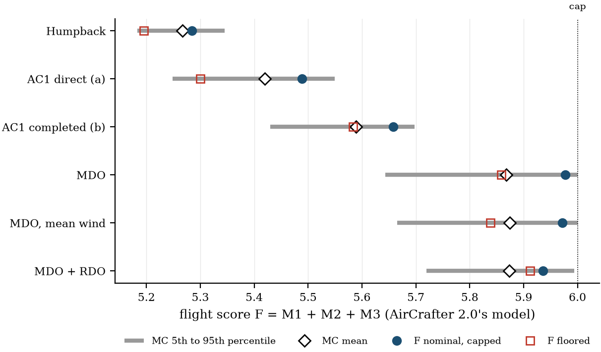

## 2. Common evaluation

### 2.1 The AirCrafter 1.0 mappings

AirCrafter 1.0 run: this campaign, shipped steps (`outputs/results_2026/ac1/fr_ac1_2026_shipped.json`); 119196 grid points, 3218292.0 mission evaluations, 1463 feasible. Selected: m 8.7 kg, b 1.52 m, AR 4, 45/15, banner 225 in, battery fraction 0.8, V 27 / 17 m/s, props 18x10E / 22x12E. Mapping (a) throttle notes: {'M2': '', 'M3': ''}.

| item | mapping (a), direct | mapping (b), completed |
|---|---:|---:|
| span b | AirCrafter 1.0 | AirCrafter 1.0 |
| chord c | AirCrafter 1.0 (b / AR) | AirCrafter 1.0 (b / AR) |
| payload counts n_p, n_c | AirCrafter 1.0 (bundles of 3 + 1) | AirCrafter 1.0 (bundles of 3 + 1) |
| banner length | AirCrafter 1.0 | AirCrafter 1.0 |
| props per mission | AirCrafter 1.0 (propSelector's minimum-power row) | AirCrafter 1.0 (the same) |
| M2 battery | AirCrafter 1.0 (fraction x 100 Wh) | AirCrafter 2.0 optimises capacity_M2 |
| M3 battery | the full 100 Wh (AirCrafter 1.0's M3) | AirCrafter 2.0 optimises capacity_M3 |
| throttle per mission | matches AirCrafter 1.0's cruise speed (within 0.5-1) | AirCrafter 2.0 optimises |
| airfoil | seed S3016, unscaled | AirCrafter 2.0 optimises tc_scale, camber_scale |
| tails S_ht, S_vt, arm l_ht | rule: V_h 0.575, V_v 0.05 (band middles), l_ht 1.1 m | AirCrafter 2.0 optimises |
| motor Kv | 245 rpm/V (AT7215 as flown) | AirCrafter 2.0 optimises |
| wing, battery stations | Humpback's | AirCrafter 2.0 optimises |
| masses | AirCrafter 2.0's model (AirCrafter 1.0's mass is not imposed) | AirCrafter 2.0's model |

### 2.2 Nominal

| design | M2 laps | M3 laps | violated | M1 check | M1 laps | continuations | F at mean wind | at the cap |
|---|---:|---:|---:|---:|---:|---:|---:|---:|
| Humpback | 8.25 | 5.59 | none | pass, SM 0.464 | 9.64 | 0 / 0 | 5.2789 | none |
| AC1 direct (a) | 7.82 | 5.94 | none | pass, SM 0.423 | 9.00 | 0 / 1 | 5.4479 | none |
| AC1 completed (b) | 9.12 | 6.44 | none | pass, SM 0.423 | 9.18 | 0 / 0 | 5.6200 | none |
| MDO | 8.69 | 5.33 | none | pass, SM 0.440 | 8.88 | 0 / 1 | 5.9225 | M2 |
| MDO, mean wind | 8.73 | 5.44 | none | pass, SM 0.471, SM_high | 8.94 | 0 / 1 | 5.9213 | M2 |
| MDO + RDO | 8.37 | 6.16 | none | pass, SM 0.414 | 8.98 | 0 / 0 | 5.8997 | M2 |

| mass factors | F capped | F floored | M2 | M3 | M2 take-off mass (kg) | empty mass (kg) | MC mean | MC sigma | P(any violation) |
|---|---:|---:|---:|---:|---:|---:|---:|---:|---:|
| Humpback | 5.2845 | 5.1948 | 1.5479 | 2.7366 | 7.625 | 4.059 | 5.2672 | 0.0486 | 0.293 |
| Humpback (LOO factors) | 5.2839 | 5.1948 | 1.5478 | 2.7361 | 7.638 | 4.072 | 5.2667 | 0.0485 | 0.323 |

**Every constraint's margin:**

| constraint | Humpback | AC1 direct (a) | AC1 completed (b) | MDO | MDO, mean wind | MDO + RDO |
|---|---:|---:|---:|---:|---:|---:|
| M2.stall_margin | 21.48 | 10.03 | 15.06 | 15.25 | 15.42 | 13.96 |
| M2.turn_speed_margin | 13.82 | 6.735 | 9.809 | 7.905 | 8.191 | 7.219 |
| M2.thrust_margin_static | 48.78 | 17.02 | 29.97 | 19.01 | 20.11 | 14.96 |
| M2.energy_margin | 1.748e+05 | 1.717e+05 | 1.33e+05 | 1.766e+05 | 1.745e+05 | 1.605e+05 |
| M2.rpm_margin | 1047 | 2491 | 1689 | 1783 | 1763 | 1968 |
| M2.I_margin | 8.66 | 36.98 | 27.17 | 22.27 | 22.02 | 25.49 |
| M2.v_fit_margin | 5.242 | 3.682 | 3.901 | 5.623 | 5.408 | 5.226 |
| M2.SM | 0.07885 | 0.06193 | 0.01261 | 0.1009 | 0.06811 | 0.06853 |
| M2.V_h | 0.004719 | 0.225 | -1.045e-11 | -1.922e-09 | -6.298e-11 | -2.298e-09 |
| M2.V_v | 0.002376 | 0.03 | -5.97e-13 | -1.098e-10 | -3.599e-12 | -1.313e-10 |
| M2.wall_ratio | 0.1278 | 0.1299 | 0.1312 | 0.153 | 0.1454 | 0.1435 |
| M2.r_tube | 0.008859 | 0.009257 | 0.009526 | 0.01626 | 0.01331 | 0.0127 |
| M2.cruise.cl_margin_sec | 1.414 | 1.326 | 1.448 | 1.515 | 1.47 | 1.459 |
| rules_M2.energy_margin_Wh | 2.32 | 20 | 29.78 | 3.982 | 5.109 | 11.21 |
| rules_M2.fuse_margin | 48.66 | 76.98 | 67.17 | 62.27 | 62.02 | 65.49 |
| rules_M2.fuse_margin_C | 278.7 | 247.3 | 204.4 | 286.7 | 282.6 | 265.4 |
| M3.stall_margin | 7.223 | 2.864 | 4.668 | 1.549 | 1.805 | 3.865 |
| M3.turn_speed_margin | 7.443 | 4.012 | 5.239 | 2.533 | 2.817 | 4.165 |
| M3.thrust_margin_static | 41.38 | 25.03 | 33.45 | 15.32 | 17.62 | 26.44 |
| M3.energy_margin | 1.317e+05 | 1.641e+05 | 1.574e+05 | 1.298e+05 | 1.325e+05 | 1.505e+05 |
| M3.rpm_margin | 1259 | 2301 | 2086 | 2190 | 2170 | 2100 |
| M3.I_margin | 15.2 | 31.03 | 26.68 | 28.34 | 27.98 | 26.88 |
| M3.v_fit_margin | 16.05 | 13.5 | 14.25 | 16.4 | 16.15 | 14.6 |
| M3.SM | 0.04472 | 0.09597 | 0.1092 | 0.09377 | 0.06683 | 0.1063 |
| M3.V_h | 0.004719 | 0.225 | -1.045e-11 | -1.922e-09 | -6.298e-11 | -2.298e-09 |
| M3.V_v | 0.002376 | 0.03 | -5.97e-13 | -1.098e-10 | -3.599e-12 | -1.313e-10 |
| M3.wall_ratio | 0.1278 | 0.1299 | 0.1312 | 0.153 | 0.1454 | 0.1435 |
| M3.r_tube | 0.008859 | 0.009257 | 0.009526 | 0.01626 | 0.01331 | 0.0127 |
| M3.cruise.cl_margin_sec | 1.277 | 1.231 | 1.383 | 1.455 | 1.386 | 1.399 |
| rules_M3.energy_margin_Wh | 2.32 | 0 | 0 | 0 | 0 | 0 |
| rules_M3.fuse_margin | 55.2 | 71.03 | 66.68 | 68.34 | 67.98 | 66.88 |
| rules_M3.fuse_margin_C | 285.2 | 308.9 | 304.5 | 306.2 | 305.8 | 304.7 |
| rules.togw_margin | 17.32 | 17.12 | 17.28 | 13.65 | 13.83 | 13.57 |
| rules.pax_margin | 0 | 0 | 0 | -1.421e-14 | -1.421e-14 | 0 |
| rules.fuselage_margin | 1.257 | 1.219 | 1.219 | 0.5877 | 0.5877 | 0.517 |
| M2.batt_fwd_margin | 0.0824 | 0.1142 | 0.1142 | 0.4181 | 0.4442 | 0.4216 |
| M2.batt_aft_margin | 0.9998 | 1.039 | 1.039 | 1.372 | 1.346 | 1.439 |
| M3.batt_fwd_margin | 0.0824 | 0.1142 | 0.1142 | 0.4899 | 0.5079 | 0.5299 |
| M3.batt_aft_margin | 0.9998 | 1.039 | 1.039 | 1.3 | 1.282 | 1.331 |
| M2.tail_margin | 0.4951 | 0.4639 | 0.2661 | 0.05663 | 0.09724 | 0.0228 |

### 2.3 In-set Monte Carlo

These Monte Carlos ran in batches of 384 samples, each on fresh workers (`studies/results_2026_mc_batched.py`), with the frozen model and study code. A first run in one pool lost 17-30 % of its samples to a failure that depends on how many evaluations a worker has done, not on the sample (docs/development/RESULTS_LOG.md, Decision 13); on the samples both runs converged, F agrees to 2e-12.

| design | converged | mean | sigma | mean - k sigma | 5th pct | 95th pct | M2 mean | M3 mean | P(any violation) | MDA failures | wind limits | recovered from nominal | wall (min) |
|---|---:|---:|---:|---:|---:|---:|---:|---:|---:|---:|---:|---:|---:|
| Humpback | 1024/1024 | 5.2672 | 0.0486 | 5.2186 | 5.1830 | 5.3452 | 1.5538 | 2.7134 | 0.293 | 0 | 0 | 0 | 13.8 |
| Humpback (LOO factors) | 1024/1024 | 5.2667 | 0.0485 | 5.2181 | 5.1825 | 5.3446 | 1.5537 | 2.7129 | 0.323 | 0 | 0 | 0 | 15.7 |
| AC1 direct (a) | 1024/1024 | 5.4196 | 0.0931 | 5.3264 | 5.2489 | 5.5496 | 1.5887 | 2.8309 | 0.046 | 0 | 0 | 0 | 14.9 |
| AC1 completed (b) | 1024/1024 | 5.5889 | 0.0843 | 5.5046 | 5.4299 | 5.6978 | 1.6838 | 2.9051 | 0.354 | 0 | 0 | 0 | 14.3 |
| MDO | 1024/1024 | 5.8683 | 0.1175 | 5.7507 | 5.6437 | 6.0000 | 1.9873 | 2.8810 | 0.071 | 0 | 0 | 0 | 21.3 |
| MDO, mean wind | 1024/1024 | 5.8743 | 0.1094 | 5.7650 | 5.6659 | 6.0000 | 1.9909 | 2.8834 | 0.137 | 0 | 0 | 0 | 15.0 |
| MDO + RDO | 1024/1024 | 5.8737 | 0.0833 | 5.7904 | 5.7199 | 5.9943 | 1.9984 | 2.8753 | 0.000 | 0 | 0 | 0 | 14.9 |

| constraint | Humpback | Humpback (LOO factors) | AC1 direct (a) | AC1 completed (b) | MDO | MDO, mean wind | MDO + RDO |
|---|---:|---:|---:|---:|---:|---:|---:|
| M2.SM | 0.000 | 0.000 | 0.000 | 0.354 | 0.000 | 0.000 | 0.000 |
| M3.SM | 0.293 | 0.323 | 0.046 | 0.000 | 0.000 | 0.104 | 0.000 |
| M3.stall_margin | 0.000 | 0.000 | 0.000 | 0.000 | 0.071 | 0.033 | 0.000 |
| **any constraint** | 0.293 | 0.323 | 0.046 | 0.354 | 0.071 | 0.137 | 0.000 |

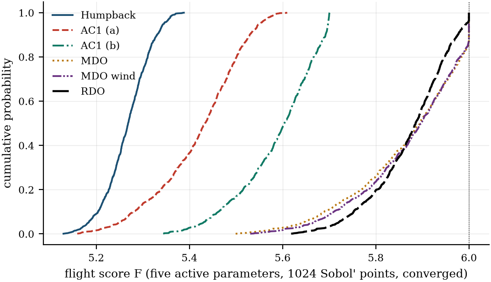

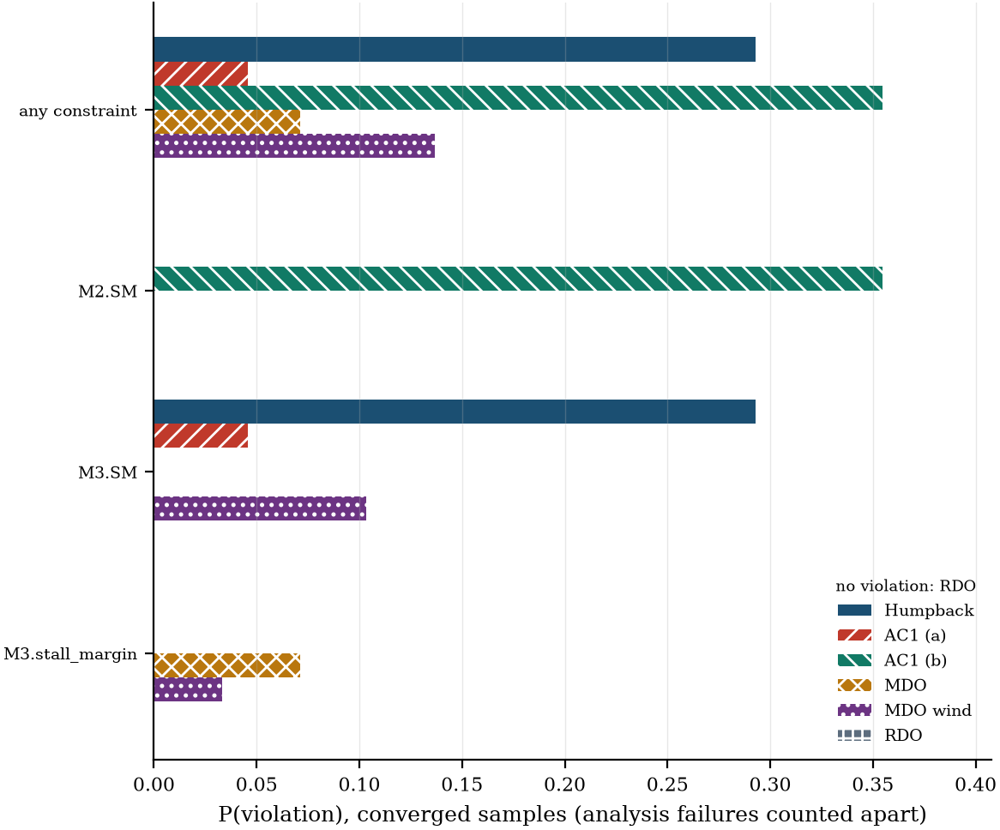

**Samples on the low-speed balance.** At a fixed throttle, a sample with enough drag or mass has no level-flight root above stall, and the T = D balance can land on the sub-stall root (docs/development/MDA_ROBUSTNESS_PLAN.md §0). Those samples converge, count as violations of the stall margin, and still carry an F from the lap model: Humpback 0/1024, mean of F without them 5.2672 (with 5.2672); AC1 direct (a) 0/1024, mean of F without them 5.4196 (with 5.4196); AC1 completed (b) 0/1024, mean of F without them 5.5889 (with 5.5889); MDO 73/1024, mean of F without them 5.8785 (with 5.8683); MDO, mean wind 34/1024, mean of F without them 5.8796 (with 5.8743); MDO + RDO 0/1024, mean of F without them 5.8737 (with 5.8737).

### 2.4 Propagation check

| quantity | UDR mean | UDR sigma | Smolyak mean | Smolyak sigma | Sobol' mean | Sobol' sigma | se(mean) |
|---|---:|---:|---:|---:|---:|---:|---:|
| flight_score | 5.8751 | 0.08357 | 5.874 | 0.08494 | 5.8737 | 0.08332 | 0.0026 |
| M2.stall_margin | 13.956 | 0.6148 | 13.956 | 0.6148 | 13.956 | 0.6151 | 0.0192 |
| M2.thrust_margin_static | 14.883 | 3.304 | 14.883 | 3.304 | 14.883 | 3.305 | 0.103 |
| M2.energy_margin | 1.6035e+05 | 3936 | 1.6037e+05 | 3974 | 1.6037e+05 | 3973 | 124 |
| M2.rpm_margin | 1967.9 | 2.923 | 1967.9 | 2.924 | 1967.9 | 2.925 | 0.0914 |
| M2.I_margin | 25.491 | 0 | 25.491 | 0 | 25.491 | 0 | 0 |
| M2.SM | 0.31976 | 0.02274 | 0.31976 | 0.02274 | 0.31976 | 0.02275 | 0.000711 |
| M2.wall_ratio | 0.056495 | 0 | 0.056495 | 2.281e-09 | 0.056495 | 3.791e-17 | 1.18e-18 |
| M2.r_tube | 0.017701 | 4.657e-10 | 0.017701 | 8.065e-10 | 0.017701 | 6.942e-18 | 2.17e-19 |
| M3.stall_margin | 3.8973 | 1 | 3.8972 | 1 | 3.8973 | 1.001 | 0.0313 |
| M3.thrust_margin_static | 26.351 | 4.643 | 26.35 | 4.649 | 26.35 | 4.651 | 0.145 |
| M3.energy_margin | 1.4124e+05 | 1.43e+04 | 1.414e+05 | 1.472e+04 | 1.4141e+05 | 1.467e+04 | 458 |
| M3.rpm_margin | 2099.3 | 7.154 | 2099.3 | 7.153 | 2099.3 | 7.156 | 0.224 |
| M3.I_margin | 26.883 | 9.537e-07 | 26.883 | 0 | 26.883 | 1.066e-14 | 3.33e-16 |
| M3.SM | 0.36826 | 0.04524 | 0.36826 | 0.04524 | 0.36826 | 0.04526 | 0.00141 |
| M3.wall_ratio | 0.056495 | 0 | 0.056495 | 2.281e-09 | 0.056495 | 3.791e-17 | 1.18e-18 |
| M3.r_tube | 0.017701 | 4.657e-10 | 0.017701 | 8.065e-10 | 0.017701 | 6.942e-18 | 2.17e-19 |

### 2.5 Out-of-set Monte Carlo

This shows whether the robustness is tuned to the five parameters RDO saw.

| parameter | set | mean | sigma | distribution | source | question |
|---|---:|---:|---:|---:|---:|---:|
| f_build | in set | 1.0000 | 0.1732 | uniform | USYD LOO | Q39 (USYD LOO) |
| f_tb | out of set | 3.2737 | 0.5670 | uniform | PLACEHOLDER | Q32 |
| m_avionics | in set | 0.2220 | 0.0192 | uniform | PLACEHOLDER | Q32 |
| lap.wind | in set | 5.0000 | 2.8868 | uniform | PLACEHOLDER | Q39 |
| lap.wind_dir | in set | 0.0000 | 17.3205 | uniform | Woodward 1998 | Q59 |
| banner_drag_factor | in set | 1.0000 | 0.1106 | uniform | HB Table 41 | Q56 ([HB] Table 41) |
| f_cb | out of set | 1.2708 | 0.2201 | uniform | PLACEHOLDER | Q32 (configs/uncertainty.yaml) |
| f_gear | out of set | 0.0302 | 0.0052 | uniform | PLACEHOLDER | Q32 (configs/uncertainty.yaml) |
| e_spec | out of set | 176.5000 | 10.1902 | uniform | PLACEHOLDER | Q32 (configs/uncertainty.yaml) |
| R_cell | out of set | 0.0050 | 0.0009 | uniform | PLACEHOLDER | Q32 (configs/uncertainty.yaml) |
| Kv_factor | out of set | 1.0000 | 0.0289 | uniform | PLACEHOLDER | Q32 (configs/uncertainty.yaml) |
| Rm_ref | out of set | 0.0200 | 0.0023 | uniform | PLACEHOLDER | Q32 (configs/uncertainty.yaml) |
| m_motor | out of set | 0.5550 | 0.0320 | uniform | PLACEHOLDER | Q32 (configs/uncertainty.yaml) |
| eta_h | out of set | 0.9000 | 0.0520 | uniform | PLACEHOLDER | Q32 (configs/uncertainty.yaml) |
| lap.thrust_factor | out of set | 1.0000 | 0.0577 | uniform | PLACEHOLDER | Q32 (configs/uncertainty.yaml) |
| a_ht | out of set | 1.1757 | 0.2036 | uniform | PLACEHOLDER | Q32 (±30 %, as f_ht) |
| a_vt | out of set | 1.3920 | 0.2411 | uniform | PLACEHOLDER | Q32 (±30 %, as f_vt) |

| design | converged | mean | sigma | mean - k sigma | 5th pct | 95th pct | M2 mean | M3 mean | P(any violation) | MDA failures | wind limits | recovered from nominal | wall (min) |
|---|---:|---:|---:|---:|---:|---:|---:|---:|---:|---:|---:|---:|---:|
| Humpback | 1024/1024 | 5.2686 | 0.0850 | 5.1836 | 5.1362 | 5.4087 | 1.5548 | 2.7138 | 0.305 | 0 | 0 | 0 | 15.0 |
| MDO | 1024/1024 | 5.8289 | 0.1366 | 5.6923 | 5.5868 | 6.0000 | 1.9717 | 2.8572 | 0.108 | 0 | 0 | 0 | 15.9 |
| MDO, mean wind | 1024/1024 | 5.8362 | 0.1275 | 5.7087 | 5.6068 | 6.0000 | 1.9761 | 2.8601 | 0.187 | 0 | 0 | 0 | 16.2 |
| MDO + RDO | 1024/1024 | 5.8430 | 0.0976 | 5.7453 | 5.6658 | 5.9848 | 1.9900 | 2.8529 | 0.021 | 0 | 0 | 0 | 15.8 |

| constraint | Humpback | MDO | MDO, mean wind | MDO + RDO |
|---|---:|---:|---:|---:|
| M2.I_margin | 0.006 | 0.000 | 0.000 | 0.000 |
| M2.SM | 0.049 | 0.000 | 0.002 | 0.000 |
| M2.thrust_margin_static | 0.000 | 0.000 | 0.000 | 0.002 |
| M3.SM | 0.301 | 0.024 | 0.124 | 0.020 |
| M3.energy_margin | 0.000 | 0.008 | 0.006 | 0.000 |
| M3.stall_margin | 0.000 | 0.084 | 0.062 | 0.000 |
| M3.thrust_margin_static | 0.000 | 0.028 | 0.017 | 0.000 |
| **any constraint** | 0.305 | 0.108 | 0.187 | 0.021 |

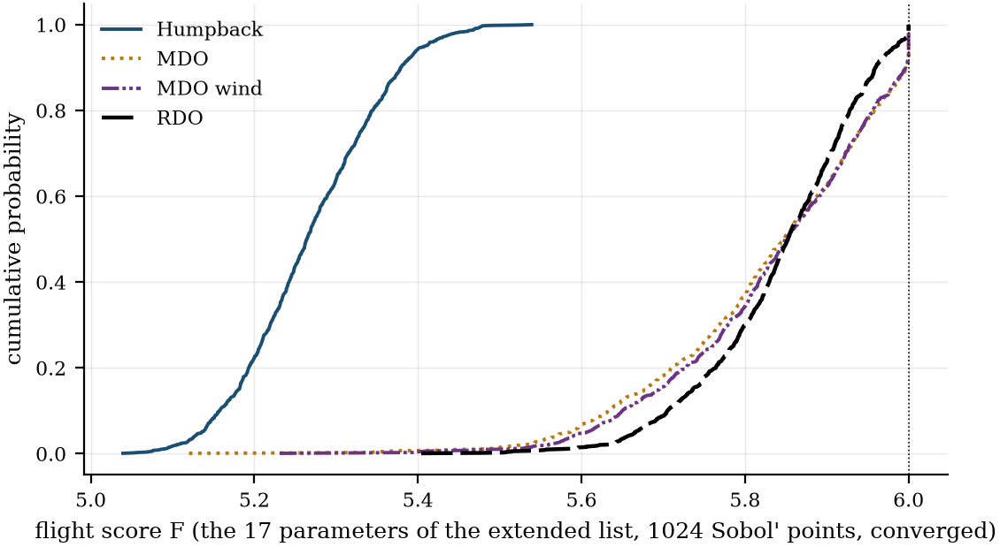

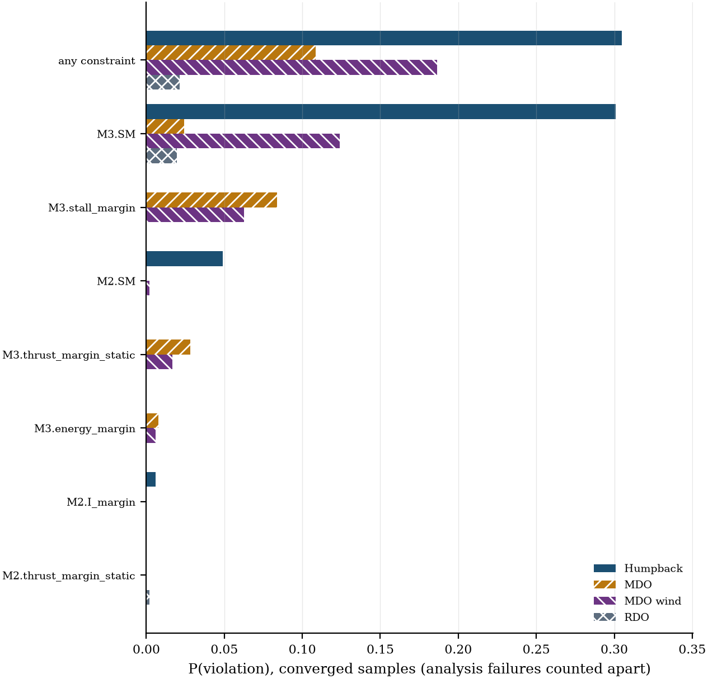

### 2.6 Wind

| direction (deg) | MDO limit (m/s) | stopped by | MDO + RDO limit (m/s) | stopped by |
|---|---:|---:|---:|---:|
| -30.0 | 12.42 | lap_invalid | 12.50 | lap_invalid |
| -22.5 | 12.42 | lap_invalid | 12.50 | lap_invalid |
| -15.0 | 12.42 | lap_invalid | 12.50 | lap_invalid |
| -7.5 | 12.42 | lap_invalid | 12.50 | lap_invalid |
| +0.0 | 12.42 | lap_invalid | 12.50 | lap_invalid |
| +7.5 | 12.42 | lap_invalid | 12.50 | lap_invalid |
| +15.0 | 12.42 | lap_invalid | 12.50 | lap_invalid |
| +22.5 | 12.42 | lap_invalid | 12.50 | lap_invalid |
| +30.0 | 12.42 | lap_invalid | 12.50 | lap_invalid |

| direction (deg) | Humpback | AC1 direct (a) | AC1 completed (b) | MDO | MDO, mean wind | MDO + RDO |
|---|---:|---:|---:|---:|---:|---:|
| -30.0 | 5.2795 | 5.4533 | 5.6252 | 5.9298 | 5.9281 | 5.9046 |
| -22.5 | 5.2793 | 5.4512 | 5.6231 | 5.9268 | 5.9253 | 5.9026 |
| -15.0 | 5.2791 | 5.4494 | 5.6214 | 5.9245 | 5.9232 | 5.9010 |
| -7.5 | 5.2790 | 5.4483 | 5.6204 | 5.9230 | 5.9218 | 5.9000 |
| +0.0 | 5.2789 | 5.4479 | 5.6200 | 5.9225 | 5.9213 | 5.8997 |
| +7.5 | 5.2790 | 5.4483 | 5.6204 | 5.9230 | 5.9218 | 5.9000 |
| +15.0 | 5.2791 | 5.4494 | 5.6214 | 5.9245 | 5.9232 | 5.9010 |
| +22.5 | 5.2793 | 5.4512 | 5.6231 | 5.9268 | 5.9253 | 5.9026 |
| +30.0 | 5.2795 | 5.4533 | 5.6252 | 5.9298 | 5.9281 | 5.9046 |

The upwind ground speed stays positive while v > w for every direction, so the limit barely depends on direction; F rises with |direction| because the along-course component falls (crosswind isn't checked: no directional-stability model, Q60).

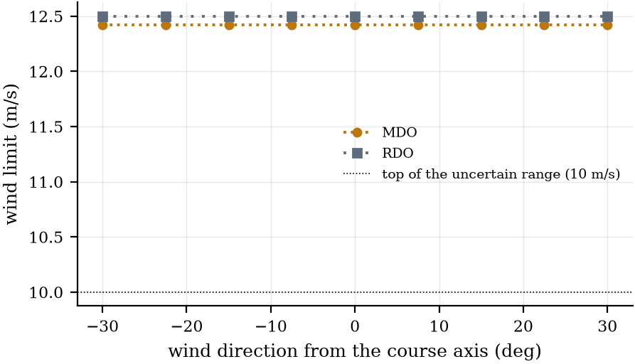

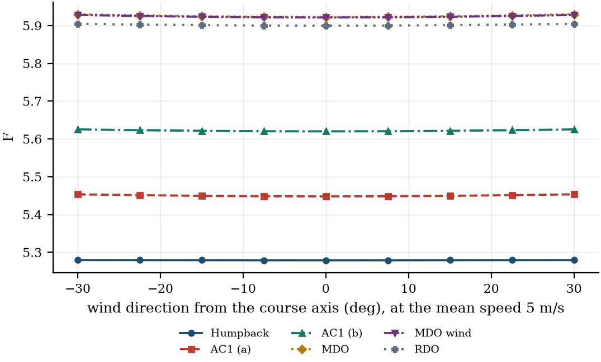

## 3. Why the designs differ

| quantity | Humpback | AC1 direct (a) | AC1 completed (b) | MDO | MDO, mean wind | MDO + RDO |
|---|---:|---:|---:|---:|---:|---:|
| span b (m) | 1.499 | 1.520 | 1.520 | 1.524 | 1.524 | 1.524 |
| chord c (m) | 0.370 | 0.380 | 0.380 | 0.450 | 0.450 | 0.450 |
| AR | 4.05 | 4.00 | 4.00 | 3.39 | 3.39 | 3.39 |
| wing area (m²) | 0.555 | 0.578 | 0.578 | 0.686 | 0.686 | 0.686 |
| t/c scale | 1.000 | 1.000 | 1.018 | 1.232 | 1.069 | 1.035 |
| camber scale | 1.000 | 1.000 | 1.594 | 2.000 | 1.707 | 1.616 |
| S_ht (m²) | 0.1484 | 0.1147 | 0.0857 | 0.1147 | 0.1120 | 0.1108 |
| vertical tail height / chord (m) | 0.297 / 0.198 | 0.245 / 0.163 | 0.171 / 0.114 | 0.182 / 0.122 | 0.180 / 0.120 | 0.179 / 0.120 |
| S_vt (m²) | 0.0587 | 0.0399 | 0.0196 | 0.0222 | 0.0217 | 0.0214 |
| tail arm l_ht (m) | 1.100 | 1.100 | 0.896 | 0.942 | 0.964 | 0.975 |
| V_h | 0.795 | 0.575 | 0.350 | 0.350 | 0.350 | 0.350 |
| V_v | 0.078 | 0.050 | 0.020 | 0.020 | 0.020 | 0.020 |
| Kv (rpm/V) | 245.0 | 245.0 | 243.7 | 222.5 | 228.3 | 218.1 |
| props M2 / M3 | 19x12E / 19x10E | 18x10E / 22x12E | 18x10E / 22x12E | 19x12E / 22x12E | 19x12E / 22x12E | 19x12E / 22x12E |
| cells | 8 | 8 | 8 | 8 | 8 | 8 |
| M2 pack (Ah) | 3.300 | 2.703 | 2.372 | 3.244 | 3.206 | 3.000 |
| M3 pack (Ah) | 3.300 | 3.378 | 3.378 | 3.378 | 3.378 | 3.378 |
| M2 pack (Wh) | 97.7 | 80.0 | 70.2 | 96.0 | 94.9 | 88.8 |
| M3 pack (Wh) | 97.7 | 100.0 | 100.0 | 100.0 | 100.0 | 100.0 |
| passengers n_p | 42.0 | 45.0 | 45.0 | 72.0 | 72.0 | 75.0 |
| cargo n_c | 14.0 | 15.0 | 15.0 | 24.0 | 24.0 | 25.0 |
| banner length (in) | 197.0 | 225.0 | 225.0 | 275.0 | 268.0 | 228.0 |
| payload fuselage l_cb (m) | 0.991 | 1.061 | 1.061 | 1.698 | 1.698 | 1.769 |
| x_motor (m) | -0.533 | -0.565 | -0.565 | -0.935 | -0.952 | -0.938 |
| M2 take-off mass (kg) | 7.625 | 7.826 | 7.666 | 11.293 | 11.120 | 11.379 |
| M3 take-off mass (kg) | 4.958 | 5.145 | 5.041 | 6.670 | 6.471 | 6.362 |
| empty mass, M2 pack (kg) | 4.059 | 4.005 | 3.846 | 5.180 | 5.007 | 5.011 |
| SM M2 | 0.391 | 0.312 | 0.263 | 0.369 | 0.402 | 0.319 |
| SM M3 | 0.425 | 0.374 | 0.359 | 0.376 | 0.403 | 0.364 |
| cruise M2 (m/s) | 38.2 | 27.0 | 31.2 | 32.9 | 33.2 | 32.0 |
| cruise M3 (m/s) | 21.3 | 17.0 | 17.9 | 15.2 | 15.5 | 17.5 |
| throttle M2 | 1.000 | 0.831 | 0.956 | 0.977 | 0.955 | 0.964 |
| throttle M3 | 1.000 | 0.677 | 0.718 | 0.771 | 0.755 | 0.800 |
| M2 laps | 8.25 | 7.82 | 9.12 | 8.69 | 8.73 | 8.37 |
| M3 laps | 5.59 | 5.94 | 6.44 | 5.33 | 5.44 | 6.16 |
| M2 score | 1.5479 | 1.5967 | 1.6910 | 1.9998 | 2.0000 | 2.0000 |
| M3 score | 2.7366 | 2.8916 | 2.9670 | 2.9777 | 2.9718 | 2.9362 |
| NeuralFoil confidence M2 | 0.952 | 0.961 | 0.950 | 0.953 | 0.950 | 0.949 |
| NeuralFoil confidence M3 | 0.965 | 0.968 | 0.956 | 0.962 | 0.959 | 0.957 |

| design | active |
|---|---:|
| Humpback | rules.pax_margin (lower) [rule: 3 passengers per cargo [R26 p. 10]]; throttle_M2 (upper) [physical: full throttle]; throttle_M3 (upper) [physical: full throttle] |
| AC1 direct (a) | rules_M3.energy_margin_Wh (lower) [rule: 100 Wh [R26 p. 16]]; rules.pax_margin (lower) [rule: 3 passengers per cargo [R26 p. 10]] |
| AC1 completed (b) | M2.V_h (lower) [PLACEHOLDER: Q9 (lower 0.35; flown 0.66-0.80)]; M2.V_v (lower) [PLACEHOLDER: Q9 (lower 0.02; flown 0.059-0.08)]; M3.V_h (lower) [PLACEHOLDER: Q9 (lower 0.35; flown 0.66-0.80)]; M3.V_v (lower) [PLACEHOLDER: Q9 (lower 0.02; flown 0.059-0.08)]; rules_M3.energy_margin_Wh (lower) [rule: 100 Wh [R26 p. 16]]; rules.pax_margin (lower) [rule: 3 passengers per cargo [R26 p. 10]] |
| MDO | M2.V_h (lower) [PLACEHOLDER: Q9 (lower 0.35; flown 0.66-0.80)]; M2.V_v (lower) [PLACEHOLDER: Q9 (lower 0.02; flown 0.059-0.08)]; M3.V_h (lower) [PLACEHOLDER: Q9 (lower 0.35; flown 0.66-0.80)]; M3.V_v (lower) [PLACEHOLDER: Q9 (lower 0.02; flown 0.059-0.08)]; rules_M3.energy_margin_Wh (lower) [rule: 100 Wh [R26 p. 16]]; rules.pax_margin (lower) [rule: 3 passengers per cargo [R26 p. 10]]; b (upper) [rule: 5 ft [R26 p. 10]]; c (upper) [PLACEHOLDER: configs/full_mdo.yaml, no Q (sensitivity i)]; camber_scale (upper) [PLACEHOLDER: configs/full_mdo.yaml, Q10 (sensitivity i)]; L_banner (upper) [PLACEHOLDER: Q56 (275 in)] |
| MDO, mean wind | M2.V_h (lower) [PLACEHOLDER: Q9 (lower 0.35; flown 0.66-0.80)]; M2.V_v (lower) [PLACEHOLDER: Q9 (lower 0.02; flown 0.059-0.08)]; M3.V_h (lower) [PLACEHOLDER: Q9 (lower 0.35; flown 0.66-0.80)]; M3.V_v (lower) [PLACEHOLDER: Q9 (lower 0.02; flown 0.059-0.08)]; rules_M3.energy_margin_Wh (lower) [rule: 100 Wh [R26 p. 16]]; rules.pax_margin (lower) [rule: 3 passengers per cargo [R26 p. 10]]; b (upper) [rule: 5 ft [R26 p. 10]]; c (upper) [PLACEHOLDER: configs/full_mdo.yaml, no Q (sensitivity i)] |
| MDO + RDO | M2.V_h (lower) [PLACEHOLDER: Q9 (lower 0.35; flown 0.66-0.80)]; M2.V_v (lower) [PLACEHOLDER: Q9 (lower 0.02; flown 0.059-0.08)]; M3.V_h (lower) [PLACEHOLDER: Q9 (lower 0.35; flown 0.66-0.80)]; M3.V_v (lower) [PLACEHOLDER: Q9 (lower 0.02; flown 0.059-0.08)]; rules_M3.energy_margin_Wh (lower) [rule: 100 Wh [R26 p. 16]]; rules.pax_margin (lower) [rule: 3 passengers per cargo [R26 p. 10]]; b (upper) [rule: 5 ft [R26 p. 10]]; c (upper) [PLACEHOLDER: configs/full_mdo.yaml, no Q (sensitivity i)] |

**Planform overlay.** AirCrafter 1.0 sets only span, AR, mass and the mission choices, so its tails and fuselage in the figure are AirCrafter 2.0's mapping (b).

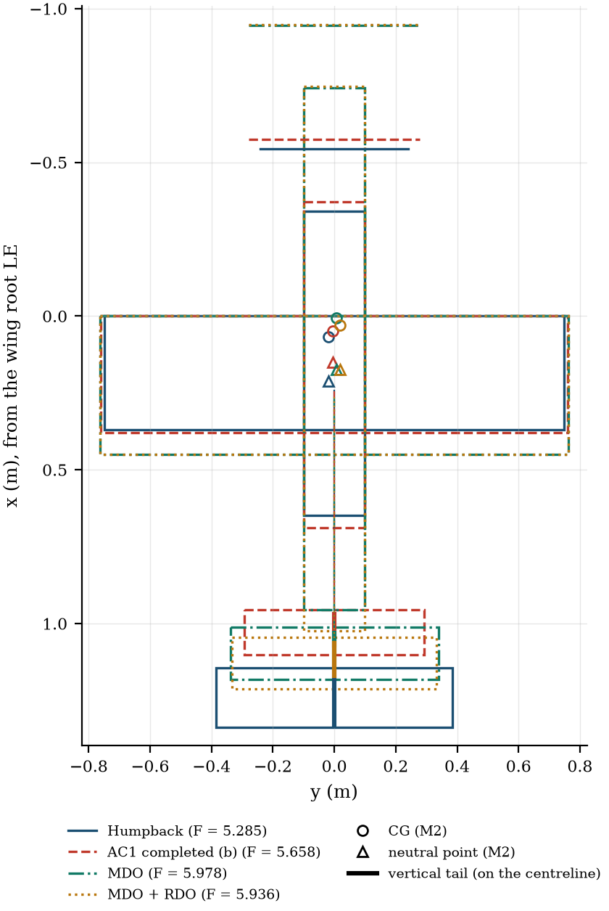

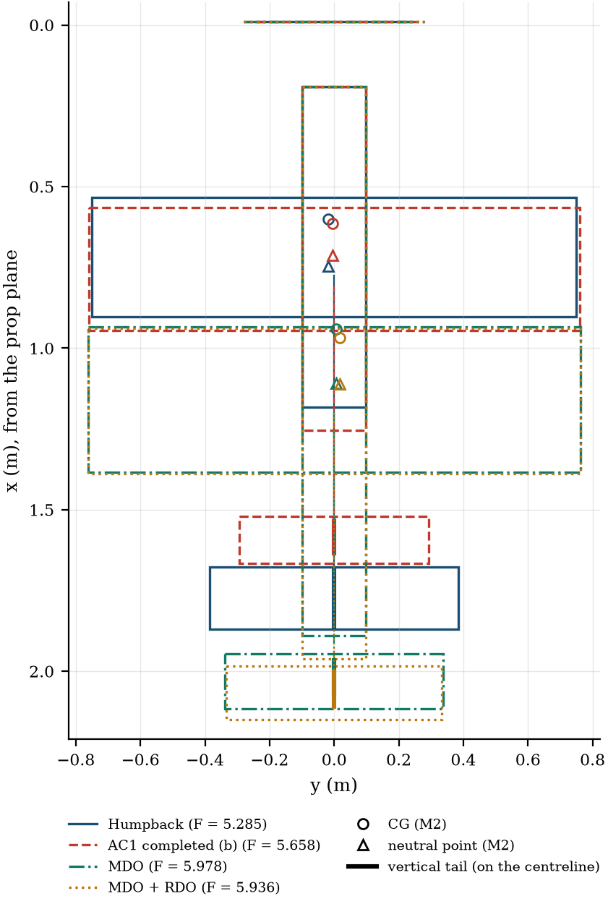

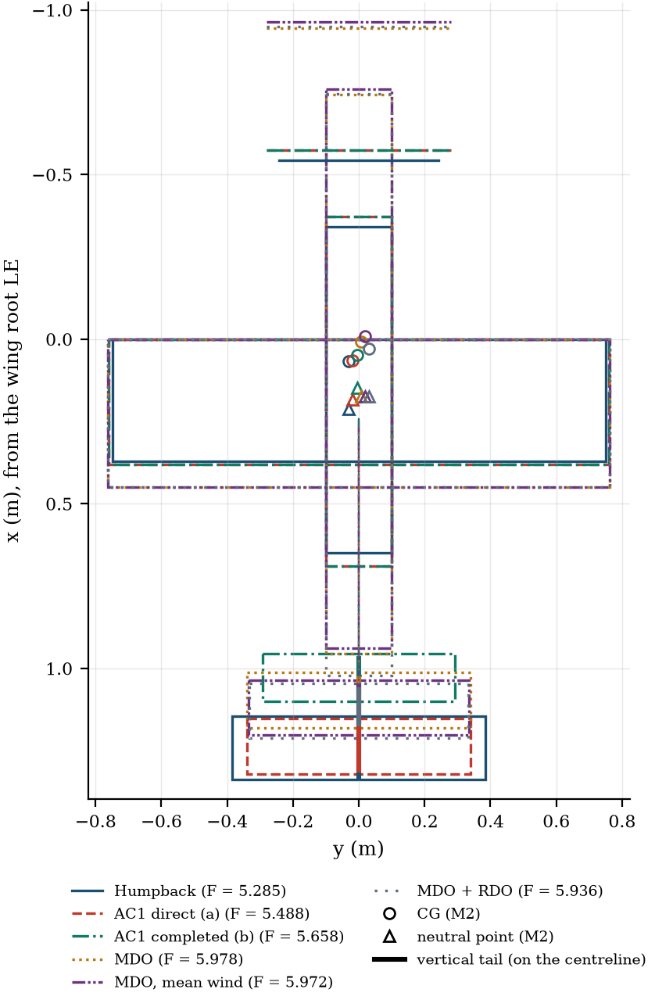

| component | Humpback | AC1 direct (a) | AC1 completed (b) | MDO | MDO, mean wind | MDO + RDO |
|---|---:|---:|---:|---:|---:|---:|
| wing spar tube | 0.482 | 0.503 | 0.513 | 0.761 | 0.653 | 0.631 |
| wing ribs, LE/TE, film | 0.398 | 0.422 | 0.426 | 0.661 | 0.606 | 0.597 |
| tails | 0.256 | 0.190 | 0.128 | 0.166 | 0.162 | 0.160 |
| tail boom | 0.234 | 0.234 | 0.184 | 0.195 | 0.201 | 0.204 |
| payload fuselage | 0.921 | 0.982 | 0.982 | 1.528 | 1.528 | 1.589 |
| landing gear | 0.230 | 0.236 | 0.231 | 0.341 | 0.335 | 0.343 |
| motor, ESC, prop | 0.762 | 0.762 | 0.762 | 0.762 | 0.762 | 0.762 |
| battery (M2 pack) | 0.553 | 0.453 | 0.398 | 0.544 | 0.538 | 0.503 |
| avionics | 0.222 | 0.222 | 0.222 | 0.222 | 0.222 | 0.222 |
| M2 payload | 3.566 | 3.821 | 3.821 | 6.113 | 6.113 | 6.368 |
| **sum (M2 take-off)** | 7.625 | 7.826 | 7.666 | 11.293 | 11.120 | 11.379 |
| model M2 take-off mass | 7.625 | 7.826 | 7.666 | 11.293 | 11.120 | 11.379 |

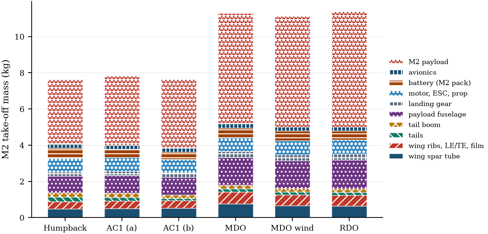

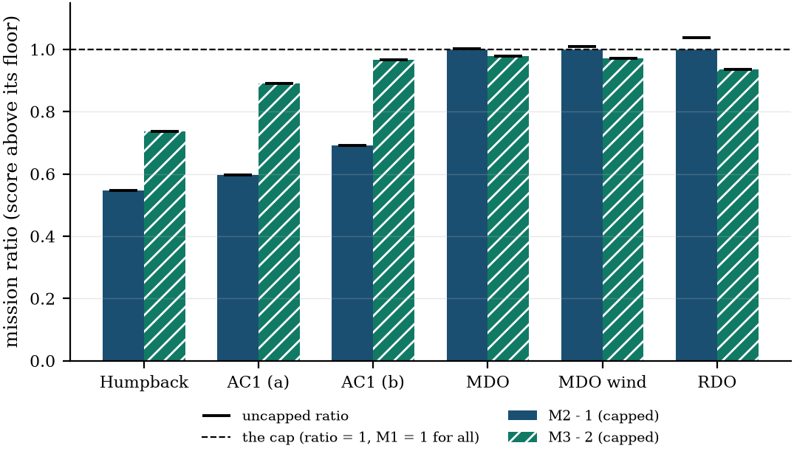

| component | Humpback | AC1 direct (a) | AC1 completed (b) | MDO | MDO, mean wind | MDO + RDO |
|---|---:|---:|---:|---:|---:|---:|
| M2 induced (VLM) | 0.0019 | 0.0074 | 0.0040 | 0.0059 | 0.0055 | 0.0067 |
| M2 wing profile | 0.0048 | 0.0053 | 0.0061 | 0.0073 | 0.0063 | 0.0056 |
| M2 tails | 0.0047 | 0.0037 | 0.0026 | 0.0027 | 0.0026 | 0.0026 |
| M2 payload fuselage | 0.0070 | 0.0072 | 0.0070 | 0.0068 | 0.0068 | 0.0071 |
| M2 tail boom | 0.0004 | 0.0004 | 0.0003 | 0.0003 | 0.0003 | 0.0003 |
| M2 gear + leakage areas | 0.0091 | 0.0087 | 0.0087 | 0.0073 | 0.0073 | 0.0073 |
| **M2 total at cruise** | 0.0279 | 0.0328 | 0.0287 | 0.0303 | 0.0289 | 0.0296 |
| M3 induced (VLM) | 0.0083 | 0.0205 | 0.0159 | 0.0458 | 0.0389 | 0.0233 |
| M3 wing profile | 0.0059 | 0.0071 | 0.0067 | 0.0080 | 0.0074 | 0.0065 |
| M3 tails | 0.0053 | 0.0041 | 0.0029 | 0.0032 | 0.0031 | 0.0030 |
| M3 payload fuselage | 0.0078 | 0.0078 | 0.0077 | 0.0078 | 0.0078 | 0.0078 |
| M3 tail boom | 0.0004 | 0.0004 | 0.0003 | 0.0003 | 0.0003 | 0.0003 |
| M3 gear + leakage areas | 0.0091 | 0.0087 | 0.0087 | 0.0073 | 0.0073 | 0.0073 |
| M3 banner (deployed) | 0.2122 | 0.2658 | 0.2658 | 0.3344 | 0.3177 | 0.2299 |
| **M3 total at cruise** | 0.2490 | 0.3144 | 0.3079 | 0.4068 | 0.3825 | 0.2781 |

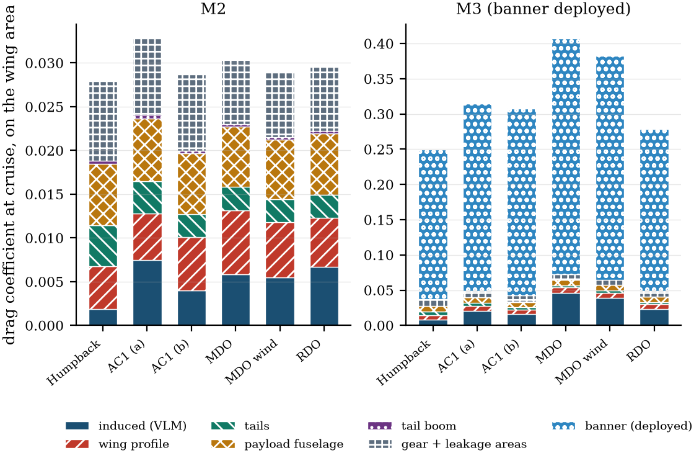

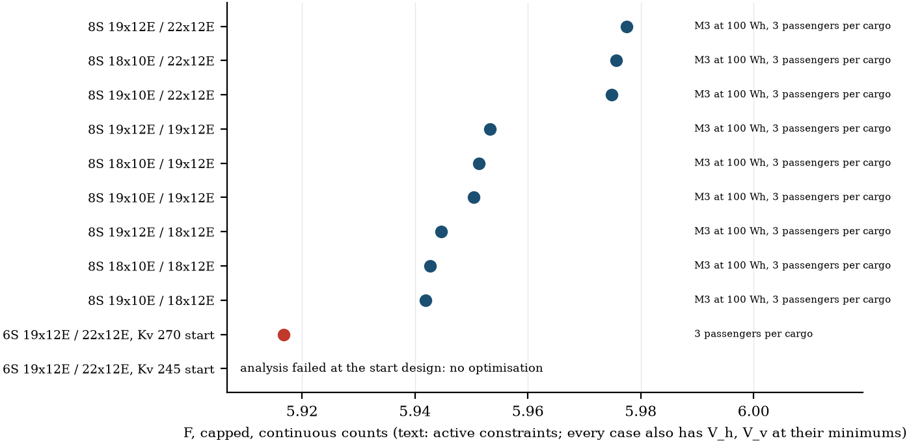

**Humpback** (F 5.2845; M2 1.548, r 0.548; M3 2.737, r 0.737; floored 5.1948). What limits it: rules.pax_margin (lower) [rule: 3 passengers per cargo [R26 p. 10]]; throttle_M2 (upper) [physical: full throttle]; throttle_M3 (upper) [physical: full throttle]. Against MDO: chord 0.370 against 0.450, passengers 42 against 72, cargo 14 against 24, banner 197 against 275, S_ht 0.148 against 0.115, S_vt 0.059 against 0.022.

**AC1 direct (a)** (F 5.4883; M2 1.597, r 0.597; M3 2.892, r 0.892; floored 5.3000). What limits it: rules_M3.energy_margin_Wh (lower) [rule: 100 Wh [R26 p. 16]]; rules.pax_margin (lower) [rule: 3 passengers per cargo [R26 p. 10]]. Against MDO: chord 0.380 against 0.450, passengers 45 against 72, cargo 15 against 24, banner 225 against 275, S_vt 0.040 against 0.022.

**AC1 completed (b)** (F 5.6579; M2 1.691, r 0.691; M3 2.967, r 0.967; floored 5.5839). What limits it: M2.V_h (lower) [PLACEHOLDER: Q9 (lower 0.35; flown 0.66-0.80)]; M2.V_v (lower) [PLACEHOLDER: Q9 (lower 0.02; flown 0.059-0.08)]; M3.V_h (lower) [PLACEHOLDER: Q9 (lower 0.35; flown 0.66-0.80)]; M3.V_v (lower) [PLACEHOLDER: Q9 (lower 0.02; flown 0.059-0.08)]; rules_M3.energy_margin_Wh (lower) [rule: 100 Wh [R26 p. 16]]; rules.pax_margin (lower) [rule: 3 passengers per cargo [R26 p. 10]]. Against MDO: chord 0.380 against 0.450, passengers 45 against 72, cargo 15 against 24, banner 225 against 275, S_ht 0.086 against 0.115, S_vt 0.020 against 0.022.

**MDO** (F 5.9775; M2 2.000, r 1.003; M3 2.978, r 0.978; floored 5.8588). What limits it: M2.V_h (lower) [PLACEHOLDER: Q9 (lower 0.35; flown 0.66-0.80)]; M2.V_v (lower) [PLACEHOLDER: Q9 (lower 0.02; flown 0.059-0.08)]; M3.V_h (lower) [PLACEHOLDER: Q9 (lower 0.35; flown 0.66-0.80)]; M3.V_v (lower) [PLACEHOLDER: Q9 (lower 0.02; flown 0.059-0.08)]; rules_M3.energy_margin_Wh (lower) [rule: 100 Wh [R26 p. 16]]; rules.pax_margin (lower) [rule: 3 passengers per cargo [R26 p. 10]]; b (upper) [rule: 5 ft [R26 p. 10]]; c (upper) [PLACEHOLDER: configs/full_mdo.yaml, no Q (sensitivity i)]; camber_scale (upper) [PLACEHOLDER: configs/full_mdo.yaml, Q10 (sensitivity i)]; L_banner (upper) [PLACEHOLDER: Q56 (275 in)].

**MDO, mean wind** (F 5.9718; M2 2.000, r 1.009; M3 2.972, r 0.972; floored 5.8385). What limits it: M2.V_h (lower) [PLACEHOLDER: Q9 (lower 0.35; flown 0.66-0.80)]; M2.V_v (lower) [PLACEHOLDER: Q9 (lower 0.02; flown 0.059-0.08)]; M3.V_h (lower) [PLACEHOLDER: Q9 (lower 0.35; flown 0.66-0.80)]; M3.V_v (lower) [PLACEHOLDER: Q9 (lower 0.02; flown 0.059-0.08)]; rules_M3.energy_margin_Wh (lower) [rule: 100 Wh [R26 p. 16]]; rules.pax_margin (lower) [rule: 3 passengers per cargo [R26 p. 10]]; b (upper) [rule: 5 ft [R26 p. 10]]; c (upper) [PLACEHOLDER: configs/full_mdo.yaml, no Q (sensitivity i)]. Against MDO: banner 268 against 275, S_ht 0.112 against 0.115, S_vt 0.022 against 0.022.

**MDO + RDO** (F 5.9362; M2 2.000, r 1.037; M3 2.936, r 0.936; floored 5.9120). What limits it: M2.V_h (lower) [PLACEHOLDER: Q9 (lower 0.35; flown 0.66-0.80)]; M2.V_v (lower) [PLACEHOLDER: Q9 (lower 0.02; flown 0.059-0.08)]; M3.V_h (lower) [PLACEHOLDER: Q9 (lower 0.35; flown 0.66-0.80)]; M3.V_v (lower) [PLACEHOLDER: Q9 (lower 0.02; flown 0.059-0.08)]; rules_M3.energy_margin_Wh (lower) [rule: 100 Wh [R26 p. 16]]; rules.pax_margin (lower) [rule: 3 passengers per cargo [R26 p. 10]]; b (upper) [rule: 5 ft [R26 p. 10]]; c (upper) [PLACEHOLDER: configs/full_mdo.yaml, no Q (sensitivity i)]. Against MDO: passengers 75 against 72, cargo 25 against 24, banner 228 against 275, S_ht 0.111 against 0.115, S_vt 0.021 against 0.022.

## 4. What robustness costs

| quantity | MDO | MDO, mean wind | MDO + RDO | designing at the mean wind | robustness itself | total |
|---|---:|---:|---:|---:|---:|---:|
| F nominal (calm air) | 5.9775 | 5.9718 | 5.9362 | -0.0057 | -0.0357 | -0.0413 |
| MC mean of F | 5.8683 | 5.8743 | 5.8737 | +0.0061 | -0.0007 | +0.0054 |
| MC sigma of F | 0.1175 | 0.1094 | 0.0833 | -0.0081 | -0.0261 | -0.0342 |
| P(any violation) | 0.0713 | 0.1367 | 0.0000 | +0.0654 | -0.1367 | -0.0713 |

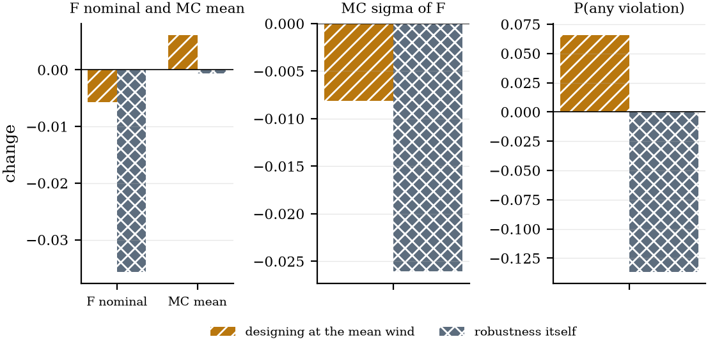

| design | F nominal | MC mean | MC sigma | mean - k sigma | P(any violation) | wall (min) |
|---|---:|---:|---:|---:|---:|---:|
| MDO | 5.9775 | 5.8683 | 0.1175 | 5.7507 | 0.071 | 11.6 |
| MDO, mean wind | 5.9718 | 5.8743 | 0.1094 | 5.7650 | 0.137 | 9.1 |
| MDO + RDO | 5.9362 | 5.8737 | 0.0833 | 5.7904 | 0.000 | 143.2 |

| run | start | converged | its | nit | wall (h) | mean | sigma | mean - k sigma | n_p | n_c | banner (in) | continuations | failed attempts | error |
|---|---:|---:|---:|---:|---:|---:|---:|---:|---:|---:|---:|---:|---:|---:|
| rdo_humpback | humpback | no | 5 | None | 0.07 | 5.1470 | 0.0357 | 5.1113 | 42.00 | 14.00 | 197 | 9 | 9 | wind limit (lap_invalid): 'nodes.n1.points.M2.lap' <class Sm |
| rdo_mdo | 8S_19x12E_22x12E_int_72p24c | yes | 51 | 45 | 0.81 | 5.8764 | 0.0836 | 5.7928 | 73.82 | 24.61 | 228 | 11 | 11 |  |
| rdo_mdo_int_73p24c | rdo_mdo | no | 20 | 15 | 0.28 | 5.8726 | 0.0848 | 5.7878 | 73.00 | 24.00 | 227 | 2 | 2 |  |
| rdo_mdo_int_74p24c | rdo_mdo | no | 20 | 15 | 0.28 | 5.8739 | 0.0840 | 5.7899 | 74.00 | 24.00 | 228 | 1 | 1 |  |
| rdo_mdo_int_75p25c | rdo_mdo | no | 20 | 15 | 0.26 | 5.8750 | 0.0836 | 5.7914 | 75.00 | 25.00 | 228 | 0 | 0 |  |
| rdo_mdo_int_75p25c_conv | rdo_mdo_int_75p25c | yes | 59 | 47 | 0.76 | 5.8751 | 0.0836 | 5.7915 | 75.00 | 25.00 | 228 | 1 | 1 |  |
| rdo_second | 8S_18x10E_22x12E | yes | 43 | 38 | 0.66 | 5.8764 | 0.0836 | 5.7928 | 73.82 | 24.61 | 228 | 11 | 11 |  |

`rdo` in the comparison is `fr_rdo_mdo_int_75p25c_conv`. Command for Appendix C: `.venv/bin/python studies/results_2026.py rdo --tag fr_rdo_mdo --case fr_8S_19x12E_22x12E --start fr_8S_19x12E_22x12E_int_72p24c --free` (the driver: `studies/results_2026_campaign.py`; the config: `configs/dbf2026_multipoint_rdo.yaml`).

**The screening** at the MDO and RDO designs, over the extended list (f_tb included):

| parameter | set | source | MDO: first order | MDO: 1-D Gauss | MDO + RDO: first order | MDO + RDO: 1-D Gauss |
|---|---:|---:|---:|---:|---:|---:|
| lap.wind | in set | PLACEHOLDER | 0.0933 | 0.1088 | 0.0634 | 0.0687 |
| f_build | in set | USYD LOO | 0.0425 | 0.0522 | 0.0290 | 0.0292 |
| banner_drag_factor | in set | HB Table 41 | 0.0476 | 0.0477 | 0.0378 | 0.0375 |
| lap.thrust_factor | out of set | PLACEHOLDER | 0.0331 | 0.0409 | 0.0249 | 0.0250 |
| Kv_factor | out of set | PLACEHOLDER | 0.0099 | 0.0333 | 0.0025 | 0.0187 |
| f_cb | out of set | PLACEHOLDER | 0.0178 | 0.0203 | 0.0131 | 0.0131 |
| R_cell | out of set | PLACEHOLDER | 0.0060 | 0.0066 | 0.0027 | 0.0030 |
| f_gear | out of set | PLACEHOLDER | 0.0040 | 0.0040 | 0.0028 | 0.0028 |
| Rm_ref | out of set | PLACEHOLDER | 0.0040 | 0.0040 | 0.0018 | 0.0019 |
| lap.wind_dir | in set | Woodward 1998 | 0.0000 | 0.0023 | 0.0000 | 0.0016 |
| f_tb | out of set | PLACEHOLDER | 0.0023 | 0.0023 | 0.0017 | 0.0017 |
| e_spec | out of set | PLACEHOLDER | 0.0022 | 0.0022 | 0.0015 | 0.0016 |
| m_motor | out of set | PLACEHOLDER | 0.0022 | 0.0022 | 0.0015 | 0.0015 |
| a_ht | out of set | PLACEHOLDER | 0.0016 | 0.0016 | 0.0011 | 0.0011 |
| m_avionics | in set | PLACEHOLDER | 0.0013 | 0.0013 | 0.0009 | 0.0009 |
| a_vt | out of set | PLACEHOLDER | 0.0004 | 0.0004 | 0.0002 | 0.0002 |
| eta_h | out of set | PLACEHOLDER | 0.0000 | 0.0000 | 0.0000 | 0.0000 |

At MDO, the first-order screen (threshold 0.9, at most 7 parameters) would select f_build, lap.wind, banner_drag_factor, f_cb, Kv_factor, eta_h, lap.thrust_factor; below the threshold: M2.SM 0.89, M3.rpm_margin 0.89, M3.SM 0.88.

At MDO + RDO, the first-order screen (threshold 0.9, at most 7 parameters) would select f_build, lap.wind, banner_drag_factor, f_cb, Kv_factor, eta_h, lap.thrust_factor; below the threshold: M2.SM 0.88, M3.rpm_margin 0.90, M3.SM 0.89.

**The node check** (every UDR node, both points; N = 11): rdo optimum 0/11 failed (0 wind limit); start (Humpback) 0/11 failed (0 wind limit); sobol0 0/11 failed (0 wind limit); sobol1 11/11 failed (0 wind limit); sobol2 11/11 failed (0 wind limit); sobol3 0/11 failed (0 wind limit); sobol4 0/11 failed (0 wind limit); sobol5 11/11 failed (0 wind limit).

## 5. Is it a real optimum?

### 5.1 Enumeration, rounding, multistart, bookends

| case | cells | M2 prop | M3 prop | converged | its | F | F floored | M2 | M3 | n_p | banner (in) | Kv | Kv set by | active constraints | bounds |
|---|---:|---:|---:|---:|---:|---:|---:|---:|---:|---:|---:|---:|---:|---:|
| 8S_18x10E_18x12E | 8 | 18x10E | 18x12E | yes | 61 | 5.9427 | 5.8359 | 1.9997 | 2.9429 | 72.8 | 267 | 255 | interior | M2.V_h, M2.V_v, M3.V_h, M3.V_v, rules_M3.energy_margin_Wh, rules.pax_margin | b (upper), c (upper), camber_scale (upper) |
| 8S_18x10E_19x12E | 8 | 18x10E | 19x12E | yes | 67 | 5.9513 | 5.8476 | 1.9997 | 2.9516 | 72.8 | 271 | 269 | interior | M2.V_h, M2.V_v, M3.V_h, M3.V_v, rules_M3.energy_margin_Wh, rules.pax_margin | b (upper), c (upper), camber_scale (upper) |
| 8S_18x10E_22x12E | 8 | 18x10E | 22x12E | yes | 63 | 5.9756 | 5.8615 | 1.9997 | 2.9759 | 72.8 | 275 | 259 | interior | M2.V_h, M2.V_v, M3.V_h, M3.V_v, rules_M3.energy_margin_Wh, rules.pax_margin | b (upper), c (upper), camber_scale (upper), L_banner (upper) |
| 8S_19x10E_18x12E | 8 | 19x10E | 18x12E | yes | 63 | 5.9419 | 5.8348 | 1.9997 | 2.9421 | 73.2 | 267 | 253 | interior | M2.V_h, M2.V_v, M3.V_h, M3.V_v, rules_M3.energy_margin_Wh, rules.pax_margin | b (upper), c (upper), camber_scale (upper) |
| 8S_19x10E_19x12E | 8 | 19x10E | 19x12E | yes | 64 | 5.9505 | 5.8464 | 1.9997 | 2.9507 | 73.2 | 271 | 256 | interior | M2.V_h, M2.V_v, M3.V_h, M3.V_v, rules_M3.energy_margin_Wh, rules.pax_margin | b (upper), c (upper), camber_scale (upper) |
| 8S_19x10E_22x12E | 8 | 19x10E | 22x12E | yes | 61 | 5.9748 | 5.8612 | 1.9997 | 2.9751 | 73.2 | 275 | 244 | interior | M2.V_h, M2.V_v, M3.V_h, M3.V_v, rules_M3.energy_margin_Wh, rules.pax_margin | b (upper), c (upper), camber_scale (upper), L_banner (upper) |
| 8S_19x12E_18x12E | 8 | 19x12E | 18x12E | yes | 62 | 5.9446 | 5.8358 | 1.9997 | 2.9449 | 72.0 | 268 | 244 | interior | M2.V_h, M2.V_v, M3.V_h, M3.V_v, rules_M3.energy_margin_Wh, rules.pax_margin | b (upper), c (upper), camber_scale (upper) |
| 8S_19x12E_19x12E | 8 | 19x12E | 19x12E | yes | 59 | 5.9532 | 5.8474 | 1.9997 | 2.9535 | 72.0 | 272 | 235 | interior | M2.V_h, M2.V_v, M3.V_h, M3.V_v, rules_M3.energy_margin_Wh, rules.pax_margin | b (upper), c (upper), camber_scale (upper) |
| 8S_19x12E_22x12E | 8 | 19x12E | 22x12E | yes | 69 | 5.9775 | 5.8588 | 1.9997 | 2.9778 | 72.0 | 275 | 223 | interior | M2.V_h, M2.V_v, M3.V_h, M3.V_v, rules_M3.energy_margin_Wh, rules.pax_margin | b (upper), c (upper), camber_scale (upper), L_banner (upper) |
| 6S_19x12E_22x12E | – | – | – | no | 0 | – | – | – | – | – | – | – | – | MDA non-convergence: Solver 'NL: Newton' on system 'points.M |
| 6S_19x12E_22x12E_kv270 | 6 | 19x12E | 22x12E | yes | 57 | 5.9168 | 5.7931 | 1.9997 | 2.9171 | 73.5 | 269 | 270 | Kv (upper) | M2.V_h, M2.V_v, M3.V_h, M3.V_v, rules.pax_margin | b (upper), c (upper), camber_scale (upper), Kv (upper), throttle_M2 (upper), capacity_M3 (upper) |

| run | converged | its | F | F uncapped | F floored | M2 | M3 | violated | wall (s) |
|---|---:|---:|---:|---:|---:|---:|---:|---:|---:|
| 8S_19x12E_22x12E_int_71p23c | yes | 34 | 5.9668 | 5.9668 | 5.8359 | 1.9919 | 2.9749 | none | 162 |
| 8S_19x12E_22x12E_int_72p23c | yes | 31 | 5.9697 | 5.9698 | 5.8413 | 1.9963 | 2.9734 | none | 147 |
| 8S_19x12E_22x12E_int_72p24c | yes | 2 | 5.9775 | 5.9806 | 5.8588 | 1.9998 | 2.9777 | none | 19 |
| wind_int_71p23c | yes | 37 | 5.9160 | 5.9160 | 5.8081 | 1.9941 | 2.9219 | none | 184 |
| wind_int_72p24c | yes | 6 | 5.9213 | 5.9320 | 5.8385 | 2.0000 | 2.9213 | none | 30 |

| start | converged | its | F | F floored | n_p | banner (in) | Kv | wall (s) | error |
|---|---:|---:|---:|---:|---:|---:|---:|---:|---:|
| ms0 | yes | 76 | 5.9775 | 5.8588 | 72.0 | 275 | 235 | 384 |  |
| ms1 | no | 0 | – | – | – | – | – | 44 | MDA non-convergence: Solver 'NL: Newton' on system 'points.M2.mda' fai |
| ms2 | no | 0 | – | – | – | – | – | 38 | MDA non-convergence: Solver 'NL: Newton' on system 'points.M2.mda': re |
| ms3 | yes | 66 | 5.9775 | 5.8588 | 72.0 | 275 | 220 | 330 |  |
| ms4 | yes | 72 | 5.9775 | 5.8588 | 72.0 | 275 | 236 | 371 |  |
| ms5 | no | 0 | – | – | – | – | – | 37 | MDA non-convergence: Solver 'NL: Newton' on system 'points.M2.mda': re |
| ms6 | no | 0 | – | – | – | – | – | 42 | MDA non-convergence: Solver 'NL: Newton' on system 'points.M2.mda': re |
| ms7 | yes | 77 | 5.9775 | 5.8588 | 72.0 | 275 | 237 | 390 |  |
| ms8 | yes | 86 | 5.9775 | 5.8588 | 72.0 | 275 | 235 | 440 |  |
| ms9 | yes | 54 | 5.9775 | 5.8588 | 72.0 | 275 | 245 | 297 |  |

6/10 converge feasibly; distinct optima: F 5.9775–5.9775 (6). Design spread at the best optimum (more than 1 % of the box): x_cb_frac 0.09983–0.261, Kv 220.3–244.8, x_batt_M2 -0.7028–0.1649, throttle_M2 0.8884–0.9871, x_batt_M3 -0.4033–0.1716, throttle_M3 0.7007–0.7786.

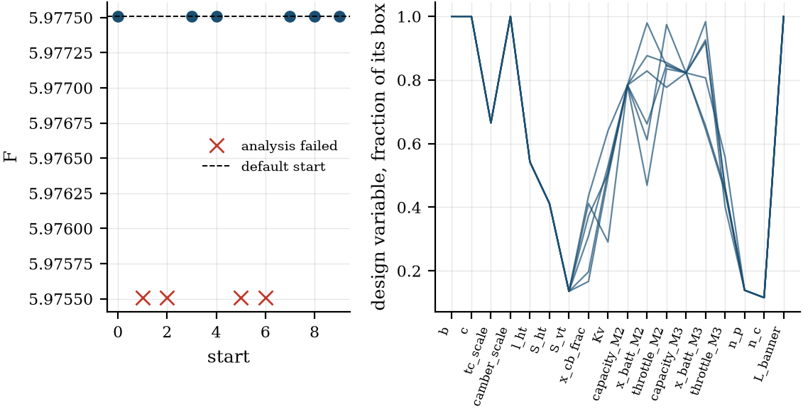

| objective | converged | its | M2 | M3 | r_M2 | r_M3 | n_p | banner (in) | c (m) | M2 laps | M3 laps |
|---|---:|---:|---:|---:|---:|---:|---:|---:|---:|---:|---:|
| multipoint (M2 + M3) | yes | 69 | 1.9997 | 2.9778 | 1.003 | 0.978 | 72.0 | 275 | 0.450 | 8.69 | 5.33 |
| M2 only | yes | 8 | 2.0000 | 2.9740 | 1.005 | 0.974 | 72.1 | 275 | 0.440 | 8.70 | 5.31 |
| M3 only | yes | 12 | 1.3083 | 3.0000 | 0.308 | 1.029 | 41.2 | 275 | 0.449 | 6.29 | 5.61 |

### 5.2 Normalisation

| normalisation | converged | its | F | M2 | M3 | n_p | banner (in) | ΔF |
|---|---:|---:|---:|---:|---:|---:|---:|---:|
| NI_max 2800, B_max 1500 (main) | yes | 69 | 5.9775 | 1.9997 | 2.9778 | 72.0 | 275 | – |
| NI_max x0.5 (1400) | yes | 13 | 6.0000 | 2.0000 | 3.0000 | 52.7 | 275 | +0.0225 |
| NI_max x2 (5600) | yes | 27 | 5.5291 | 1.6114 | 2.9177 | 96.9 | 263 | -0.4484 |
| B_max x0.5 (750) | yes | 8 | 6.0000 | 2.0000 | 3.0000 | 72.1 | 275 | +0.0225 |
| B_max x2 (3000) | yes | 11 | 5.4887 | 1.9999 | 2.4888 | 72.1 | 275 | -0.4888 |

### 5.3 Bound sensitivities

| bound | converged | F | ΔF | F floored | c (m) | camber scale | NeuralFoil confidence | violated |
|---|---:|---:|---:|---:|---:|---:|---:|---:|
| (i) c <= 0.60 m and camber_scale <= 2.5 | yes | 5.9973 | +0.0198 | 5.8715 | 0.582 | 1.315 | 0.932 | none |
| (ii) V_h >= 0.50, V_v >= 0.04 (Raymer 6th ed., Table 6.4, p. 160, homebuilt) | yes | 5.9667 | -0.0108 | 5.8556 | 0.450 | 1.992 | 0.953 | none |
| (iii) V_h >= 0.66 ([OH]), V_v >= 0.059 ([W]), the lowest flown | yes | 5.9564 | -0.0211 | 5.8549 | 0.450 | 1.676 | 0.950 | none |
| (added) banner <= 500 in, AirCrafter 1.0's grid limit ([HB] Table 7), against the 275 in the team built (Q56) | yes | 5.9783 | +0.0008 | 5.8839 | 0.450 | 2.000 | 0.953 | none |

- (i) c <= 0.60 m and camber_scale <= 2.5: relaxing it is worth ΔF = 0.0198. Design: c 0.45 to 0.582, tc_scale 1.23 to 0.858, camber_scale 2 to 1.32, l_ht 0.942 to 1.24, S_ht 0.115 to 0.146, x_cb_frac 0.236 to 0.228, Kv 223 to 218, capacity_M2 3.24 to 3.08, throttle_M3 0.771 to 0.787.
- (ii) V_h >= 0.50, V_v >= 0.04 (Raymer 6th ed., Table 6.4, p. 160, homebuilt): a realistic floor costs ΔF = 0.0108. Design: l_ht 0.942 to 1.24, S_ht 0.115 to 0.125, S_vt 0.0222 to 0.0338.
- (iii) V_h >= 0.66 ([OH]), V_v >= 0.059 ([W]), the lowest flown: a realistic floor costs ΔF = 0.0211. Design: tc_scale 1.23 to 1.06, camber_scale 2 to 1.68, l_ht 0.942 to 1.4, S_ht 0.115 to 0.145, S_vt 0.0222 to 0.044.
- (added) banner <= 500 in, AirCrafter 1.0's grid limit ([HB] Table 7), against the 275 in the team built (Q56): relaxing it is worth ΔF = 0.0008. Design: L_banner 275 to 283.

### 5.4 Other sensitivities

| case | design | ok | F | ΔF | F floored | violated |
|---|---:|---:|---:|---:|---:|---:|
| old constraint set (rpm 0.85, SM_max 0.40, V_h_max 0.65, V_v_max 0.06), re-optimised | MDO | yes | 5.9775 | +0.0000 | 5.8588 | none |
| take-off off, re-optimised | MDO | yes | 5.9818 | +0.0043 | 5.8924 | none |
| C_D,b 0.019 ([HB] Table 41, low) (re-analysis) | MDO | yes | 5.9998 | +0.0223 | 5.8588 | none |
| C_D,b 0.019 ([HB] Table 41, low), M3 full throttle (re-analysis) | MDO | yes | 5.7209 | -0.2566 | 5.4921 | M3.I_margin = -1.688 |
| C_D,b 0.028 ([HB] Table 41, high) (re-analysis) | MDO | yes | 5.8416 | -0.1359 | 5.6755 | M3.SM = 4.733 |
| C_D,b 0.028 ([HB] Table 41, high), M3 full throttle (re-analysis) | MDO | yes | 5.6203 | -0.3572 | 5.4921 | M3.I_margin = -1.688 |
| C_D,b 0.03 (AirCrafter 1.0) (re-analysis) | MDO | no | – | – | – | wind limit (lap_invalid): 'points.M3.lap' <class SmoothLapModel>: Error calling compute(), points.M3.lap: non-physical lap (lap times [nan nan], wind 0.00 m/s against V_stall 11.17 m/s): outside the lap model's validity |
| C_D,b 0.03 (AirCrafter 1.0), M3 full throttle (re-analysis) | MDO | yes | 5.6033 | -0.3743 | 5.4921 | M3.I_margin = -1.688 |
| C_D,b 0.034 (Table 29 deployed, on L x H) (re-analysis) | MDO | yes | 5.8388 | -0.1387 | 5.6755 | M3.SM = 4.09 |
| C_D,b 0.034 (Table 29 deployed, on L x H), M3 full throttle (re-analysis) | MDO | yes | 5.5730 | -0.4045 | 5.4921 | M3.I_margin = -1.688 |
| rpm limit 0.85 (re-analysis) | MDO | yes | 5.9775 | +0.0000 | 5.8588 | none |
| C_D,b 0.019 ([HB] Table 41, low) (re-analysis) | MDO + RDO | yes | 5.9987 | +0.0625 | 5.9120 | none |
| C_D,b 0.019 ([HB] Table 41, low), M3 full throttle (re-analysis) | MDO + RDO | yes | 5.7141 | -0.2220 | 5.6080 | none |
| C_D,b 0.028 ([HB] Table 41, high) (re-analysis) | MDO + RDO | yes | 5.8741 | -0.0621 | 5.7600 | none |
| C_D,b 0.028 ([HB] Table 41, high), M3 full throttle (re-analysis) | MDO + RDO | yes | 5.6175 | -0.3187 | 5.6080 | none |
| C_D,b 0.03 (AirCrafter 1.0) (re-analysis) | MDO + RDO | yes | 5.8487 | -0.0874 | 5.7600 | none |
| C_D,b 0.03 (AirCrafter 1.0), M3 full throttle (re-analysis) | MDO + RDO | yes | 5.6012 | -0.3349 | 5.4560 | none |
| C_D,b 0.034 (Table 29 deployed, on L x H) (re-analysis) | MDO + RDO | yes | 5.8025 | -0.1336 | 5.7600 | none |
| C_D,b 0.034 (Table 29 deployed, on L x H), M3 full throttle (re-analysis) | MDO + RDO | yes | 5.5725 | -0.3637 | 5.4560 | none |
| rpm limit 0.85 (re-analysis) | MDO + RDO | yes | 5.9362 | +0.0000 | 5.9120 | none |

### 5.5 Placeholders

| rank | PLACEHOLDER | effect on F | effect on uncapped F | measure |
|---|---:|---:|---:|---:|
| 1 | Q52 normalisation B2 | 0.4888 | 0.4879 | F re-optimised; mostly a rescaling of the score |
| 2 | Q52 normalisation NI2 | 0.4484 | 0.4514 | F re-optimised; mostly a rescaling of the score |
| 3 | uncertainty spread lap.wind (Q32, Q39) | 0.1088 | – | sigma of F, 3-point Gauss, this parameter alone, at the MDO design |
| 4 | no Q pilot reaction time per lap | 0.0928 | 0.1498 | re-analysis over 1 to 5 (±2 s, assumed) |
| 5 | Q54 restraint per seat (kg) | 0.0593 | 0.0780 | re-analysis over 0 to 0.01 (×0 / ×2, assumed) |
| 6 | uncertainty spread lap.thrust_factor (Q32, Q39) | 0.0409 | – | sigma of F, 3-point Gauss, this parameter alone, at the MDO design |
| 7 | Q54 restraint per slot (kg) | 0.0401 | 0.0520 | re-analysis over 0 to 0.02 (×0 / ×2, assumed) |
| 8 | uncertainty spread Kv_factor (Q32, Q39) | 0.0333 | – | sigma of F, 3-point Gauss, this parameter alone, at the MDO design |
| 9 | Q55 passenger pitch (m) | 0.0311 | 0.0439 | re-analysis over 0.0202 to 0.026 (33.4 in box ([HB] Fig. 9) to +10 %) |
| 10 | Q63 gear drag area (m²) | 0.0253 | 0.0358 | re-analysis over 0.0014 to 0.0056 (×0.5 / ×2, scaling PLACEHOLDER) |
| 11 | Q52 normalisation NI0.5 | 0.0225 | 0.1073 | F re-optimised; mostly a rescaling of the score |
| 12 | Q52 normalisation B0.5 | 0.0225 | 0.9726 | F re-optimised; mostly a rescaling of the score |
| 13 | bound (iii) V_h >= 0.66 ([OH]), V_v >= 0.059 ([W]), the lowest flown | 0.0211 | – | F re-optimised, payload counts fixed |
| 14 | uncertainty spread f_cb (Q32, Q39) | 0.0203 | – | sigma of F, 3-point Gauss, this parameter alone, at the MDO design |
| 15 | bound (i) c <= 0.60 m and camber_scale <= 2.5 | 0.0198 | – | F re-optimised, payload counts fixed |
| 16 | Q63 leakage drag area (m²) | 0.0193 | 0.0284 | re-analysis over 0.00112 to 0.00448 (×0.5 / ×2, scaling PLACEHOLDER) |
| 17 | Q55 fuselage width (m) | 0.0179 | 0.0260 | re-analysis over 0.178 to 0.218 (±10 %, assumed) |
| 18 | Q8 cell resistance | 0.0163 | 0.0199 | re-analysis over 0.0035 to 0.0065 (±30 % (configs/uncertainty.yaml, Q32)) |
| 19 | Q55 fuselage height (m) | 0.0126 | 0.0188 | re-analysis over 0.126 to 0.154 (±10 %, assumed) |
| 20 | bound (ii) V_h >= 0.50, V_v >= 0.04 (Raymer 6th ed., Table 6.4, p. 160, homebuilt) | 0.0108 | – | F re-optimised, payload counts fixed |
| 21 | Q56 banner mechanism (kg) | 0.0077 | 0.0077 | re-analysis over 0.038 to 0.153 (×0.5 / ×2, assumed) |
| 22 | uncertainty spread R_cell (Q32, Q39) | 0.0066 | – | sigma of F, 3-point Gauss, this parameter alone, at the MDO design |
| 23 | Q19 tail boom radius | 0.0063 | 0.0087 | re-analysis over 0.006 to 0.01 (12-20 mm tube, assumed) |
| 24 | Q6 boom density | 0.0061 | 0.0085 | re-analysis over 1280 to 1920 (±20 %, assumed) |
| 25 | Q61 avionics mass | 0.0052 | 0.0072 | re-analysis over 0.1887 to 0.2553 (±15 % (Q32)) |
| 26 | Q8 cell nominal voltage | 0.0045 | 0.0045 | re-analysis over 3.6 to 3.85 (LiPo 3.6-3.85 V, assumed) |
| 27 | Q5 tube clearance | 0.0041 | 0.0058 | re-analysis over 0.0005 to 0.002 (×0.5 / ×2, assumed) |
| 28 | Q16 n_crit | 0.0041 | 0.0067 | re-analysis over 7 to 11 (XFoil: 9 average wind tunnel; ±2, assumed) |
| 29 | uncertainty spread f_gear (Q32, Q39) | 0.0040 | – | sigma of F, 3-point Gauss, this parameter alone, at the MDO design |
| 30 | uncertainty spread Rm_ref (Q32, Q39) | 0.0040 | – | sigma of F, 3-point Gauss, this parameter alone, at the MDO design |
| 31 | uncertainty spread f_tb (Q32, Q39) | 0.0023 | – | sigma of F, 3-point Gauss, this parameter alone, at the MDO design |
| 32 | uncertainty spread e_spec (Q32, Q39) | 0.0022 | – | sigma of F, 3-point Gauss, this parameter alone, at the MDO design |
| 33 | uncertainty spread m_motor (Q32, Q39) | 0.0022 | – | sigma of F, 3-point Gauss, this parameter alone, at the MDO design |
| 34 | Q19 boom start offset | 0.0020 | 0.0028 | re-analysis over 0.1 to 0.2 (±0.05 m, assumed) |
| 35 | Q43 start offset (ft) | 0.0018 | 0.0026 | re-analysis over 0 to 50 (0-50 ft, assumed) |
| 36 | uncertainty spread a_ht (Q32, Q39) | 0.0016 | – | sigma of F, 3-point Gauss, this parameter alone, at the MDO design |
| 37 | uncertainty spread m_avionics (Q32, Q39) | 0.0013 | – | sigma of F, 3-point Gauss, this parameter alone, at the MDO design |
| 38 | bound (added) banner <= 500 in, AirCrafter 1.0's grid limit ([HB] Table 7), against the 275 in the team built (Q56) | 0.0008 | – | F re-optimised, payload counts fixed |
| 39 | uncertainty spread a_vt (Q32, Q39) | 0.0004 | – | sigma of F, 3-point Gauss, this parameter alone, at the MDO design |
| 40 | Q56 stowed banner ΔC_D0 | 0.0003 | 0.0003 | re-analysis over 0.002 to 0.008 (×0.5 / ×2, assumed) |
| 41 | Q40 ground-roll C_L | 0.0003 | 0.0007 | re-analysis over 0 to 1 (Q40's study range) |
| 42 | Q41 lift-off factor k_lof | 0.0002 | 0.0004 | re-analysis over 1.05 to 1.2 (1.2 = Eq. 3.3's rotation speed (Q41)) |
| 43 | Q55 cargo pitch (m) | 0.0000 | 0.0000 | re-analysis over 0.0384 to 0.0469 (±10 %, assumed) |
| 44 | Q23 tail dynamic-pressure ratio eta_h | 0.0000 | 0.0000 | re-analysis over 0.81 to 0.99 (±10 % (configs/uncertainty.yaml, Q32)) |
| 45 | Q23 wing CG / chord | 0.0000 | 0.0000 | re-analysis over 0.35 to 0.45 (±0.05 c, assumed) |
| 46 | Q23 avionics station | 0.0000 | 0.0000 | re-analysis over -0.2 to 0 (±0.10 m, assumed) |
| 47 | Q23 gear station | 0.0000 | 0.0000 | re-analysis over 0 to 0.1 (±0.05 m, assumed) |
| 48 | Q4 ground-test hold point x_gd | 0.0000 | 0.0000 | re-analysis over 0.2 to 0.3 (±0.05 c, assumed) |
| 49 | Q6 boom strength | 0.0000 | 0.0000 | re-analysis over 5.76e+08 to 8.64e+08 (±20 %, assumed) |
| 50 | Q6 boom modulus | 0.0000 | 0.0000 | re-analysis over 6.72e+10 to 1.008e+11 (±20 %, assumed) |
| 51 | Q12 tip-deflection ratio | 0.0000 | 0.0000 | re-analysis over 0.05 to 0.15 (±50 %, assumed) |
| 52 | uncertainty spread eta_h (Q32, Q39) | 0.0000 | – | sigma of F, 3-point Gauss, this parameter alone, at the MDO design |

| placeholder | config path | nominal | low | high | F low | F high | (p/F) dF/dp | uncapped | range |
|---|---:|---:|---:|---:|---:|---:|---:|---:|---:|
| Q55 passenger pitch (m) | multipoint.stores2026.pax_pitch | 0.023587 | 0.0202 | 0.026 | 5.9928 | 5.9617 | -0.0212 | -0.0298 | 33.4 in box ([HB] Fig. 9) to +10 % |
| Q55 fuselage width (m) | multipoint.stores2026.w_cb | 0.19812 | 0.178 | 0.218 | 5.9889 | 5.9710 | -0.0149 | -0.0216 | ±10 %, assumed |
| no Q pilot reaction time per lap | course.pilot_reaction_time_s | 3 | 1 | 5 | 6.0000 | 5.9072 | -0.0116 | -0.0188 | ±2 s, assumed |
| Q8 cell nominal voltage | propulsion.V_cell | 3.7 | 3.6 | 3.85 | 5.9420 | 5.9465 | 0.0111 | 0.0111 | LiPo 3.6-3.85 V, assumed |
| Q55 fuselage height (m) | multipoint.stores2026.h_cb | 0.1397 | 0.126 | 0.154 | 5.9828 | 5.9702 | -0.0105 | -0.0157 | ±10 %, assumed |
| Q54 restraint per seat (kg) | multipoint.stores2026.m_seat | 0.005 | 0 | 0.01 | 5.9996 | 5.9402 | -0.0050 | -0.0065 | ×0 / ×2, assumed |
| Q8 cell resistance | propulsion.R_cell | 0.005 | 0.0035 | 0.0065 | 5.9785 | 5.9622 | -0.0045 | -0.0055 | ±30 % (configs/uncertainty.yaml, Q32) |
| Q54 restraint per slot (kg) | multipoint.stores2026.m_slot | 0.01 | 0 | 0.02 | 5.9941 | 5.9540 | -0.0034 | -0.0043 | ×0 / ×2, assumed |
| Q61 avionics mass | propulsion.m_avionics | 0.222 | 0.1887 | 0.2553 | 5.9800 | 5.9748 | -0.0029 | -0.0040 | ±15 % (Q32) |
| Q63 gear drag area (m²) | aero.cd_area_gear | 0.0028 | 0.0014 | 0.0056 | 5.9804 | 5.9551 | -0.0028 | -0.0040 | ×0.5 / ×2, scaling PLACEHOLDER |
| Q6 boom density | mass.inputs.rho_tb | 1600 | 1280 | 1920 | 5.9804 | 5.9743 | -0.0026 | -0.0035 | ±20 %, assumed |
| Q63 leakage drag area (m²) | aero.cd_area_lp | 0.00224 | 0.00112 | 0.00448 | 5.9799 | 5.9606 | -0.0022 | -0.0032 | ×0.5 / ×2, scaling PLACEHOLDER |
| Q19 tail boom radius | mass.inputs.r_tb | 0.008 | 0.006 | 0.01 | 5.9793 | 5.9730 | -0.0021 | -0.0029 | 12-20 mm tube, assumed |
| Q16 n_crit | aero.n_crit | 9 | 7 | 11 | 5.9744 | 5.9785 | 0.0015 | 0.0025 | XFoil: 9 average wind tunnel; ±2, assumed |
| Q56 banner mechanism (kg) | multipoint.stores2026.m_banner_mech | 0.0766 | 0.038 | 0.153 | 5.9801 | 5.9724 | -0.0009 | -0.0009 | ×0.5 / ×2, assumed |
| Q19 boom start offset | geometry.boom_offset | 0.15 | 0.1 | 0.2 | 5.9765 | 5.9785 | 0.0005 | 0.0007 | ±0.05 m, assumed |
| Q5 tube clearance | mass.inputs.clearance | 0.001 | 0.0005 | 0.002 | 5.9761 | 5.9802 | 0.0005 | 0.0007 | ×0.5 / ×2, assumed |
| Q41 lift-off factor k_lof | course.takeoff.k_lof | 1.1 | 1.05 | 1.2 | 5.9775 | 5.9776 | 0.0002 | 0.0005 | 1.2 = Eq. 3.3's rotation speed (Q41) |
| Q56 stowed banner ΔC_D0 | multipoint.stores2026.dcd_stowed | 0.004 | 0.002 | 0.008 | 5.9776 | 5.9773 | -0.0000 | -0.0000 | ×0.5 / ×2, assumed |
| Q40 ground-roll C_L | course.takeoff.CL_ground | 0.15 | 0 | 1 | 5.9775 | 5.9772 | -0.0000 | -0.0000 | Q40's study range |
| Q55 cargo pitch (m) | multipoint.stores2026.car_pitch | 0.042636 | 0.0384 | 0.0469 | 5.9775 | 5.9775 | -0.0000 | -0.0000 | ±10 %, assumed |
| Q23 tail dynamic-pressure ratio eta_h | stability.eta_h | 0.9 | 0.81 | 0.99 | 5.9775 | 5.9775 | 0.0000 | 0.0000 | ±10 % (configs/uncertainty.yaml, Q32) |
| Q23 wing CG / chord | stability.wing_cg_frac | 0.4 | 0.35 | 0.45 | 5.9775 | 5.9775 | 0.0000 | 0.0000 | ±0.05 c, assumed |
| Q23 avionics station | stability.x_avionics | -0.1 | -0.2 | 0 | 5.9775 | 5.9775 | -0.0000 | -0.0000 | ±0.10 m, assumed |
| Q23 gear station | stability.x_gear | 0.05 | 0 | 0.1 | 5.9775 | 5.9775 | 0.0000 | 0.0000 | ±0.05 m, assumed |
| Q4 ground-test hold point x_gd | mass.inputs.x_gd | 0.25 | 0.2 | 0.3 | 5.9775 | 5.9775 | 0.0000 | 0.0000 | ±0.05 c, assumed |
| Q6 boom strength | mass.inputs.sigma_tb | 7.2e+08 | 5.76e+08 | 8.64e+08 | 5.9775 | 5.9775 | 0.0000 | 0.0000 | ±20 %, assumed |
| Q6 boom modulus | mass.inputs.E_tb | 8.4e+10 | 6.72e+10 | 1.008e+11 | 5.9775 | 5.9775 | 0.0000 | 0.0000 | ±20 %, assumed |
| Q12 tip-deflection ratio | mass.inputs.delta_tip_ratio | 0.1 | 0.05 | 0.15 | 5.9775 | 5.9775 | 0.0000 | 0.0000 | ±50 %, assumed |
| Q43 start offset (ft) | course.takeoff.start_offset_ft | 0 | 0 | 50 | 5.9775 | 5.9757 | -0.0000 | -0.0000 | 0-50 ft, assumed |

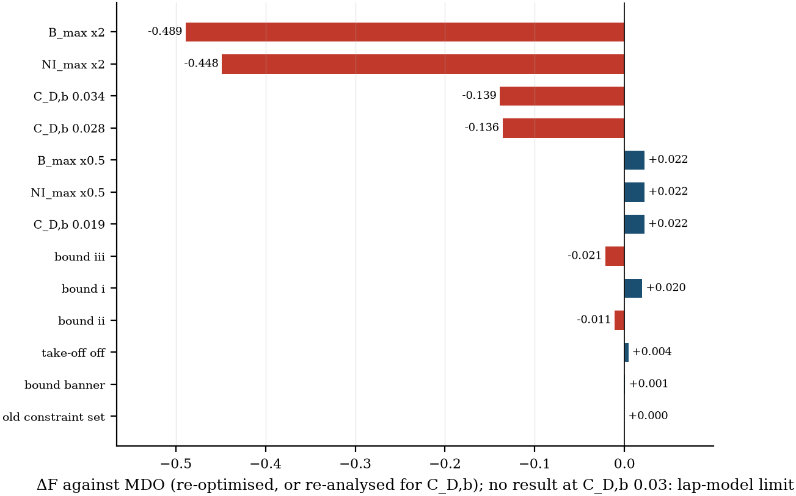

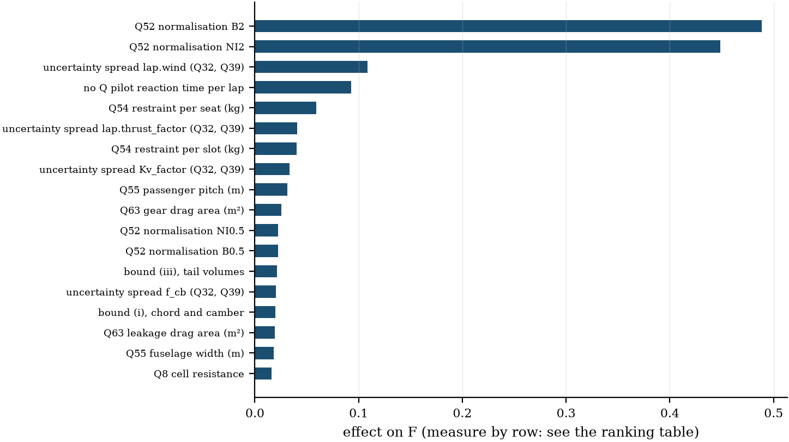

## 7. Biases and limitations

| item | measured in | size |
|---|---:|---:|
| M3 lap-time and C_D0 gap | validation_2026.md §2-3; Q56, Q57 | Lap errors (model minus test, negative = model too fast): M3 test1 -46 %, M3 test2 -31 %, M3 test3 -20 %, M2 test1 -23 %, M2 test2 -15 %. Deployed C_D0 0.243 at the 197 in test against Table 29's 0.36. |
| Tail volumes at their PLACEHOLDER minimums; no directional-stability or crosswind check | §5.3; Q9, Q60 | Humpback V_h 0.795, V_v 0.078; AC1 direct (a) V_h 0.575, V_v 0.050; AC1 completed (b) V_h 0.350, V_v 0.020; MDO V_h 0.350, V_v 0.020; MDO, mean wind V_h 0.350, V_v 0.020; MDO + RDO V_h 0.350, V_v 0.020. Raymer's typical values cost ΔF -0.0108, the lowest flown -0.0211. Directional stability isn't checked: not measured. |
| Chord and camber bounds | §5.3; Q10 | Relaxing c to 0.60 m and camber_scale to 2.5 is worth ΔF +0.0198, NeuralFoil confidence 0.932. |
| The box-boom overlap counted twice | §7 table; Q31 | Overlap, mass and M2 drag counted twice: Humpback 0.41 m, 100 g, 1.6 counts; AC1 direct (a) 0.44 m, 110 g, 1.8 counts; AC1 completed (b) 0.44 m, 110 g, 1.8 counts; MDO 0.69 m, 171 g, 2.3 counts; MDO, mean wind 0.68 m, 167 g, 2.2 counts; MDO + RDO 0.76 m, 188 g, 2.5 counts. |
| The Ground Mission not modelled | Q53 | Not in F. Its loading time grows with the counts (Humpback 42/14; AC1 direct (a) 45/15; AC1 completed (b) 45/15; MDO 72/24; MDO, mean wind 72/24; MDO + RDO 75/25); USYD's GM was 0.01 ([RES26] 2026 DBF Competition Summary (USYD, rank 14)): size not measured. |
| The normalisation PLACEHOLDERS | §5.2; Q52 | Re-optimised: NI0.5 ΔF +0.0225; NI2 ΔF -0.4484; B0.5 ΔF +0.0225; B2 ΔF -0.4888. |
| The SM frame offset | validation_2026.md §4; Q9, Q62 | The model's neutral point sits about 0.2 c aft of the teams' eCalc, so its SM isn't comparable to the reports' 10-20 %. Modelled SM M2/M3: Humpback 0.39/0.43; AC1 direct (a) 0.31/0.37; AC1 completed (b) 0.26/0.36; MDO 0.37/0.38; MDO, mean wind 0.40/0.40; MDO + RDO 0.32/0.36. |
| The rectangular wing against Humpback's end-plated wing | validation_2026.md, stated up front | End-plates aren't modelled: every design's induced drag is the plain rectangular wing's (M3 induced drag Humpback 83 counts; AC1 direct (a) 205 counts; AC1 completed (b) 159 counts; MDO 458 counts; MDO, mean wind 389 counts; MDO + RDO 233 counts). Effect of end-plates not measured. |
| The three-aircraft calibration | mass_calibration_usyd.md §5; Q46 | LOO structure errors -26 / +12 / +24 %; f_build's ±30 % gives sigma of F 0.0522 at MDO. A payload fuselage this long is an extrapolation: l_cb 1.70 m against Humpback's 0.99 m. |
| The constant gear and leakage drag areas | §5.5; Q63 | ×0.5 to ×2 at MDO: gear F 5.9804 to 5.9551, leakage F 5.9799 to 5.9606. |
| Calm air in the deterministic optimum | §4 | MDO F 5.9775 in calm air, 5.9225 at the mean wind; designing at the mean wind changes the Monte Carlo mean by +0.0061. |
| Fixed-throttle analysis can land on the sub-stall balance | docs/development/MDA_ROBUSTNESS_PLAN.md §0 | 73 of 1024 in-set samples of MDO have M3's level speed below 1.2 V_stall at its fixed throttle. They count as stall-margin violations. Without them the mean of F is 5.8785 against 5.8683. |

| design | overlap (m) | share of the boom (%) | mass counted twice (g) | M2 drag counted twice (counts) |
|---|---:|---:|---:|---:|
| Humpback | 0.407 | 43 | 100 | 1.6 |
| AC1 direct (a) | 0.444 | 47 | 110 | 1.8 |
| AC1 completed (b) | 0.444 | 59 | 110 | 1.8 |
| MDO | 0.693 | 88 | 171 | 2.3 |
| MDO, mean wind | 0.675 | 83 | 167 | 2.2 |
| MDO + RDO | 0.760 | 92 | 188 | 2.5 |

## 8. Recommendations for the team

Model-based: each rests on the named result, with its confidence given §7. Nothing here rests only on a PLACEHOLDER-driven result; §5.3's tail and chord bounds are why there is no recommendation on tail volume or chord.

- **Choose the M3 prop first; it matters more than the M2 prop.** Across the 8S enumeration the mean F runs from 5.9430 to 5.9760 with the M3 prop (22x12E best), and only from 5.9557 to 5.9584 with the M2 prop. *Rests on §5.1. Confidence: medium; the ordering comes from the cited APC data, but the model flies M3 laps too fast (§7), so the size of the gain isn't a prediction.*
- **Carry more passengers than Humpback's 42, and test the fuselage it takes.** Every normalisation tried wants at least 53 passengers, so the direction doesn't rest on the PLACEHOLDER normalisers (Q52), though the MDO's own count does. *Rests on §5.1 and §5.2. Confidence: medium for the direction, low for the count; the Ground Mission, which grows with the counts, isn't modelled (Q53), and a fuselage this long is an extrapolation of the mass calibration (§7).*
- **Don't size the banner to its limit before its drag is known.** RDO gives up banner length (275 to 228 in) for margin: sigma of F 0.1175 to 0.0833, P(any violation) 0.071 to 0.000, at 0.0413 of nominal F. The re-analyses at [HB] Table 41's drag coefficients show why (§5.4). *Rests on §4 and §5.4. Confidence: medium; the Monte Carlo favours RDO by construction, so read it with §2.5's out-of-set result.*
- **Spend ground and flight tests on banner drag and built mass.** They are the largest contributions to the sigma of F with measured spreads: banner drag factor 0.0375 ([HB] Table 41), build factor 0.0292 (USYD leave-one-out). Wind contributes more, but its spread is a PLACEHOLDER and it can't be designed out by a test. *Rests on §4's screening. Confidence: medium.*
- **Don't commission a motor rewind for this score.** At the best prop pair, every converged start reaches the same F with Kv anywhere from 220 to 245 rpm/V: a flat direction, inside which the throttle takes up the difference. *Rests on §5.1's multistart. Confidence: medium; the motor's limits are checked, but its thermal behaviour isn't modelled.*
- **Use the rule limits on span and M3 energy.** The optima sit on the 5 ft span (b 1.524 m, Humpback 1.499 m) and the 100 Wh limit in M3, both from the rules [R26 p. 10, p. 16], not from a PLACEHOLDER. *Rests on §3's active-constraint table. Confidence: high that they're active in the model, medium on the gain, which isn't separated from the others.*
- **Log M3 lap times and throttle in test flights, with the banner's size.** The largest gap between this model and Humpback is M3's lap time, and these logs are what closes it. *Rests on validation_2026.md and §7's first row. Confidence: high that the gap exists, its cause isn't separated (Q56, Q57).*
